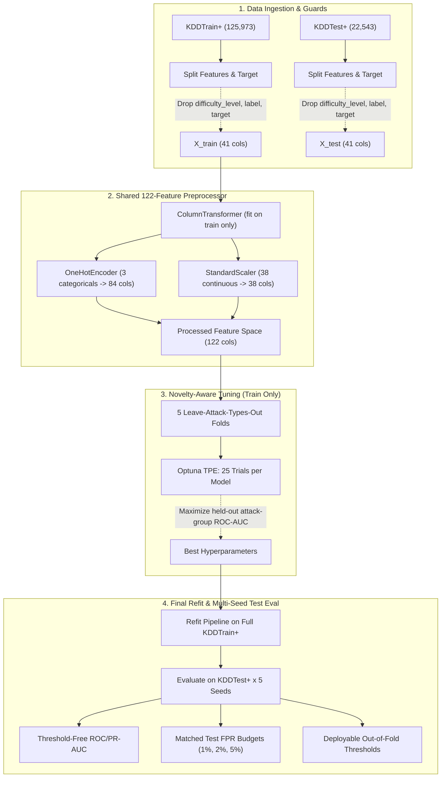

# Signature Memorization vs. Unseen Attack Generalization in Network Intrusion Detection

[](https://www.python.org/)
[](https://scikit-learn.org/)
[](https://xgboost.readthedocs.io/)
[](https://optuna.org/)
[](https://react.dev/)
[](https://www.typescriptlang.org/)
[](https://vitejs.dev/)
[](https://tailwindcss.com/)
[-B91C1C.svg)](https://www.iitgn.ac.in/)

**Undergraduate Machine Learning Research Project**  
*ES 335: Machine Learning (Semester 5) · Indian Institute of Technology Gandhinagar*  
**Authors:** Vedant Bondekar & Dhruv Meshram  
**Repository:** [github.com/vedantb7/attack-generalization-study](https://github.com/vedantb7/attack-generalization-study)

---

## Table of Contents
1. [Project Overview & Central Findings](#1-project-overview--central-findings)
2. [Research Questions & Hypotheses](#2-research-questions--hypotheses)
3. [Dataset Specification (NSL-KDD)](#3-dataset-specification-nsl-kdd)
4. [Technology Stack & Architecture](#4-technology-stack--architecture)
5. [End-to-End Reproduction Guide](#5-end-to-end-reproduction-guide)
6. [Repository & Notebook Pipeline](#6-repository--notebook-pipeline)
7. [Experimental Protocol & Controlled Framework](#7-experimental-protocol--controlled-framework)
8. [Authoritative Benchmark Results](#8-authoritative-benchmark-results)
9. [Compute vs. Detection Quality Trade-Off](#9-compute-vs-detection-quality-trade-off)
10. [Documentation Index & References](#10-documentation-index--references)
11. [Academic Attribution & AI Disclosure](#11-academic-attribution--ai-disclosure)

---

## 1. Project Overview & Central Findings

### The Central Question
In network security, machine learning classifiers for Network Intrusion Detection Systems (NIDS) routinely achieve $> 98\%$ accuracy on static, in-distribution test benchmarks. However, deployed network defenders face constantly mutating adversarial tradecraft. **Can simpler machine learning models (e.g., Logistic Regression, shallow Decision Trees) generalize better to novel, previously unseen zero-day attack signatures than complex, high-capacity ensembles (Random Forest, XGBoost)?**

### The Core Finding: Disproving the Simplistic Generalization Hypothesis
Our controlled empirical study disproves the premise across model families:

1. **Ensembles Generalize Best Across Families:** On threshold-free ranking of unseen attacks against normal traffic, the high-capacity ensembles—**XGBoost (AUC 0.943 ± 0.005)** and **Random Forest (AUC 0.941 ± 0.004)**—consistently and statistically significantly outperform **Logistic Regression (AUC 0.883 ± 0.000)** and the single **Decision Tree (AUC 0.746 ± 0.028)** across all 5 random seeds ($p < 10^{-15}$ under Edwards-corrected McNemar tests and paired bootstrap evaluations).
2. **The 0.5 Threshold Illusion:** Previous literature suggestions that Random Forest suffers a catastrophic "collapse" on zero-day attacks was an artifact of evaluating models at an uncalibrated default threshold ($P = 0.5$), where models operate at radically different False Positive Rates (FPR). When evaluated threshold-free (ROC-AUC) or at matched operating budgets, ensembles preserve superior separability.
3. **Regularization Within Single Families:** Within single-model families, Occam's razor holds: stronger L2 regularization improves Logistic Regression's unseen AUC from $0.710 \to 0.881$, and constrained tree depth ($d=4\text{–}6$) outperforms fully grown, memorizing trees.
4. **The Deployment Trade-Off (Compute vs. Detection):** While ensembles provide the strongest ranking quality, simpler models offer decisive throughput advantages for edge networks. Logistic Regression and Decision Trees score a single network flow in **$\sim 3.3\text{–}3.5$ ms** and compile to **$4\text{–}5$ KB**, whereas Random Forest requires **$46.0$ ms** (13× latency) and **$2.9$ MB** of memory.

---

## 2. Research Questions & Hypotheses

| # | Hypothesis Tested | Empirical Status | Key Evidence |
|:---|:---|:---:|:---|
| **H1** | **Simpler Models Generalize Better:** Simpler models (Logistic Regression, Decision Tree) suffer a smaller performance degradation on novel attack signatures than complex ensembles. | **Rejected (Across Families)**<br>**Supported (Within Families)** | Ensembles maintain higher unseen-vs-normal AUC ($0.94\text{+} \text{ vs } 0.74\text{–}0.88$). However, within single families, regularizing LR and pruning trees prevents overfitting. |
| **H2** | **Strict Low-FPR Detection Collapse:** At operational false alarm budgets ($\text{FPR} \le 1\%$), all models fail to reliably detect zero-day attacks. | **Supported** | At $1\%$ test FPR, no model detects $> 7.2\%$ of unseen attack flows. Ensembles only pull ahead when the false alarm budget expands to $\ge 5\%$. |
| **H3** | **Distribution Inversion Distortion:** Standard accuracy is misleading due to class distribution shifts; threshold-free metrics (ROC-AUC, PR-AUC) and category-stratified recall are required. | **Supported** | Normal traffic drops from $53.46\%$ (train) to $43.07\%$ (test). Accuracy masks a 40–52 pp drop in attack recall on novel signatures. |

---

## 3. Dataset Specification (NSL-KDD)

The benchmark is conducted on the curated **NSL-KDD** benchmark dataset (Tavallaee et al., 2009), which eliminates duplicate records and calibrates evaluation difficulty.

### Data Partitions & Distribution Inversion
- **KDDTrain+ (`dataset/raw/KDDTrain+.csv`):** 125,973 records
  - Normal traffic: 67,343 ($53.46\%$)
  - Attack traffic: 58,630 ($46.54\%$)
  - 22 distinct attack signatures across 4 DARPA categories
- **KDDTest+ (`dataset/raw/KDDTest+.csv`):** 22,543 records
  - Normal traffic: 9,710 ($43.07\%$)
  - Attack traffic: 12,833 ($56.93\%$) — **Empirical Distribution Inversion**
  - Contains **17 novel, unseen attack signatures** (3,750 flows) completely absent from training

### 41 Predictive Features $\to$ 122 Preprocessed Input Columns
Input telemetry encompasses 41 raw features divided into four functional domains:
1. **Basic Connection Telemetry (10 features):** `duration`, `protocol_type` (3), `service` (70), `flag` (11), `src_bytes`, `dst_bytes`, `land`, `wrong_fragment`, `urgent`, `hot`.
2. **Content / Payload Signals (12 features):** `num_failed_logins`, `logged_in`, `num_compromised`, `root_shell`, `su_attempted`, `num_root`, `num_file_creations`, `num_shells`, `num_access_files`, `num_outbound_cmds`, `is_host_login`, `is_guest_login`.
3. **Time-Based Traffic (9 features, 2-sec window):** `count`, `srv_count`, `serror_rate`, `srv_serror_rate`, `rerror_rate`, `srv_rerror_rate`, `same_srv_rate`, `diff_srv_rate`, `srv_diff_host_rate`.
4. **Host-Based Traffic (10 features, 100-connection window):** `dst_host_count`, `dst_host_srv_count`, `dst_host_same_srv_rate`, `dst_host_diff_srv_rate`, `dst_host_same_src_port_rate`, `dst_host_srv_diff_host_rate`, `dst_host_serror_rate`, `dst_host_srv_serror_rate`, `dst_host_rerror_rate`, `dst_host_srv_rerror_rate`.

> **Feature Justifications & Leakage Prevention:**  
> Detailed justifications for preserving all 41 features, one-hot encoding all 70 services without binning, and strictly barring column 43 (`difficulty_level`, univariate ROC-AUC 0.763 target leak) are documented in [`docs/features.md`](docs/features.md).

### The 17 Novel Unseen Attack Signatures (Test-Only)
- **DoS (4 signatures):** `apache2`, `mailbomb`, `processtable`, `udpstorm`
- **Probe (2 signatures):** `mscan`, `saint`
- **R2L (8 signatures):** `httptunnel`, `named`, `sendmail`, `snmpgetattack`, `snmpguess`, `worm`, `xlock`, `xsnoop`
- **U2R (3 signatures):** `ps`, `sqlattack`, `xterm`

---

## 4. Technology Stack & Architecture

### Machine Learning & Data Science Core
- **Runtime:** Python 3.10+ (tested through 3.12 / 3.14)
- **Data Engineering:** `pandas` (3.x), `numpy` (2.x)
- **Modeling & Preprocessing:** `scikit-learn` (1.5+ / 1.9+), `xgboost` (3.2+)
- **Hyperparameter Optimization:** `optuna` (4.x) utilizing Tree-structured Parzen Estimator (TPE) Bayesian search
- **Statistical Testing:** `scipy.stats` (Edwards-corrected McNemar tests, Paired Bootstrap distributions, Holm-Bonferroni FWER correction)
- **Model Serialization:** `joblib` for preprocessor and pipeline artifact freezing

### Interactive Research Web Application (`website/`)
- **Framework:** React 18.3, TypeScript 5.6
- **Build Tool:** Vite 6.0 (configured with relative asset base `./` for zero-configuration subpath deployment)
- **Styling & Design System:** Tailwind CSS 3.4 with custom typography, responsive grid, CSS variables, and dual themes:
  - *Academic Burgundy & Warm Ivory* (default light mode)
  - *Midnight Navy & Champagne* (dark mode)
- **Icons & Controls:** `lucide-react`
- **CI/CD:** GitHub Actions workflow (`.github/workflows/deploy-pages.yml`) deploying production builds directly to GitHub Pages on every push to `main`.

### Testing & Verification Suite
- **Test Runner:** `pytest`
- **Coverage:** 27 comprehensive unit tests in `tests/`:
  - `test_data_pipeline.py`: Validates schema invariance, 122-feature ColumnTransformer output, and metadata leakage guards.
  - `test_controlled_framework.py`: Validates novelty fold partitioning, McNemar calculation accuracy, Holm-Bonferroni rank-order correction, and bootstrap determinism.

---

## 5. End-to-End Reproduction Guide

Follow these steps to replicate the complete experimental study and research website from source.

### Step 1: Clone Repository
```bash
git clone https://github.com/vedantb7/attack-generalization-study.git
cd attack-generalization-study
```

### Step 2: Python Environment Setup
```bash
# Create and activate a clean virtual environment
python3 -m venv .venv
source .venv/bin/activate

# Install dependencies (use requirements-lock.txt for exact pinned versions)
pip install -r requirements.txt
```

### Step 3: Verify or Place Dataset Files
Ensure the raw NSL-KDD benchmark files exist in `dataset/raw/`:
```bash
ls -lh dataset/raw/
# Expected:
# KDDTrain+.csv (125,973 rows)
# KDDTest+.csv  (22,543 rows)
```
*(If missing, download the official NSL-KDD archive from Kaggle or the Canadian Institute for Cybersecurity and place the CSVs in `dataset/raw/`)*.

### Step 4: Run the Complete Notebook Pipeline (01 $\to$ 11)
To execute all experiments headless in strict sequential order:
```bash
export PYTHONHASHSEED=42
for nb in notebooks/0*.ipynb notebooks/1*.ipynb; do
  echo "Executing $nb..."
  jupyter nbconvert --to notebook --execute --inplace --ExecutePreprocessor.timeout=-1 "$nb" || break
done
```

#### Execution Stages:
- **`01_data_exploration.ipynb`**: Computes EDA statistics $\to$ `results/eda/eda_summary.json` & figures.
- **`02_preprocessing.ipynb`**: Builds leave-attack-types-out CV folds and fits preprocessor $\to$ `scalars/preprocessor.joblib`.
- **`03_majority_baseline.ipynb`**: Evaluates zero-rule majority class baseline.
- **`04_logistic_regression.ipynb`**: Optuna TPE tuning (25 trials $\times$ 5 seeds) + evaluation $\to$ `models/logistic_regression.joblib`.
- **`05_decision_tree.ipynb`**: Optuna TPE tuning (25 trials $\times$ 5 seeds) + evaluation $\to$ `models/decision_tree.joblib`.
- **`06_random_forest.ipynb`**: Optuna TPE tuning (25 trials $\times$ 5 seeds) + evaluation $\to$ `models/random_forest.joblib`.
- **`07_xgboost.ipynb`**: Optuna TPE tuning (25 trials $\times$ 5 seeds) + evaluation $\to$ `models/xgboost.joblib`.
- **`08_evaluation_comparison.ipynb`**: Computes statistical comparison, McNemar tests, bootstrap CIs, and comparison figures $\to$ `results/metrics/statistical_comparison.json`.
- **`09_capacity_analysis.ipynb`**: Runs family-internal capacity sweeps (LR $C$, Tree depth, RF/XGB depth).
- **`10_additional_evaluation.ipynb`**: Known-vs-unseen CV, FPR at 95% recall, and compute profiling.
- **`11_website_data.ipynb`**: Serializes all empirical results into the website data layer $\to$ `website/src/data/researchData.ts`.

### Step 5: Run Automated Tests
```bash
pytest -q tests
# Expected: 27 passed in ~0.5s
```

### Step 6: Launch the Interactive Research Website
```bash
cd website
npm install
npm run dev
# Vite server starts at http://localhost:5173/

# To build and preview static production bundle:
npm run build
npm run preview
```

---

## 6. Repository & Notebook Pipeline

```text
attack-generalization-study/
├── config.yaml                    # Master experiment configuration (seeds, paths, CV folds, budgets)
├── requirements.txt               # Direct dependencies
├── requirements-lock.txt          # Fully pinned dependency lockfile
│
├── dataset/raw/                   # Official NSL-KDD benchmark files (headerless)
│   ├── KDDTrain+.csv              # 125,973 network flows
│   └── KDDTest+.csv               # 22,543 network flows
│
├── notebooks/                     # Authoritative single source of truth (run in order 01 -> 11)
│   ├── 01_data_exploration.ipynb  # EDA and univariate distribution shift analysis
│   ├── 02_preprocessing.ipynb     # Feature segregation, preprocessor fit, novelty CV folds
│   ├── 03_majority_baseline.ipynb # Zero-rule class prior baseline
│   ├── 04_logistic_regression.ipynb # L2 regularized logistic regression (tuning + 5 seeds)
│   ├── 05_decision_tree.ipynb     # Single CART decision tree (tuning + 5 seeds)
│   ├── 06_random_forest.ipynb     # Random Forest ensemble (tuning + 5 seeds)
│   ├── 07_xgboost.ipynb           # XGBoost gradient boosted trees (tuning + 5 seeds)
│   ├── 08_evaluation_comparison.ipynb # Cross-model benchmarking & statistical tests
│   ├── 09_capacity_analysis.ipynb # Intra-family capacity & regularization sweeps
│   ├── 10_additional_evaluation.ipynb # Known-vs-unseen gap, operational FPRs, compute latency
│   └── 11_website_data.ipynb      # Serializes results to website TypeScript data layer
│
├── src/                           # Python modules imported by notebooks
│   ├── config.py                  # YAML configuration parser and seed initializers
│   ├── data_loader.py             # Schema definitions, robust CSV loading, attack mapping
│   ├── preprocessing.py           # Shared ColumnTransformer (122 cols) & leakage guards
│   └── controlled_framework.py    # Novelty CV, Optuna tuning, evaluation, statistical tests
│
├── models/                        # Serialized primary seed (42) model pipelines (*.joblib)
├── scalars/                       # Serialized preprocessor artifact, feature names, label map
│
├── results/                       # Empirical outputs (authoritative data sources)
│   ├── eda/                       # eda_summary.json (class balance, KS shifts, correlations)
│   ├── splits/                    # Novelty CV fold assignments & per-row split indices
│   ├── tuning/                    # Optuna hyperparameter trial histories (*_trials.json / csv)
│   ├── metrics/                   # Model performance JSONs & statistical_comparison.json
│   ├── predictions/               # Per-flow test prediction CSVs with probabilities
│   ├── tables/                    # Markdown & CSV summary tables
│   └── figures/                   # Visualizations (EDA, evaluation curves, capacity sweeps)
│
├── docs/                          # In-depth scientific documentation
│   ├── dataset_notes.md           # Raw schema definitions and domain notes
│   ├── features.md                # 41 feature justifications & caveman definitions
│   ├── methodology.md             # Formal research design, leakage guards, protocol history
│   ├── project_proposal.md        # Original study motivation & preliminary hypotheses
│   └── references.md              # References (dataset, McNemar, Holm)
│
├── website/                       # React 18 + Vite + Tailwind CSS interactive research portal
│   ├── src/                       # Components, charts, layout, and researchData.ts
│   ├── public/                    # Static assets (including public docs/features.md)
│   ├── index.html                 # Entrypoint with anti-FOUC theme initialization
│   └── package.json               # Frontend dependencies & scripts
│
├── .github/workflows/             # GitHub Actions CI/CD
│   └── deploy-pages.yml           # Automated GitHub Pages static deployment
│
└── tests/                         # Pytest test suite (27 tests)
```

---

## 7. Experimental Protocol & Controlled Framework

To isolate architectural inductive bias from data engineering differences, every model adheres to a strictly controlled protocol:



### Key Protocol Standards
1. **Zero Test-Set Peeking During Tuning:** Hyperparameters are selected via **Leave-Attack-Types-Out 5-Fold Cross-Validation** on `KDDTrain+` only. Each fold holds out 4–5 distinct attack types plus 20% of benign flows. Optuna maximizes held-out ROC-AUC to explicitly reward zero-day attack separation.
2. **Deterministic Seeding Across 5 Runs:** Experiments are repeated across 5 independent seeds (`42, 1, 2, 3, 4`).
3. **Programmatic Parameter Freezing:** The final estimator refits on all 125,973 training rows with identical hyperparameter locks; tests fail if the final model deviates from the best trial.
4. **Multiple Operating Points:** Models are evaluated across three regimes:
   - *Threshold-Free:* ROC-AUC and PR-AUC.
   - *Matched Test FPR:* Unseen recall when decision thresholds are fixed to exact test False Positive Rates ($1\%, 2\%, 5\%$).
   - *Deployable Operational Thresholds:* Thresholds calibrated strictly on out-of-fold training normals to achieve target FPRs, then tested on `KDDTest+`.

---

## 8. Authoritative Benchmark Results

All metrics below are drawn directly from the serialized empirical files in `results/metrics/` and `results/tables/`.

### 8.1 Headline Model Comparison (`KDDTest+`, Primary Seed 42)

| Model Architecture | Test ROC-AUC | Test PR-AUC | Seen Attack AUC | **Unseen Attack AUC** | Unseen Recall @ 1% FPR | Unseen Recall @ 2% FPR | Unseen Recall @ 5% FPR | Unseen Recall @ 0.5 Thresh |
|:---|:---:|:---:|:---:|:---:|:---:|:---:|:---:|:---:|
| **Majority Baseline** | 0.5000 | 0.5693 | 0.5000 | **0.5000** | 0.00% | 0.00% | 0.00% | 0.00% |
| **Logistic Regression** | 0.8847 | 0.9160 | 0.8853 | **0.8831** | 5.17% | 5.44% | 7.20% | 29.60% |
| **Decision Tree** | 0.8841 | 0.9123 | 0.9467 | **0.7337** | 6.72% | 14.59% | 35.60% | 35.04% |
| **Random Forest** | **0.9654** | **0.9679** | **0.9751** | **0.9416** | **7.23%** | 9.31% | 63.31% | 24.59% |
| **XGBoost** | 0.9582 | 0.9658 | 0.9630 | **0.9469** | 5.23% | 8.00% | **82.21%** | 28.32% |

### 8.2 Stability Across 5 Seeds ($\text{Mean} \pm \text{Std}$)

| Model Architecture | Unseen Attack AUC | Unseen Recall @ 2% FPR | Macro-F1 @ 0.5 | Test FPR @ 0.5 | Unseen Recall @ 0.5 |
|:---|:---:|:---:|:---:|:---:|:---:|
| **Logistic Regression** | $0.8831 \pm 0.0001$ | $5.44\% \pm 0.00\%$ | $0.7363 \pm 0.0000$ | $7.24\% \pm 0.01\%$ | $29.60\% \pm 0.20\%$ |
| **Decision Tree** | $0.7456 \pm 0.0277$ | $16.63\% \pm 4.71\%$ | $0.7749 \pm 0.0108$ | $3.21\% \pm 0.41\%$ | $31.07\% \pm 8.70\%$ |
| **Random Forest** | $0.9410 \pm 0.0037$ | $8.44\% \pm 1.43\%$ | $0.7686 \pm 0.0021$ | $2.68\% \pm 0.04\%$ | $25.01\% \pm 1.08\%$ |
| **XGBoost** | $\mathbf{0.9432 \pm 0.0048}$ | $6.91\% \pm 1.44\%$ | $\mathbf{0.7871 \pm 0.0089}$ | $\mathbf{2.73\% \pm 0.09\%}$ | $\mathbf{32.36\% \pm 5.48\%}$ |

### 8.3 Statistical Hypothesis Testing (Holm-Bonferroni Adjusted)
Pairwise differences evaluated on seed 42 over 2,000 paired bootstrap resamples:
- **RF vs. LR (Unseen AUC):** $\Delta = +0.0585$ ($95\%\text{ CI: } [0.0545, 0.0626]$, $p_{\text{adj}} < 10^{-15}$). **Random Forest significantly outperforms Logistic Regression.**
- **RF vs. DT (Unseen AUC):** $\Delta = +0.2079$ ($95\%\text{ CI: } [0.1979, 0.2181]$, $p_{\text{adj}} < 10^{-15}$). **Random Forest significantly outperforms Decision Tree.**
- **XGB vs. RF (Unseen AUC):** $\Delta = +0.0053$ ($95\%\text{ CI: } [0.0032, 0.0074]$, $p_{\text{adj}} < 10^{-4}$). **XGBoost achieves a small but statistically significant edge over Random Forest.**

---

## 9. Compute vs. Detection Quality Trade-Off

Profiled on an Intel Core i7-1355U laptop CPU (10 cores, 12 threads, no GPU, Python 3.11 / scikit-learn 1.9 / XGBoost 3.2):

| Model Family | Single-Flow Latency | Batch Latency / Flow | Serialized Model Size | Optuna Tuning Time (5 Seeds) | Unseen Attack AUC | Known Attack AUC |
|:---|:---:|:---:|:---:|:---:|:---:|:---:|
| **Logistic Regression** | **3.5 ms** (3.1–3.9) | 1.4 µs (1.3–2.2) | **4 KB** | 13 min | 0.8831 | 0.9918 |
| **Decision Tree** | **3.3 ms** (3.1–3.6) | **1.0 µs** (1.0–1.0) | **5 KB** | **4 min** | 0.7456 | 0.9991 |
| **XGBoost** | 18.0 ms (5.1–22.1) | 2.4 µs (2.0–3.4) | 92 KB | 21 min | **0.9432** | **1.0000** |
| **Random Forest** | 46.0 ms (39.8–50.1) | 5.3 µs (4.5–5.9) | 2.9 MB | 42 min | 0.9410 | **1.0000** |

### Practical Deployment Guidance:
- **Resource-Constrained Edge Routers (IoT / Embedded firewalls):** Deploy **Logistic Regression** or shallow **Decision Trees**. They execute in $\le 3.5\text{ ms}$, consume $\le 5\text{ KB}$ of RAM, and provide baseline linear separability.
- **Enterprise Core Security Gateways:** Deploy **XGBoost**. It matches or exceeds Random Forest's zero-day separability (AUC 0.943 vs 0.941) while delivering **$2.5\times$ faster single-flow scoring** ($18.0\text{ ms}$ vs $46.0\text{ ms}$) and requiring **$30\times$ less memory** ($92\text{ KB}$ vs $2.9\text{ MB}$).

---

## 10. Documentation Index & References

For comprehensive technical and methodological details, consult the specialized documentation in [`docs/`](docs/):

- **[`docs/features.md`](docs/features.md)**: Exhaustive justification of all 41 features, mathematical definitions in caveman format, one-hot encoding mechanics, and proof of why 10 collinear pairs were intentionally kept.
- **[`docs/methodology.md`](docs/methodology.md)**: Full formal research methodology, mathematical definitions of all metrics, leakage guards, fold generation equations, and the complete protocol revision log.
- **[`docs/dataset_notes.md`](docs/dataset_notes.md)**: Raw NSL-KDD schema definitions, column data types, observation boundaries, and domain literature notes.
- **[`docs/project_proposal.md`](docs/project_proposal.md)**: Original project proposal, preliminary hypotheses, and initial research objectives.
- **[`docs/references.md`](docs/references.md)**: References: Tavallaee et al. (2009), the NSL-KDD dataset (UNB original source and Kaggle mirror), McNemar (1947) and Holm (1979).

---

## 11. Academic Attribution & AI Disclosure

### Course & Affiliation
- **Course:** ES 335: Machine Learning (Semester 5)
- **Institution:** Indian Institute of Technology Gandhinagar (IITGN)
- **Authors:** Vedant Bondekar & Dhruv Meshram

### Team Distribution of Work
- **Vedant Bondekar:** Data ingestion & preprocessing modules (`src/data_loader.py`, `src/preprocessing.py`), majority baseline (`notebooks/03_majority_baseline.ipynb`), Random Forest implementation (`notebooks/06_random_forest.ipynb`), controlled framework architecture (`src/controlled_framework.py`), and test suite (`tests/`).
- **Dhruv Meshram:** Exploratory data analysis (`notebooks/01_data_exploration.ipynb`, `docs/dataset_notes.md`), Logistic Regression (`notebooks/04_logistic_regression.ipynb`), Decision Tree (`notebooks/05_decision_tree.ipynb`), and comparative evaluation (`notebooks/08_evaluation_comparison.ipynb`).
- **Joint Responsibilities:** XGBoost implementation (`notebooks/07_xgboost.ipynb`), capacity analysis sweeps (`notebooks/09_capacity_analysis.ipynb`), compute latency profiling (`notebooks/10_additional_evaluation.ipynb`), and interactive web platform (`website/`).

### Academic AI Transparency Disclosure
Large Language Models (LLMs) were employed as engineering assistants for documentation formatting, UI styling, and boilerplate code assistance. All research hypotheses, experimental pipelines, model tuning spaces, empirical findings, and statistical test outputs were formulated, executed, and audited directly against authoritative serialized artifacts by the authors.
