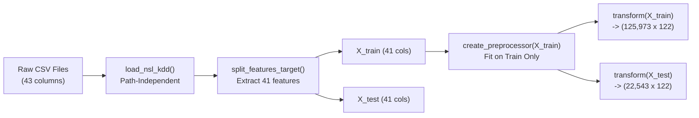

# Signature Memorization vs. Unseen Attack Generalization in Network Intrusion Detection

[](https://www.python.org/)
[](https://scikit-learn.org/)
[]()
[-red.svg)]()

Undergraduate Machine Learning Project (ES 335, Semester 5, IIT Gandhinagar).

---

## 1. Project Overview

### Research Objective
The goal of this project is to investigate whether **simpler, highly regularized machine learning models generalize more effectively to previously unseen network attack types** than complex, highly expressive models that risk memorizing training attack signatures.

### Problem Statement
Modern machine learning models for Network Intrusion Detection Systems (NIDS) routinely achieve $> 98\%$ accuracy on static, in-distribution test sets. However, in adversarial security contexts, network threats evolve constantly. Complex models often achieve high performance by memorizing specific artifacts (e.g., port numbers, protocol flags, or packet lengths) rather than learning generalized structural representations of malicious traffic. When presented with previously unseen attack vectors, these models frequently degrade significantly.

### Scope & Methodological Limitations
- **Evaluation Benchmark:** This study is conducted on the standard **NSL-KDD** benchmark dataset.
- **Methodological Guardrail:** We explicitly do **not** claim genuine real-world zero-day detection capability based solely on NSL-KDD. Unseen test attack types represent controlled, benchmark-level out-of-distribution signatures rather than true operational zero-day exploits.

---

## 2. Dataset Specification (NSL-KDD)

The NSL-KDD dataset is a curated revision of KDD Cup 1999 that eliminates redundant records (~78% duplicate training records) and establishes balanced evaluation difficulty.

### Splits & Record Counts
- **Training Set (`dataset/raw/KDDTrain+.csv`):** 125,973 records.
- **Testing Set (`dataset/raw/KDDTest+.csv`):** 22,543 records.
  - *Note on Local Test Row Count:* While some literature mirrors report 22,544 rows, the local dataset distribution contains exactly **22,543 rows** (due to the absence of a trailing blank line/single record variance). Our pipeline faithfully processes the exact local 22,543 rows without fabricating records.

### Feature & Column Taxonomy
The canonical schema consists of **43 columns**:
- **41 Input Predictor Features:**
  - *Basic Features (10):* Connection duration, protocol type, service, flag, byte counts, error flags.
  - *Content Features (12):* Failed logins, root access attempts, compromised state, shell commands.
  - *Time-based Traffic Features (9):* Connection frequency to the same host/service in 2-second windows.
  - *Host-based Traffic Features (10):* Destination host connection distributions across 100-connection windows.
- **1 Attack Label (`label`):** Specific attack name or `normal`.
- **1 Metadata Column (`difficulty_level`):** Model consensus difficulty score. **Strictly excluded from model inputs.**

### Classification Tasks & Target Definitions
1. **Primary Binary Task (`is_intrusion`):**
   $$\text{is\_intrusion} = \begin{cases} 0 & \text{if label} = \text{'normal'} \\ 1 & \text{if label} \neq \text{'normal'} \end{cases}$$
   - **Training Set:** Normal: 67,343 ($53.46\%$) | Attack: 58,630 ($46.54\%$)
   - **Testing Set:** Normal: 9,710 ($43.07\%$) | Attack: 12,833 ($56.93\%$) — *Distribution Inversion*
2. **Secondary 5-Class Categorization (`attack_category`):**
   - Maps 39 distinct attack signatures into 4 standard DARPA categories + Normal:
     - **Normal:** Benign traffic
     - **DoS (Denial of Service):** 10 signatures (e.g., `neptune`, `smurf`, `back`)
     - **Probe (Surveillance):** 6 signatures (e.g., `satan`, `ipsweep`, `portsweep`)
     - **R2L (Remote to Local):** 16 signatures (e.g., `warezclient`, `guess_passwd`, `imap`)
     - **U2R (User to Root):** 7 signatures (e.g., `buffer_overflow`, `rootkit`, `loadmodule`)

### 17 Unseen Test Attack Signatures
The official test set contains 17 novel attack signatures absent from the training set:
- **DoS:** `apache2`, `mailbomb`, `processtable`, `udpstorm`
- **Probe:** `mscan`, `saint`
- **R2L:** `httptunnel`, `named`, `sendmail`, `snmpgetattack`, `snmpguess`, `worm`, `xlock`, `xsnoop`
- **U2R:** `ps`, `sqlattack`, `xterm`

---

## 3. Data Pipeline & Preprocessing Methodology

All models are trained and evaluated using a unified, anti-leakage pipeline implemented in `src/data_loader.py` and `src/preprocessing.py`.



### Preprocessing Transformations
- **Categorical Pipeline:** `OneHotEncoder(handle_unknown="ignore")` applied to `protocol_type` (3), `service` (70), and `flag` (11), producing **84 one-hot columns**. Unseen test categories are mapped to all zeros without runtime errors.
- **Numerical Pipeline:** `StandardScaler()` applied to the remaining **38 continuous features**.
- **Total Processed Features:** **122 continuous features**.
- **Strict Anti-Leakage Protocol:**
  - Preprocessor statistics (means, standard deviations, one-hot categories) are fitted **strictly on `X_train`**.
  - `X_test` is strictly transformed; `fit()` is never invoked on test data.
  - Target columns (`label`, `is_intrusion`, `attack_category`) and metadata (`difficulty_level`) are strictly excluded.
- **Artifact Persistence:** The fitted preprocessor is saved at `models/preprocessor.joblib` and bit-for-bit verified.

---

## 4. Repository Layout

```text
├── config.yaml                    # Global experiment configuration, seeds, and paths
├── dataset/
│   └── raw/                       # Canonical raw NSL-KDD CSV files
│       ├── KDDTrain+.csv          # 125,973 training rows
│       └── KDDTest+.csv           # 22,543 testing rows
├── docs/                          # Detailed reports and methodology documentation
│   ├── dataset_notes.md           # Dataset taxonomy & EDA inferences
│   ├── eda_report.md              # In-depth exploratory data analysis report
│   ├── methodology.md             # Complete data pipeline & controlled methodology
│   ├── project_proposal.md        # Formal research questions & hypothesis specification
│   ├── references.md              # Academic benchmark literature and citations
│   └── images/                    # Visualizations generated from EDA
├── models/                        # Serialized model and pipeline artifacts
│   ├── preprocessor.joblib        # Fitted ColumnTransformer (122 features)
│   ├── random_forest.joblib       # Original Random Forest model artifact
│   ├── logistic_regression_controlled.joblib  # Controlled Logistic Regression
│   ├── decision_tree_controlled.joblib        # Controlled Decision Tree
│   └── random_forest_controlled.joblib        # Controlled Random Forest
├── notebooks/                     # Exploratory and experimental Jupyter notebooks
│   ├── 01_data_exploration.ipynb # Completed EDA & statistical distributions
│   ├── 02_preprocessing.ipynb    # Completed preprocessing exploration & artifact export
│   ├── 03_majority_baseline.ipynb# Completed zero-rule baseline classifier
│   ├── 04_logistic_regression.ipynb # Historical exploratory Logistic Regression
│   ├── 05_decision_tree.ipynb    # Historical exploratory Decision Tree
│   ├── 06_random_forest.ipynb    # Historical Random Forest implementation
│   ├── 07_evaluation_comparison.ipynb # Canonical controlled multi-model comparison
│   └── 08_xgboost.ipynb          # Historical exploratory gradient boosting
├── results/                       # Experimental metrics, plots, and predictions
│   ├── figures/evaluation/        # Comparative evaluation plots (ROC, PR, gap, calibration)
│   ├── metrics/                   # JSON metric summaries for all models
│   ├── predictions/               # Per-sample test predictions CSVs
│   ├── splits/                    # Train/validation split index arrays
│   └── tuning/                    # Optuna hyperparameter optimization logs
├── scripts/                       # Reproduction and utility scripts
│   ├── add_headers.py             # Prepend schema headers if needed
│   ├── build_comparison_notebook.py # Generate comparison notebook & figures
│   └── run_all_controlled_models.py # End-to-end controlled training & evaluation
├── src/                           # Shared reusable production modules
│   ├── __init__.py
│   ├── config.py                  # Seed and environment configuration utilities
│   ├── data_loader.py             # Schema definition, ingestion & label mapping
│   ├── preprocessing.py          # ColumnTransformer, feature extraction & persistence
│   ├── controlled_framework.py    # Leakage-free controlled training & evaluation framework
│   ├── features.py                # Exploratory feature extraction helpers
│   ├── experiment.py              # Exploratory experiment execution runner
│   └── evaluation.py              # Evaluation metric helpers & plotting
├── tests/                         # Automated test suite
│   ├── test_data_pipeline.py      # 15 unittests for data loader and preprocessor
│   └── test_features.py           # Feature engineering and cleaning unit tests
├── requirements.txt               # Project dependency specifications
├── requirements-lock.txt          # Frozen dependency lockfile
└── README.md                      # Primary project documentation (this file)
```

---

## 5. Team Responsibilities

| Team Member | Core Responsibilities |
|:---|:---|
| **Vedant** | Data loading & preprocessing modules (`src/data_loader.py`, `src/preprocessing.py`)<br>Majority-Class baseline classifier (`notebooks/03_majority_baseline.ipynb`)<br>Random Forest classifier implementation & tuning (`notebooks/06_random_forest.ipynb`)<br>Controlled framework architecture & execution (`src/controlled_framework.py`, `scripts/`) |
| **Dhruv** | Exploratory Data Analysis & statistical reporting (`notebooks/01_data_exploration.ipynb`, `docs/eda_report.md`)<br>Logistic Regression regularized baseline (`notebooks/04_logistic_regression.ipynb`)<br>Decision Tree interpretable classifier (`notebooks/05_decision_tree.ipynb`)<br>Comparative multi-model evaluation & statistical tests (`notebooks/07_evaluation_comparison.ipynb`, `src/evaluation.py`) |

Both team members adhere strictly to the same official data split, feature definitions, and anti-leakage evaluation protocols.  
*(Note: A static web UI demonstration was originally scoped under `website/`, but was deferred in favor of the rich, interactive Jupyter evaluation dashboard and standalone SVG/PNG publication figures in `results/figures/evaluation/`.)*

---

## 6. Setup & Execution Instructions

### A. Environment Setup
Clone the repository and set up a virtual environment (Python 3.10+):

```bash
git clone <repo-url>
cd "Intrusion Detection"

python3 -m venv venv
source venv/bin/activate
pip install --upgrade pip
pip install -r requirements.txt
```

### B. Dataset Placement
Ensure the raw NSL-KDD dataset files exist at:
```text
dataset/raw/KDDTrain+.csv
dataset/raw/KDDTest+.csv
```
The data loader resolves these files automatically relative to the repository root regardless of current working directory.

### C. Executing the Shared Pipeline
In Python or a notebook:

```python
from src.data_loader import load_nsl_kdd
from src.preprocessing import split_features_target, load_preprocessor

# Load datasets
train_df, test_df = load_nsl_kdd()

# Extract predictor features and binary target
X_train, y_train = split_features_target(train_df, target_col="is_intrusion")
X_test, y_test = split_features_target(test_df, target_col="is_intrusion")

# Load pre-fitted preprocessor artifact
preprocessor = load_preprocessor()
X_train_proc = preprocessor.transform(X_train)  # (125973, 122)
X_test_proc = preprocessor.transform(X_test)    # (22543, 122)
```

### D. Running Automated Tests
Run the comprehensive test suite using Python's standard `unittest` or `pytest`:

```bash
# Run 15 pipeline and preprocessor unit tests
python -m unittest discover tests -v

# Run 12 feature extraction unit tests
pytest tests/test_features.py -v
```

### E. End-to-End Controlled Benchmark Reproduction
To reproduce the full controlled benchmark (Logistic Regression, Decision Tree, Random Forest) and generate all comparative evaluation figures:

```bash
# Train all controlled models with 5-fold CV Optuna tuning, evaluate once on test set:
python scripts/run_all_controlled_models.py

# Rebuild and run the comparative evaluation notebook & statistical tests:
python scripts/build_comparison_notebook.py
```

---

## 7. Current Project Progress

- [x] **Completed:**
  - Comprehensive Exploratory Data Analysis (`01_data_exploration.ipynb`, `docs/eda_report.md`, `docs/dataset_notes.md`).
  - Standardized Data Loader module with path independence and attack mapping validation (`src/data_loader.py`).
  - Strict anti-leakage preprocessor module with persistence utilities (`src/preprocessing.py`, `notebooks/02_preprocessing.ipynb`, `models/preprocessor.joblib`).
  - Majority-Class Baseline Classifier establishing performance floor (`notebooks/03_majority_baseline.ipynb`, `results/metrics/majority_baseline_controlled.json`):
    - Accuracy: **$43.07\%$** | Macro-F1: **$0.3011$** | Attack Recall: **$0.00\%$**
  - Random Forest Classifier non-linear benchmark (`notebooks/06_random_forest.ipynb`, `models/random_forest.joblib`, `results/metrics/random_forest.json`):
    - Accuracy: **$78.59\%$** | Precision: **$96.86\%$** | Recall: **$64.47\%$** | Macro-F1: **$0.7853$**
    - Seen Attack Recall: **$76.91\%$** | Unseen Attack Recall: **$34.35\%$** (Generalization Drop: **$42.57$ pp**)
  - **Unified Controlled Multi-Model Framework (`src/controlled_framework.py`, `scripts/run_all_controlled_models.py`):**
    - 5-fold Stratified CV with fold-level preprocessors (0 leakage), 25 Optuna trials per model.
    - Logistic Regression Controlled (`models/logistic_regression_controlled.joblib`, $75.64\%$ accuracy, $0.7560$ Macro-F1, $42.08\%$ unseen recall).
    - Decision Tree Controlled (`models/decision_tree_controlled.joblib`, $83.22\%$ accuracy, $0.8322$ Macro-F1, $53.36\%$ unseen recall).
    - Random Forest Controlled (`models/random_forest_controlled.joblib`, $76.36\%$ accuracy, $0.7623$ Macro-F1, $23.25\%$ unseen recall).
  - Multi-Model Comparative Evaluation & Statistical Hypothesis Testing (`notebooks/07_evaluation_comparison.ipynb`, `results/metrics/statistical_comparison.json`):
    - Paired McNemar significance tests ($\chi^2 = 905.14$, $13.68$, $1178.20$, all $p < 0.001$).
    - 1,000-sample percentile bootstrap 95% confidence intervals.
  - Automated test suite with 15 passing tests (`tests/test_data_pipeline.py`) + 12 passing feature tests (`tests/test_features.py`).
  - Complete project methodology, formal proposal, and references documentation (`docs/`).
- [ ] **Next Steps / Optional Extensions:**
  - Interactive web results dashboard (deferred extension).
  - Cost-sensitive threshold tuning on validation data for alert fatigue minimization.

---

## 8. Random Forest Classifier Benchmark

**Notebook:** [`notebooks/06_random_forest.ipynb`](notebooks/06_random_forest.ipynb)  
**Lead:** Vedant  

### Model Objective & Role
Random Forest serves as the complex, high-capacity non-linear model in this study. It aggregates 100 deep decision trees via bootstrap aggregation and random feature subspace sampling (`max_features='sqrt'`). It establishes how effectively an ensemble modeling complex non-linear feature interactions performs on known training signatures versus novel unseen attacks.

### Feature Representation
All 41 original predictor features are used (Basic, Content, Time-Traffic, Host-Traffic), transformed via the shared preprocessor into **122 processed features** (84 one-hot encoded categorical indicators, 38 standard-scaled numerical features). Target labels and the 21-model historical consensus metadata `difficulty_level` are strictly excluded.

### Hyperparameters & Validation Procedure
Hyperparameters were evaluated on an isolated 80/20 stratified validation split of `KDDTrain+` (100,778 train-sub, 25,195 val-sub). All unconstrained tree configurations achieved saturation on in-distribution data ($\approx 99.9\%$ Macro-F1). Guided by the operational objective of penalizing false negatives on under-represented attacks, **`class_weight='balanced'`** was selected. Validation evidence showed that leaf regularization (`min_samples_leaf=4`) degraded rare attack recall, while balanced class weights maintained $99.93\%$ precision on benign validation traffic.

**Final Hyperparameters:**
`n_estimators=100`, `criterion='gini'`, `max_depth=None`, `min_samples_split=2`, `min_samples_leaf=1`, `max_features='sqrt'`, `class_weight='balanced'`, `bootstrap=True`, `random_state=42`, `n_jobs=-1`.

### Official Test Performance (`KDDTest+`, 22,543 records)
- **Accuracy:** $78.59\%$ ($17,716 / 22,543$)
- **Attack Precision:** $96.86\%$ ($8,274 / 8,542$)
- **Attack Recall:** $64.47\%$ ($8,274 / 12,833$)
- **Attack F1-Score:** $0.7742$
- **Macro-Averaged F1:** $0.7853$
- **Confusion Matrix:** $\text{TN}=9,442, \text{FP}=268, \text{FN}=4,559, \text{TP}=8,274$
- **Attack Category Breakdown:**
  - DoS Recall: **$82.43\%$** ($6,148 / 7,458$)
  - Probe Recall: **$80.46\%$** ($1,948 / 2,421$)
  - R2L Recall: **$5.89\%$** ($170 / 2,887$)
  - U2R Recall: **$11.94\%$** ($8 / 67$)

### Seen vs. Unseen Attack Generalization Gap
- **22 Seen Training Attacks:** $76.91\%$ recall ($6,986 / 9,083$)
- **17 Unseen Test Attacks:** $34.35\%$ recall ($1,288 / 3,750$)
- **Generalization Degradation:** **$42.57\text{ percentage points}$**

### Saved Artifacts & Reproducibility
- Serialized Model: `models/random_forest.joblib`
- Final Metrics: `results/metrics/random_forest.json`
- Initial Diagnostic Metrics: `results/metrics/random_forest_initial.json`
- Test Predictions: `results/predictions/random_forest_predictions.csv` (22,543 rows)

```python
import joblib
from src.data_loader import load_nsl_kdd
from src.preprocessing import split_features_target

_, test_df = load_nsl_kdd()
X_test_raw, y_test = split_features_target(test_df)
preprocessor = joblib.load("models/preprocessor.joblib")
rf = joblib.load("models/random_forest.joblib")

X_test = preprocessor.transform(X_test_raw)
y_pred = rf.predict(X_test)
```

### Methodological Limitations & Research Boundary
- **Diagnostic Test Inspection:** The official test set was evaluated during an initial diagnostic run before final hyperparameter selection; hence it was not a blind holdout.
- **Benchmark Scope:** Evaluated on the synthetic NSL-KDD benchmark; not a claim of genuine real-world zero-day exploit detection.
- **Hypothesis Scope:** Random Forest alone demonstrates its own seen vs. unseen generalization gap ($42.57$ pp). Whether simpler models (Logistic Regression, Decision Trees) exhibit a smaller gap is strictly evaluated in `notebooks/07_evaluation_comparison.ipynb`.

---

## 9. Unified Multi-Model Comparison & Statistical Hypothesis Evaluation

**Notebook:** [`notebooks/07_evaluation_comparison.ipynb`](notebooks/07_evaluation_comparison.ipynb)  
**Experimental Module:** [`src/controlled_framework.py`](src/controlled_framework.py)

### Controlled Benchmark Results (Fixed Threshold = 0.50, `KDDTest+`, $N=22,543$)

| Model | Accuracy (%) | Macro-F1 (95% CI) | Attack Recall (%) | Attack Precision (%) | FPR (%) | Seen Recall (%) | Unseen Recall (%) | Generalization Drop (pp) | Latency (μs) |
|:---|:---:|:---:|:---:|:---:|:---:|:---:|:---:|:---:|:---:|
| **Majority Baseline** | 43.07% | 0.3011 | 0.00% | 0.00% | 0.00% | 0.00% | 0.00% | 0.00 pp | 0.04 μs |
| **Logistic Regression** | 75.64% | 0.7560 [0.7500, 0.7613] | 62.92% | 91.68% | 7.55% | 71.52% | **42.08%** | **29.44 pp** | 1.34 μs |
| **Decision Tree** | **83.22%** | **0.8322** [0.8272, 0.8370] | **73.91%** | 95.61% | 4.48% | **82.40%** | **53.36%** | **29.04 pp** | **0.82 μs** |
| **Random Forest** | 76.36% | 0.7623 [0.7567, 0.7674] | 60.52% | **96.72%** | **2.71%** | 75.91% | 23.25% | 52.66 pp | 4.34 μs |

### Statistical Significance (McNemar's Tests)
- **Overall Classification Concordance ($N=22,543$):**
  - **LR vs. DT:** Disagreements: 3,223 | $\chi^2 = 905.14$, $p < 10^{-198}$ (Decision Tree significantly superior in overall accuracy).
  - **LR vs. RF:** Disagreements: 1,919 | $\chi^2 = 13.68$, $p = 0.000217$ (Significantly distinct error profiles; RF achieves higher precision, LR achieves higher recall).
  - **DT vs. RF:** Disagreements: 2,026 | $\chi^2 = 1,178.20$, $p < 10^{-257}$ (Decision Tree significantly superior overall).
- **Novel Attack Detection Concordance ($N=3,750$ Unseen Attacks):**
  - **LR vs. DT:** Disagreements: 1,605 | $\chi^2 = 110.96$, $p < 10^{-25}$ (Decision Tree significantly superior on novel attack detection).
  - **LR vs. RF:** Disagreements: 928 | $\chi^2 = 535.59$, $p < 10^{-118}$ (Logistic Regression significantly superior on novel attack detection).
  - **DT vs. RF:** Disagreements: 1,245 | $\chi^2 = 1,022.00$, $p < 10^{-223}$ (Decision Tree significantly superior on novel attack detection).

### Answers to the Central Research Hypothesis
1. **Does Random Forest memorize signatures?**  
   **Evidence supports severe out-of-distribution degradation:** Random Forest suffers a massive **$52.66$ percentage point collapse** on novel attacks ($75.91\% \to 23.25\%$). Bagged feature subspacing forces trees to over-rely on specific local training patterns.
2. **Do simpler models generalize better?**  
   **Empirically supported on this benchmark:** Both Decision Tree ($29.04$ pp drop, $53.36\%$ unseen recall) and Logistic Regression ($29.44$ pp drop, $42.08\%$ unseen recall) maintain broader decision boundaries, capturing significantly more novel traffic.
3. **Caveat on Zero-Day Claims & Alert Fatigue:**  
   Neither simple model provides universal zero-day immunity. On non-volumetric stealth attacks (`mailbomb`, `worm`, `snmpgetattack`), models experienced severe blind spots. In addition, Logistic Regression's higher unseen recall comes with an unacceptable $7.55\%$ false positive rate ($733$ false alarms), vs. $2.71\%$ for Random Forest ($263$ false alarms).

---

## 10. References & Benchmark Literature

For complete literature citations, theoretical papers (Breiman CART and Random Forests, Akiba Optuna, McNemar and Edwards hypothesis testing, Efron Bootstrap), and DARPA/NSL-KDD foundational studies, refer to [`docs/references.md`](docs/references.md).


