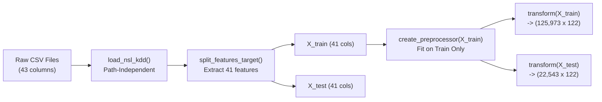

# Signature Memorization vs. Unseen Attack Generalization in Network Intrusion Detection

[](https://www.python.org/)
[](https://scikit-learn.org/)
[]()
[-red.svg)]()

Undergraduate Machine Learning Project (ES 335, Semester 5, IIT Gandhinagar).

---

## 1. Project Overview

### Research Objective
The goal of this project is to investigate whether **simpler, highly regularized machine learning models generalize more effectively to previously unseen network attack types** than complex, highly expressive models that risk memorizing training attack signatures.

### Problem Statement
Modern machine learning models for Network Intrusion Detection Systems (NIDS) routinely achieve $> 98\%$ accuracy on static, in-distribution test sets. However, in adversarial security contexts, network threats evolve constantly. Complex models often achieve high performance by memorizing specific artifacts (e.g., port numbers, protocol flags, or packet lengths) rather than learning generalized structural representations of malicious traffic. When presented with previously unseen attack vectors, these models frequently degrade significantly.

### Scope & Methodological Limitations
- **Evaluation Benchmark:** This study is conducted on the standard **NSL-KDD** benchmark dataset.
- **Methodological Guardrail:** We explicitly do **not** claim genuine real-world zero-day detection capability based solely on NSL-KDD. Unseen test attack types represent controlled, benchmark-level out-of-distribution signatures rather than true operational zero-day exploits.

---

## 2. Dataset Specification (NSL-KDD)

The NSL-KDD dataset is a curated revision of KDD Cup 1999 that eliminates redundant records (~78% duplicate training records) and establishes balanced evaluation difficulty.

### Splits & Record Counts
- **Training Set (`dataset/raw/KDDTrain+.csv`):** 125,973 records.
- **Testing Set (`dataset/raw/KDDTest+.csv`):** 22,543 records.
  - *Note on Local Test Row Count:* While some literature mirrors report 22,544 rows, the local dataset distribution contains exactly **22,543 rows** (due to the absence of a trailing blank line/single record variance). Our pipeline faithfully processes the exact local 22,543 rows without fabricating records.

### Feature & Column Taxonomy
The canonical schema consists of **43 columns**:
- **41 Input Predictor Features:**
  - *Basic Features (10):* Connection duration, protocol type, service, flag, byte counts, error flags.
  - *Content Features (12):* Failed logins, root access attempts, compromised state, shell commands.
  - *Time-based Traffic Features (9):* Connection frequency to the same host/service in 2-second windows.
  - *Host-based Traffic Features (10):* Destination host connection distributions across 100-connection windows.
- **1 Attack Label (`label`):** Specific attack name or `normal`.
- **1 Metadata Column (`difficulty_level`):** Model consensus difficulty score. **Strictly excluded from model inputs.**

### Classification Tasks & Target Definitions
1. **Primary Binary Task (`is_intrusion`):**
   $$\text{is\_intrusion} = \begin{cases} 0 & \text{if label} = \text{'normal'} \\ 1 & \text{if label} \neq \text{'normal'} \end{cases}$$
   - **Training Set:** Normal: 67,343 ($53.46\%$) | Attack: 58,630 ($46.54\%$)
   - **Testing Set:** Normal: 9,710 ($43.07\%$) | Attack: 12,833 ($56.93\%$) — *Distribution Inversion*
2. **Secondary 5-Class Categorization (`attack_category`):**
   - Maps 39 distinct attack signatures into 4 standard DARPA categories + Normal:
     - **Normal:** Benign traffic
     - **DoS (Denial of Service):** 10 signatures (e.g., `neptune`, `smurf`, `back`)
     - **Probe (Surveillance):** 6 signatures (e.g., `satan`, `ipsweep`, `portsweep`)
     - **R2L (Remote to Local):** 16 signatures (e.g., `warezclient`, `guess_passwd`, `imap`)
     - **U2R (User to Root):** 7 signatures (e.g., `buffer_overflow`, `rootkit`, `loadmodule`)

### 17 Unseen Test Attack Signatures
The official test set contains 17 novel attack signatures absent from the training set:
- **DoS:** `apache2`, `mailbomb`, `processtable`, `udpstorm`
- **Probe:** `mscan`, `saint`
- **R2L:** `httptunnel`, `named`, `sendmail`, `snmpgetattack`, `snmpguess`, `worm`, `xlock`, `xsnoop`
- **U2R:** `ps`, `sqlattack`, `xterm`

---

## 3. Data Pipeline & Preprocessing Methodology

All models are trained and evaluated using a unified, anti-leakage pipeline implemented in `src/data_loader.py` and `src/preprocessing.py`.



### Preprocessing Transformations
- **Categorical Pipeline:** `OneHotEncoder(handle_unknown="ignore")` applied to `protocol_type` (3), `service` (70), and `flag` (11), producing **84 one-hot columns**. Unseen test categories are mapped to all zeros without runtime errors.
- **Numerical Pipeline:** `StandardScaler()` applied to the remaining **38 continuous features**.
- **Total Processed Features:** **122 continuous features**.
- **Strict Anti-Leakage Protocol:**
  - Preprocessor statistics (means, standard deviations, one-hot categories) are fitted **strictly on `X_train`**.
  - `X_test` is strictly transformed; `fit()` is never invoked on test data.
  - Target columns (`label`, `is_intrusion`, `attack_category`) and metadata (`difficulty_level`) are strictly excluded.
- **Artifact Persistence:** The fitted preprocessor is saved at `models/preprocessor.joblib` and bit-for-bit verified.

---

## 4. Repository Layout

```text
├── config.yaml                    # Global experiment configuration, seeds, and paths
├── dataset/
│   ├── raw/                       # Canonical raw NSL-KDD CSV files
│   │   ├── KDDTrain+.csv          # 125,973 training rows
│   │   └── KDDTest+.csv           # 22,543 testing rows
│   └── processed/                 # Cached processed data (if generated)
├── docs/                          # Detailed reports and methodology documentation
│   ├── dataset_notes.md           # Dataset taxonomy & EDA inferences
│   ├── eda_report.md              # In-depth exploratory data analysis report
│   ├── methodology.md             # Complete data pipeline & preprocessing protocol
│   ├── project_proposal.md        # Formal research questions & hypothesis specification
│   ├── references.md              # Academic benchmark literature and citations
│   └── images/                    # Visualizations generated from EDA
├── models/                        # Serialized model and pipeline artifacts
│   ├── preprocessor.joblib        # Fitted ColumnTransformer (122 features)
│   ├── decision_tree/             # Decision tree checkpoint directory
│   ├── logistic_regression/       # Logistic regression checkpoint directory
│   └── random_forest/             # Random forest checkpoint directory
├── notebooks/                     # Exploratory and experimental Jupyter notebooks
│   ├── 01_data_exploration.ipynb # Completed EDA & statistical distributions
│   ├── 02_preprocessing.ipynb    # Completed preprocessing exploration & artifact export
│   ├── 03_majority_baseline.ipynb# Completed zero-rule baseline classifier
│   ├── 04_logistic_regression.ipynb # [Pending] Logistic Regression implementation
│   ├── 05_decision_tree.ipynb    # [Pending] Decision Tree implementation
│   ├── 06_random_forest.ipynb    # [Pending] Random Forest implementation
│   └── 07_evaluation_comparison.ipynb # [Pending] Multi-model comparative analysis
├── results/                       # Experimental metrics, plots, and confusion matrices
│   ├── confusion_matrices/
│   ├── error_analysis/
│   ├── metrics/
│   │   └── majority_baseline.json # Baseline evaluation metrics
│   └── plots/
├── src/                           # Shared reusable production modules
│   ├── __init__.py
│   ├── config.py                  # Seed and environment configuration utilities
│   ├── data_loader.py             # Schema definition, ingestion & label mapping
│   ├── preprocessing.py          # ColumnTransformer, feature extraction & persistence
│   ├── features.py                # [Pending] Specialized feature extraction helpers
│   └── evaluation.py              # [Pending] Evaluation and significance test suite
├── tests/                         # Automated test suite
│   └── test_data_pipeline.py      # 15 unittests for data loader and preprocessor
├── website/                       # Interactive demonstration web interface (Static)
│   ├── index.html
│   ├── style.css
│   └── script.js
├── requirements.txt               # Project dependency specifications
├── requirements-lock.txt          # Frozen dependency lockfile
└── README.md                      # Primary project documentation (this file)
```

---

## 5. Team Responsibilities

| Team Member | Core Responsibilities |
|:---|:---|
| **Vedant** | Data loading & preprocessing modules (`src/data_loader.py`, `src/preprocessing.py`)<br>Majority-Class baseline classifier (`notebooks/03_majority_baseline.ipynb`)<br>Random Forest classifier implementation & tuning (`notebooks/06_random_forest.ipynb`)<br>Interactive web presentation interface (`website/`) |
| **Dhruv** | Exploratory Data Analysis & statistical reporting (`notebooks/01_data_exploration.ipynb`, `docs/eda_report.md`)<br>Logistic Regression regularized baseline (`notebooks/04_logistic_regression.ipynb`)<br>Decision Tree interpretable classifier (`notebooks/05_decision_tree.ipynb`)<br>Comparative multi-model evaluation & statistical tests (`notebooks/07_evaluation_comparison.ipynb`, `src/evaluation.py`) |

Both team members adhere strictly to the same official data split, feature definitions, and anti-leakage evaluation protocols.

---

## 6. Setup & Execution Instructions

### A. Environment Setup
Clone the repository and set up a virtual environment (Python 3.10+):

```bash
git clone <repo-url>
cd "Intrusion Detection"

python3 -m venv venv
source venv/bin/activate
pip install --upgrade pip
pip install -r requirements.txt
```

### B. Dataset Placement
Ensure the raw NSL-KDD dataset files exist at:
```text
dataset/raw/KDDTrain+.csv
dataset/raw/KDDTest+.csv
```
The data loader resolves these files automatically relative to the repository root regardless of current working directory.

### C. Executing the Shared Pipeline
In Python or a notebook:

```python
from src.data_loader import load_nsl_kdd
from src.preprocessing import split_features_target, load_preprocessor

# Load datasets
train_df, test_df = load_nsl_kdd()

# Extract predictor features and binary target
X_train, y_train = split_features_target(train_df, target_col="is_intrusion")
X_test, y_test = split_features_target(test_df, target_col="is_intrusion")

# Load pre-fitted preprocessor artifact
preprocessor = load_preprocessor()
X_train_proc = preprocessor.transform(X_train)  # (125973, 122)
X_test_proc = preprocessor.transform(X_test)    # (22543, 122)
```

### D. Running Automated Tests
Run the comprehensive 15-test pipeline suite using Python's standard `unittest` or `pytest`:

```bash
python -m unittest tests/test_data_pipeline.py -v
```

---

## 7. Current Project Progress

- [x] **Completed:**
  - Comprehensive Exploratory Data Analysis (`01_data_exploration.ipynb`, `docs/eda_report.md`, `docs/dataset_notes.md`).
  - Standardized Data Loader module with path independence and attack mapping validation (`src/data_loader.py`).
  - Strict anti-leakage preprocessor module with persistence utilities (`src/preprocessing.py`, `notebooks/02_preprocessing.ipynb`, `models/preprocessor.joblib`).
  - Majority-Class Baseline Classifier establishing performance floor (`notebooks/03_majority_baseline.ipynb`, `results/metrics/majority_baseline.json`):
    - Accuracy: **$43.07\%$** | Precision: **$0.00$** | Recall: **$0.00$** | F1-Score: **$0.00$**
  - Automated test suite with 15 passing tests (`tests/test_data_pipeline.py`).
  - Complete project methodology, formal proposal, and references documentation (`docs/`).
- [ ] **Work in Progress / Next Steps:**
  - Logistic Regression regularized benchmark with $L_1$/$L_2$ cross-validation (`notebooks/04_logistic_regression.ipynb`).
  - Decision Tree classifier with cost-complexity pruning (`notebooks/05_decision_tree.ipynb`).
  - Random Forest non-linear ensemble (`notebooks/06_random_forest.ipynb`).
  - Stratified evaluation across known vs. 17 unseen attack types (`notebooks/07_evaluation_comparison.ipynb`, `src/evaluation.py`).
  - Interactive web results dashboard (`website/`).
