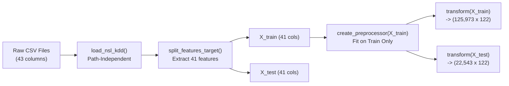

# Signature Memorization vs. Unseen Attack Generalization in Network Intrusion Detection

[](https://www.python.org/)
[](https://scikit-learn.org/)
[-red.svg)]()

Undergraduate Machine Learning Project (ES 335, Semester 5, IIT Gandhinagar).

---

## 1. Project Overview

### Research Objective
The goal of this project is to investigate whether **simpler machine learning models (Logistic Regression, a single Decision Tree) generalize more effectively to previously unseen network attack types** than higher-capacity ensembles (Random Forest, XGBoost).

### Problem Statement
Modern machine learning models for Network Intrusion Detection Systems (NIDS) routinely achieve $> 98\%$ accuracy on static, in-distribution test sets. However, in adversarial security contexts, network threats evolve constantly. Complex models often achieve high performance by memorizing specific artifacts (e.g., port numbers, protocol flags, or packet lengths) rather than learning generalized structural representations of malicious traffic. When presented with previously unseen attack vectors, these models frequently degrade significantly.

### Scope & Methodological Limitations
- **Evaluation Benchmark:** This study is conducted on the standard **NSL-KDD** benchmark dataset.
- **Methodological Guardrail:** We explicitly do **not** claim genuine real-world zero-day detection capability based solely on NSL-KDD. Unseen test attack types represent controlled, benchmark-level out-of-distribution signatures rather than true operational zero-day exploits.

---

## 2. Dataset Specification (NSL-KDD)

The NSL-KDD dataset is a curated revision of KDD Cup 1999 that eliminates redundant records (~78% duplicate training records) and establishes balanced evaluation difficulty.

### Splits & Record Counts
- **Training Set (`dataset/raw/KDDTrain+.csv`):** 125,973 records.
- **Testing Set (`dataset/raw/KDDTest+.csv`):** 22,543 records.
  - *Note on Local Test Row Count:* While some literature mirrors report 22,544 rows, the local dataset distribution contains exactly **22,543 rows** (due to the absence of a trailing blank line/single record variance). Our pipeline faithfully processes the exact local 22,543 rows without fabricating records.

### Feature & Column Taxonomy
The canonical schema consists of **43 columns**:
- **41 Input Predictor Features:**
  - *Basic Features (10):* Connection duration, protocol type, service, flag, byte counts, error flags.
  - *Content Features (12):* Failed logins, root access attempts, compromised state, shell commands.
  - *Time-based Traffic Features (9):* Connection frequency to the same host/service in 2-second windows.
  - *Host-based Traffic Features (10):* Destination host connection distributions across 100-connection windows.
- **1 Attack Label (`label`):** Specific attack name or `normal`.
- **1 Metadata Column (`difficulty_level`):** Model consensus difficulty score. **Strictly excluded from model inputs.**

### Classification Tasks & Target Definitions
1. **Primary Binary Task (`is_intrusion`):**
   $$\text{is\_intrusion} = \begin{cases} 0 & \text{if label} = \text{'normal'} \\ 1 & \text{if label} \neq \text{'normal'} \end{cases}$$
   - **Training Set:** Normal: 67,343 ($53.46\%$) | Attack: 58,630 ($46.54\%$)
   - **Testing Set:** Normal: 9,710 ($43.07\%$) | Attack: 12,833 ($56.93\%$) — *Distribution Inversion*
2. **Secondary 5-Class Categorization (`attack_category`):**
   - Maps 39 distinct attack signatures into 4 standard DARPA categories + Normal:
     - **Normal:** Benign traffic
     - **DoS (Denial of Service):** 10 signatures (e.g., `neptune`, `smurf`, `back`)
     - **Probe (Surveillance):** 6 signatures (e.g., `satan`, `ipsweep`, `portsweep`)
     - **R2L (Remote to Local):** 16 signatures (e.g., `warezclient`, `guess_passwd`, `imap`)
     - **U2R (User to Root):** 7 signatures (e.g., `buffer_overflow`, `rootkit`, `loadmodule`)

### 17 Unseen Test Attack Signatures
The official test set contains 17 novel attack signatures absent from the training set:
- **DoS:** `apache2`, `mailbomb`, `processtable`, `udpstorm`
- **Probe:** `mscan`, `saint`
- **R2L:** `httptunnel`, `named`, `sendmail`, `snmpgetattack`, `snmpguess`, `worm`, `xlock`, `xsnoop`
- **U2R:** `ps`, `sqlattack`, `xterm`

---

## 3. Data Pipeline & Preprocessing Methodology

All models are trained and evaluated using a unified, anti-leakage pipeline implemented in `src/data_loader.py` and `src/preprocessing.py` and built in `notebooks/02_preprocessing.ipynb`.



### Preprocessing Transformations
- **Categorical Pipeline:** `OneHotEncoder(handle_unknown="ignore")` applied to `protocol_type` (3), `service` (70), and `flag` (11), producing **84 one-hot columns**. Unseen test categories are mapped to all zeros without runtime errors.
- **Numerical Pipeline:** `StandardScaler()` applied to the remaining **38 continuous features**.
- **Total Processed Features:** **122 continuous features**.
- **Strict Anti-Leakage Protocol:**
  - Preprocessor statistics (means, standard deviations, one-hot categories) are fitted **strictly on `X_train`**.
  - `X_test` is strictly transformed; `fit()` is never invoked on test data.
  - Target columns (`label`, `is_intrusion`, `attack_category`) and metadata (`difficulty_level`) are strictly excluded.
- **Artifact Persistence:** The fitted preprocessor is saved at `scalars/preprocessor.joblib` (with its 122 feature names) and verified against a fresh fit in the tests. Each model pipeline in `models/` contains its own identical copy, refit inside every CV fold during tuning.

---

## 4. Repository Layout

The notebooks are the **single source of truth**: every result, model, table and figure in this repository is produced by running them in order (01 → 10). `src/` contains only helper functions that the notebooks import; nothing in `src/` runs on its own.

```text
├── config.yaml                    # All settings: seeds, paths, CV scheme, trial budget, class_weight, threshold, FPR budgets, bootstrap
├── dataset/raw/                   # Official NSL-KDD files (headerless)
│   ├── KDDTrain+.csv              # 125,973 rows
│   └── KDDTest+.csv               # 22,543 rows
├── notebooks/                     # Run in order; each saves its own outputs
│   ├── 01_data_exploration.ipynb  # EDA -> results/figures/eda/, results/eda/eda_summary.json
│   ├── 02_preprocessing.ipynb     # shared preprocessor + leave-attack-types-out folds -> scalars/, results/splits/
│   ├── 03_majority_baseline.ipynb # zero-rule baseline
│   ├── 04_logistic_regression.ipynb
│   ├── 05_decision_tree.ipynb
│   ├── 06_random_forest.ipynb
│   ├── 07_xgboost.ipynb
│   ├── 08_evaluation_comparison.ipynb  # comparison tables, seed summary, statistical tests, evaluation figures
│   ├── 09_capacity_analysis.ipynb      # capacity sweeps within each model family
│   └── 10_website_data.ipynb           # exports results to website/src/data/researchData.ts
├── src/                           # Helpers imported by the notebooks
│   ├── config.py                  # load_config(), seeding
│   ├── data_loader.py             # schema, loading, attack -> category mapping
│   ├── preprocessing.py           # shared 122-feature ColumnTransformer, persistence
│   └── controlled_framework.py    # novelty CV, tuning/refit/evaluation, operating points, McNemar, bootstraps, Holm, savers
├── models/                        # Fitted model pipelines (preprocessor + estimator), primary seed, *.joblib
├── scalars/                       # Fitted preprocessor, 122 feature names, label mapping
├── results/
│   ├── eda/                       # EDA summary (JSON)
│   ├── splits/                    # attack-type fold assignment (JSON) + per-row fold index (NPY)
│   ├── tuning/                    # Optuna trial logs per model (JSON + CSV); seeds/ for the other seeds
│   ├── metrics/                   # Per-model metrics + statistical_comparison.json; seeds/ for the other seeds
│   ├── predictions/               # Per-row test predictions incl. P(attack) (seed 42); OOF training scores and seeds/ are regenerated locally, not tracked
│   ├── tables/                    # Summary tables (CSV + Markdown)
│   └── figures/                   # eda/, preprocessing/, <model>/, evaluation/, capacity/
├── docs/                          # dataset_notes.md, methodology.md, project_proposal.md, references.md
├── website/                       # React + Vite research website (GitHub Pages); its data file is generated by notebook 10
├── tests/                         # test_data_pipeline.py, test_controlled_framework.py
├── requirements.txt / requirements-lock.txt
└── README.md
```

---

## 5. Team Responsibilities

| Team Member | Core Responsibilities |
|:---|:---|
| **Vedant** | Data loading & preprocessing modules (`src/data_loader.py`, `src/preprocessing.py`)<br>Majority-class baseline (`notebooks/03_majority_baseline.ipynb`)<br>Random Forest (`notebooks/06_random_forest.ipynb`)<br>Controlled framework (`src/controlled_framework.py`) |
| **Dhruv Meshram** | Exploratory data analysis (`notebooks/01_data_exploration.ipynb`, `docs/dataset_notes.md`)<br>Logistic Regression (`notebooks/04_logistic_regression.ipynb`)<br>Decision Tree (`notebooks/05_decision_tree.ipynb`)<br>Comparative evaluation & statistical tests (`notebooks/08_evaluation_comparison.ipynb`) |
| **Shared** | XGBoost (`notebooks/07_xgboost.ipynb`), capacity analysis (`notebooks/09_capacity_analysis.ipynb`), protocol revision after the methodology review |

---

## 6. Setup & Execution

### A. Environment
```bash
python3 -m venv .venv
source .venv/bin/activate
pip install -r requirements.txt        # or requirements-lock.txt for the exact versions used
```

### B. Run the experiment (notebooks, in order)
Run the notebooks top to bottom in order **01 → 10**, in Jupyter or headless:

```bash
export PYTHONHASHSEED=42
for nb in notebooks/0*.ipynb; do
  jupyter nbconvert --to notebook --execute --inplace --ExecutePreprocessor.timeout=-1 "$nb" || break
done
```

Dependencies: 02 before 03–07 (folds + preprocessor); 08 after 03–07 (all seeds); 09 after 04–07 (tuned parameters); 10 after 08 and 09. Each model notebook runs the full pipeline once per seed in `config.yaml` (5 seeds). On a 12-core machine this took about 13 min for LR, 5 min for the Decision Tree, about an hour for Random Forest and 1–1.5 h for XGBoost; 08 takes about 4 min and 09 about 15 min. To change a model, edit its notebook (search space, fixed parameters) or `config.yaml`, rerun that notebook, then 08, 09 and 10.

### C. Website
The research website in `website/` reads only `website/src/data/researchData.ts`, which notebook 10 generates from `results/`. Preview it locally with `cd website && npm install && npm run dev`. Pushing changes under `website/` to `main` deploys it to GitHub Pages (`.github/workflows/deploy-pages.yml`).

### D. Tests
```bash
pytest -q tests
```
27 tests: the data loader and preprocessor (`test_data_pipeline.py`, needs `scalars/preprocessor.joblib` from notebook 02) and the framework (`test_controlled_framework.py`: metric and McNemar hand values, Holm, bootstraps, FPR thresholds, that novelty folds hold out whole attack types, and that the final model is refit with the full tuned + fixed parameter set and the run's seed).

---

## 7. Experimental Protocol (identical for every model)

- **Split.** Official `KDDTrain+` / `KDDTest+`, never merged or re-split.
- **Input.** The shared 122-feature preprocessor, refit inside every CV fold and, for the final model, on `KDDTrain+` only.
- **Novelty-aware tuning.** 25 Optuna TPE trials per model. The objective is the mean ROC-AUC over 5 *leave-attack-types-out* folds of `KDDTrain+`: the 22 training attack types are dealt into 5 groups, and each fold holds out one group plus a random fifth of the normal rows. Tuning therefore rewards separating attack types the model has not seen from normal traffic, without touching `KDDTest+`.
- **Fixed parameters.** `class_weight=None` for every model (`scale_pos_weight=1` for XGBoost); `random_state` = the run's seed; LR uses `lbfgs`, `max_iter=2000` (convergence asserted).
- **Final model.** Refit on all of `KDDTrain+` with the **full** best-trial parameter set; a check fails the notebook if the fitted estimator differs from it.
- **Evaluation on `KDDTest+`** (once per model and seed):
  - threshold-free: ROC-AUC, PR-AUC, ROC-AUC of seen attacks vs normals and of unseen attacks vs normals;
  - matched FPR: unseen recall at test FPR budgets of 1 / 2 / 5% (read off the ROC curve);
  - deployable: thresholds chosen so 1 / 2 / 5% of out-of-fold `KDDTrain+` normals exceed them, applied to the test set;
  - the fixed 0.5 threshold, for continuity.
- **Seeds.** Tuning, refit and evaluation are repeated end to end for seeds 42, 1, 2, 3, 4. Seed 42 writes the models and headline files.
- **Statistics (notebook 08).** McNemar (Edwards) on all test rows and on unseen-attack rows; paired bootstrap (2,000 resamples) of Δ Macro-F1, Δ unseen recall at 0.5, Δ unseen-vs-normal AUC and Δ unseen recall at 2% test FPR; Holm–Bonferroni over all 36 two-sided tests; a cluster bootstrap over the 17 unseen attack types.

Selected configurations (seed 42, `results/tuning/*_trials.json`):

| Model | Selected hyperparameters | Final-fit complexity | Novelty CV AUC (fold SD) |
|---|---|---|---|
| Logistic Regression | `C=0.0024` (strong L2) | 121 coefficients, ‖w‖₂ = 3.4, 27 iterations | 0.906 (0.093) |
| Decision Tree | entropy, `max_depth=5`, `min_samples_leaf=35`, `min_samples_split=15` | depth 5, 24 leaves | 0.916 (0.064) |
| Random Forest | 150 trees, `max_depth=20`, `min_samples_split=5`, `min_samples_leaf=1`, `max_features='sqrt'` | depth 20, 456 leaves per tree | 0.994 (0.004) |
| XGBoost | 150 trees, `max_depth=5`, `learning_rate=0.021`, `min_child_weight=14.5`, `subsample=0.71`, `colsample_bytree=0.76`, `reg_lambda=0.98` | 21 leaves per tree | 0.982 (0.016) |

With the novelty-aware objective, the tuned LR and Decision Tree are now genuinely simple (strong regularisation; a 24-leaf tree).

---

## 8. Results (`KDDTest+`, N = 22,543)

Generated by `notebooks/08_evaluation_comparison.ipynb` (`results/tables/*`, `results/metrics/statistical_comparison.json`).

### 8.1 Ranking quality and matched FPR (seed 42)

| Model | ROC-AUC | PR-AUC | AUC seen vs normal | AUC unseen vs normal | Unseen recall @1% FPR | @2% FPR | @5% FPR |
|---|---|---|---|---|---|---|---|
| Majority Baseline | 0.500 | 0.569 | 0.500 | 0.500 | 0.0% | 0.0% | 0.0% |
| Logistic Regression | 0.885 | 0.916 | 0.885 | 0.883 | 5.2% | 5.4% | 7.2% |
| Decision Tree | 0.884 | 0.912 | 0.947 | 0.734 | 6.7% | 14.6% | 35.6% |
| Random Forest | **0.965** | **0.968** | **0.975** | 0.942 | 7.2% | 9.3% | 63.3% |
| XGBoost | 0.958 | 0.966 | 0.963 | **0.947** | 5.2% | 8.0% | **82.2%** |

### 8.2 Across 5 seeds (mean ± SD)

| Model | AUC unseen vs normal | Unseen recall @2% test FPR | Macro-F1 @0.5 | FPR @0.5 | Unseen recall @0.5 |
|---|---|---|---|---|---|
| Logistic Regression | 0.8831 ± 0.0001 | 5.4% ± 0.0 | 0.736 ± 0.000 | 7.24% ± 0.01 | 29.6% ± 0.2 |
| Decision Tree | 0.7456 ± 0.0277 | 16.6% ± 4.7 | 0.775 ± 0.011 | 3.21% ± 0.41 | 31.1% ± 8.7 |
| Random Forest | 0.9410 ± 0.0037 | 8.4% ± 1.4 | 0.769 ± 0.002 | 2.68% ± 0.04 | 25.0% ± 1.1 |
| XGBoost | 0.9432 ± 0.0048 | 6.9% ± 1.4 | 0.787 ± 0.009 | 2.73% ± 0.09 | 32.4% ± 5.5 |

On unseen-vs-normal AUC, Random Forest and XGBoost beat Logistic Regression and the Decision Tree in all 5 seeds; RF vs XGBoost is not consistent (XGBoost higher in 4 of 5).

### 8.3 Threshold 0.5 (seed 42, for continuity)

| Model | Macro-F1 | FPR | Seen recall | Unseen recall [row CI] [attack-type cluster CI] | Drop (pp) |
|---|---|---|---|---|---|
| Logistic Regression | 0.736 | 7.24% | 71.5% | 29.6% [28.1, 31.1] [8.9, 49.1] | 42.0 |
| Decision Tree | 0.780 | 2.99% | 75.6% | 35.0% [33.5, 36.5] [4.8, 66.8] | 40.6 |
| Random Forest | 0.768 | 2.72% | 76.8% | 24.6% [23.2, 26.0] [1.1, 46.5] | 52.2 |
| XGBoost | 0.781 | 2.57% | 78.2% | 28.3% [26.9, 29.8] [2.4, 52.3] | 49.9 |

The attack-type cluster CIs are an order of magnitude wider than the row CIs: unseen recall depends heavily on which attack types are in the test set (3 types are 64% of unseen rows).

### 8.4 Paired tests (seed 42, Holm-adjusted over 36 tests)

| Pair | Δ AUC unseen vs normal | Δ unseen recall @2% FPR (pp) | Δ unseen recall @0.5 (pp) |
|---|---|---|---|
| LR − DT | +0.150 [0.140, 0.160]* | −8.5 [−10.1, −1.2]* | −5.4 [−6.8, −4.1]* |
| LR − RF | −0.059 [−0.063, −0.055]* | −4.0 [−5.3, −2.9]* | +5.0 [3.4, 6.4]* |
| LR − XGB | −0.064 [−0.068, −0.060]* | −2.2 [−3.4, 0.2] | +1.2 [−0.0, 2.5] |
| DT − RF | −0.208 [−0.218, −0.198]* | +4.5 [−2.4, 6.5] | +10.4 [8.9, 11.7]* |
| DT − XGB | −0.213 [−0.223, −0.203]* | +6.2 [−0.3, 9.4] | +6.6 [5.5, 7.8]* |
| RF − XGB | −0.005 [−0.007, −0.003]* | +1.8 [0.8, 3.8]* | −3.7 [−5.0, −2.5]* |

\* significant after Holm (p_holm ≤ 0.026). 29 of 36 tests are significant; the non-significant ones are listed in `results/tables/hypothesis_tests.md`.

### 8.5 Deployable thresholds (calibrated on out-of-fold training normals)

Thresholds set for 1 / 2 / 5% FPR on training data give much higher FPRs on `KDDTest+`: 6.7–8.0% (LR), 3.0–6.0% (DT), 9.9–13.5% (RF) and 3.3–10.5% (XGBoost). Normal traffic in the test set scores higher than training normals, so FPR targets set on training data do not transfer.

### 8.6 Capacity sweeps (notebook 09; test numbers descriptive only)

| Family | Parameter swept | Unseen-vs-normal AUC as capacity grows |
|---|---|---|
| Logistic Regression | `C` 1e-3 → 100 | falls steadily, 0.881 → 0.710 |
| Decision Tree | `max_depth` 1 → None | ~0.79 for depth 1–3, peak 0.83 at depth 6, 0.72 when fully grown |
| Random Forest | `max_depth` 2 → None | flat, 0.937–0.947 |
| XGBoost | `max_depth` 1 → 10 | 0.918 at depth 1, then flat 0.937–0.949 |

The training-only novelty CV ranks LR settings the way the test set does (Spearman 0.94) and XGBoost settings moderately (0.54), but not tree depth for the Decision Tree (−0.04) or Random Forest (−0.43).

---

## 9. Interpretation and Limits

1. **Simpler models do not generalise better across families.** On threshold-free ranking of unseen attacks against normal traffic, the two ensembles (RF 0.941, XGBoost 0.943 over 5 seeds) clearly beat Logistic Regression (0.883) and the Decision Tree (0.746), consistently across seeds and significantly in paired tests. The earlier impression that RF "collapses" on unseen attacks came from comparing models at threshold 0.5, where they sit at different operating points.
2. **Within a family, regularisation helps the single models.** Stronger L2 regularisation raises LR's unseen-vs-normal AUC from 0.71 to 0.88, and a moderately deep tree (depth 4–6) beats a fully grown one. The ensembles are insensitive to depth. So "regularise single models" is supported; "prefer single models to ensembles" is not.
3. **Low-FPR detection of unseen attacks is poor for every model.** At 1% test FPR no model detects more than 7.2% of unseen-attack rows, and at 2% the best 5-seed average is 16.6% (Decision Tree). Ensembles only pull ahead around 5% FPR (XGBoost 82%, RF 63%). Which model looks best therefore depends on the operating point, and thresholds calibrated on training data overshoot the target FPR on test.
4. **The seen → unseen drop depends on how it is measured.** Recall at 0.5 falls by 41–52 pp for every model, and that drop persists after reweighting seen attacks to the unseen category mix (`results/tables/composition_reweighted_gap.md`). In ranking terms it differs a lot: AUC falls by 0.002 for LR, 0.016 for XGBoost, 0.033 for RF and 0.213 for the Decision Tree. LR's small drop reflects weak seen-attack separation (AUC 0.885), not better generalisation.
5. **Limits.**
   - Unseen-attack results hinge on a few attack types; attack-type cluster CIs for unseen recall at 0.5 span roughly 0.01–0.67 and overlap for all models.
   - Five seeds; the Decision Tree is the least stable model (unseen recall at 0.5 varies by ±8.7 pp).
   - The novelty CV objective has large fold-to-fold variation (fold 0 holds out `neptune`, 70% of training attacks) and is only a partial proxy for test behaviour (section 8.6).
   - No analysis here explains *why* a model misses an attack type.
6. **Test-set exposure.** `KDDTest+` was scored in earlier iterations of this study (an exploratory RF, a run with a refit bug, a run tuned on in-distribution Macro-F1) before the current protocol was fixed. It is not a blind holdout. See `docs/methodology.md` §10.
7. **Scope.** NSL-KDD unseen attack types are benchmark-level novel signatures, not real-world zero-day exploits.

For literature citations (Breiman, Chen & Guestrin, Akiba, McNemar, Edwards, Holm, Efron, Tavallaee), see [`docs/references.md`](docs/references.md).
