# NSL-KDD Dataset Notes

**Files:** `dataset/raw/KDDTrain+.csv` (125,973 rows), `dataset/raw/KDDTest+.csv` (22,543 rows).
**Source:** original release by the Canadian Institute for Cybersecurity, UNB (https://www.unb.ca/cic/datasets/nsl.html; download no longer available there); files obtained from the Kaggle mirror https://www.kaggle.com/datasets/hassan06/nslkdd/data.
**Loader:** [`src/data_loader.py`](../src/data_loader.py) reads the headerless official files and assigns the canonical 43 column names.
**EDA notebook:** [`notebooks/01_data_exploration.ipynb`](../notebooks/01_data_exploration.ipynb)
**Sources:** Tavallaee et al., *A Detailed Analysis of the KDD CUP 99 Data Set* (CISDA 2009), which defines NSL-KDD. Stolfo et al., *KDD Cup 1999 task description* (feature definitions). Lee & Stolfo (2000), *A framework for constructing features and models for intrusion detection systems*.

---

## Part A — Schema and column dictionary

### A.1 Overview

NSL-KDD is a cleaned version of the KDD Cup 1999 data. That data came from the DARPA 1998 simulated US Air Force LAN. Each row summarises **one TCP/IP connection**: a sequence of packets between a source and a destination, over a protocol, in a time window. NSL-KDD removed the redundant records of KDD'99. It also rebalanced records by difficulty, which `difficulty_level` encodes.

| Item | Value (verified on these files) |
|---|---|
| Columns per row | **43** = 41 features + `class` + `difficulty_level` |
| Header | None in the official files; `src/data_loader.py` assigns the 43 canonical names (`label` for the class column) |
| Delimiter / line endings | Comma / **CR-only (`\r`)**. The files are read as-is and never rewritten. |
| Train rows / Test rows | 125,973 / 22,543. The commonly cited KDDTest+ has 22,544; this copy has one fewer row. |
| Missing values / exact duplicates | 0 / 0 in both files |
| In-memory name | `src/data_loader.py` renames `class` to `label` for backward compatibility. |

> **The 42-column schema vs the files.** The requested schema ends at `class`. The KDDTrain+/KDDTest+ files carry a 43rd integer column. Tavallaee et al. define it as the **difficulty level**: how many of 21 trained learners classified the record correctly. It is kept and named `difficulty_level`, not dropped, so no data is lost. It is **not a feature**. It is computed with the true label, so using it as an input is target leakage.

### A.2 Target column `class`

- **Expected in the schema:** `normal` / `anomaly` (the binary Kaggle variant of NSL-KDD).
- **Actually in these files:** the **attack name**. That is `normal` or one of 39 attack types: 22 occur in train, 37 in test, and 17 are test-only (novel). Values were **not changed**.
- **Binary target:** `is_intrusion = (class != "normal")`, derived in memory by `load_nsl_kdd()`. It is 0 = normal, 1 = anomaly/attack. Train is 46.5% attack; test is 56.9% attack.
- **5-class target:** `attack_category` ∈ {Normal, DoS, Probe, R2L, U2R}, mapped by `src/data_loader.ATTACK_MAPPING`.

### A.3 Feature groups and types

| Group (original numbering) | Columns | Numeric | Categorical | Binary flags |
|---|---|---|---|---|
| Basic connection (1–9) | duration … urgent | 5 | 3 (`protocol_type`, `service`, `flag`) | 1 (`land`) |
| Content (10–22) | hot … is_guest_login | 8 | 0 | 5 (`logged_in`, `root_shell`, `is_host_login`, `is_guest_login`, and `su_attempted`, which is binary in principle) |
| Time-based traffic, 2-second window (23–31) | count … srv_diff_host_rate | 9 | 0 | 0 |
| Host-based traffic, last 100 connections (32–41) | dst_host_count … dst_host_srv_rerror_rate | 10 | 0 | 0 |
| **Total** | 41 features | **32 numeric + 6 binary = 38** | **3** | |

Numeric subtypes: **counts/bytes** are integers, unbounded or capped. **Rates** are fractions in [0, 1], each computed over a window of connections.

### A.4 Column dictionary

*Theoretical domain* comes from the KDD'99 feature definitions. *Observed* is computed on these files (train / test). Where the two differ, the observed value wins for modelling, and the difference is flagged.

#### Basic connection features

| # | Column | Type | Description | Theoretical domain | Observed train / test | Notes |
|---|---|---|---|---|---|---|
| 1 | `duration` | numeric (int, seconds) | Length of the connection | ≥ 0 | [0, 42,908] / [0, 57,715] | 92% zeros; extremely right-skewed |
| 2 | `protocol_type` | categorical | Transport protocol | {tcp, udp, icmp} | 3 / 3 levels | No unseen test levels |
| 3 | `service` | categorical | Destination network service (port-derived), e.g. http, ftp_data, private | ~70 named services | 70 / 63 levels | 0 test-only levels. 7 train-only. 9 services have < 50 train rows (rare). |
| 4 | `flag` | categorical | Connection status at the end (Bro/Zeek state) | {SF, S0, S1, S2, S3, REJ, RSTO, RSTOS0, RSTR, SH, OTH} | 11 / 11 levels | SF = normal establish and close. S0 = SYN with no reply. REJ = rejected. |
| 5 | `src_bytes` | numeric (int, bytes) | Data bytes from source to destination | ≥ 0 | [0, 1.38e9] / [0, 6.28e7] | 39% zeros; extreme tail |
| 6 | `dst_bytes` | numeric (int, bytes) | Data bytes from destination to source | ≥ 0 | [0, 1.31e9] / [0, 1.35e6] | 54% zeros; extreme tail |
| 7 | `land` | binary | 1 if source and destination host/port are equal (the LAND attack signature) | {0, 1} | {0, 1} / {0, 1} | Nearly constant (25 train rows = 1) |
| 8 | `wrong_fragment` | numeric (int) | Number of wrong fragments | ≥ 0 | [0, 3] / [0, 3] | 99.1% zeros (teardrop/pod) |
| 9 | `urgent` | numeric (int) | Number of urgent packets | ≥ 0 | [0, 3] / [0, 3] | Nearly constant |

#### Content features (domain knowledge from the payload)

| # | Column | Type | Description | Theoretical domain | Observed train / test | Notes |
|---|---|---|---|---|---|---|
| 10 | `hot` | numeric (int) | Number of "hot" indicators, e.g. entering a system directory or creating/executing programs | ≥ 0 | [0, 77] / [0, 101] | 97.9% zeros |
| 11 | `num_failed_logins` | numeric (int) | Failed login attempts | ≥ 0 | [0, 5] / [0, 4] | 99.9% zeros |
| 12 | `logged_in` | binary | 1 if login succeeded | {0, 1} | {0, 1} / {0, 1} | 39.6% ones |
| 13 | `num_compromised` | numeric (int) | Number of "compromised" conditions | ≥ 0 | [0, 7,479] / [0, 796] | 99% zeros |
| 14 | `root_shell` | binary | 1 if a root shell was obtained | {0, 1} | {0, 1} / {0, 1} | Rare; U2R signal |
| 15 | `su_attempted` | binary (by definition) | 1 if the `su root` command was attempted | **{0, 1}** | **{0, 1, 2}** / {0, 1, 2} | **Quirk:** value 2 in 59 train / 2 test rows. Not valid under the definition. Interpretation is verified in the EDA. |
| 16 | `num_root` | numeric (int) | Number of root accesses | ≥ 0 | [0, 7,468] / [0, 878] | Expected near-duplicate of `num_compromised`, checked in the EDA |
| 17 | `num_file_creations` | numeric (int) | File-creation operations | ≥ 0 | [0, 43] / [0, 100] | 99.8% zeros |
| 18 | `num_shells` | numeric (int) | Shell prompts | ≥ 0 | [0, 2] / [0, 5] | Nearly constant |
| 19 | `num_access_files` | numeric (int) | Operations on access-control files | ≥ 0 | [0, 9] / [0, 4] | 99.7% zeros |
| 20 | `num_outbound_cmds` | numeric (int) | Outbound commands in an ftp session | ≥ 0 | **always 0** / always 0 | **Constant**: carries no information |
| 21 | `is_host_login` | binary | 1 if the login belongs to the "host" list | {0, 1} | {0, 1} / {0, 1} | 1 train row / 11 test rows equal 1 |
| 22 | `is_guest_login` | binary | 1 if the login is a guest login | {0, 1} | {0, 1} / {0, 1} | 0.9% ones (warezclient) |

#### Time-based traffic features (connections in the past 2 seconds)

| # | Column | Type | Description | Theoretical domain | Observed train / test | Notes |
|---|---|---|---|---|---|---|
| 23 | `count` | numeric (int) | Connections to the **same host** as the current one | 0–511 (capped) | [0, 511] / [0, 511] | DoS floods saturate the cap |
| 24 | `srv_count` | numeric (int) | Connections to the **same service** | 0–511 (capped) | [0, 511] / [0, 511] | |
| 25 | `serror_rate` | rate | % of same-host connections with SYN errors | [0, 1] | [0, 1] / [0, 1] | |
| 26 | `srv_serror_rate` | rate | % of same-service connections with SYN errors | [0, 1] | [0, 1] / [0, 1] | Expected near-duplicate of `serror_rate` |
| 27 | `rerror_rate` | rate | % of same-host connections with REJ errors | [0, 1] | [0, 1] / [0, 1] | |
| 28 | `srv_rerror_rate` | rate | % of same-service connections with REJ errors | [0, 1] | [0, 1] / [0, 1] | Expected near-duplicate of `rerror_rate` |
| 29 | `same_srv_rate` | rate | % of same-host connections to the same service | [0, 1] | [0, 1] / [0, 1] | |
| 30 | `diff_srv_rate` | rate | % of same-host connections to different services | [0, 1] | [0, 1] / [0, 1] | |
| 31 | `srv_diff_host_rate` | rate | % of same-service connections to different hosts | [0, 1] | [0, 1] / [0, 1] | |

#### Host-based traffic features (last 100 connections to the same destination host)

| # | Column | Type | Description | Theoretical domain | Observed train / test | Notes |
|---|---|---|---|---|---|---|
| 32 | `dst_host_count` | numeric (int) | Connections with the same destination host | 0–255 (capped) | [0, 255] / [0, 255] | |
| 33 | `dst_host_srv_count` | numeric (int) | Connections with the same destination host and service | 0–255 (capped) | [0, 255] / [0, 255] | |
| 34 | `dst_host_same_srv_rate` | rate | % of those connections to the same service | [0, 1] | [0, 1] / [0, 1] | |
| 35 | `dst_host_diff_srv_rate` | rate | % to different services | [0, 1] | [0, 1] / [0, 1] | |
| 36 | `dst_host_same_src_port_rate` | rate | % from the same source port | [0, 1] | [0, 1] / [0, 1] | Probe (port-scan) signal |
| 37 | `dst_host_srv_diff_host_rate` | rate | % of same-service connections from different hosts | [0, 1] | [0, 1] / [0, 1] | |
| 38 | `dst_host_serror_rate` | rate | % with SYN errors (host) | [0, 1] | [0, 1] / [0, 1] | |
| 39 | `dst_host_srv_serror_rate` | rate | % with SYN errors (host + service) | [0, 1] | [0, 1] / [0, 1] | |
| 40 | `dst_host_rerror_rate` | rate | % with REJ errors (host) | [0, 1] | [0, 1] / [0, 1] | |
| 41 | `dst_host_srv_rerror_rate` | rate | % with REJ errors (host + service) | [0, 1] | [0, 1] / [0, 1] | |

#### Label and metadata

| # | Column | Type | Description | Theoretical domain | Observed train / test | Notes |
|---|---|---|---|---|---|---|
| 42 | `class` | categorical (target) | Connection label | schema: {normal, anomaly}; files: attack name | 23 / 38 distinct values | Binary target derived as `is_intrusion` |
| 43 | `difficulty_level` | numeric (int, metadata) | Number of the 21 reference learners that labelled the record correctly | 0–21 | [0, 21] / [0, 21] | **Leakage: never a model input.** Used only for evaluation slices. |

### A.5 Assumptions and items to verify (resolved in Part B)

1. `su_attempted = 2` is a data artefact, not a separate state. The EDA checks how it co-occurs with labels and with `root_shell`.
2. `num_root` ≈ `num_compromised`, and the serror/rerror rate pairs are near-duplicates. The EDA measures the correlations.
3. Rate columns are all in [0, 1] and counts are ≥ 0. This holds for every column above (0 out-of-range values).
4. `difficulty_level` is label-dependent, so it is leakage. The EDA visualises this.
5. No identifier, IP, port or timestamp columns exist, so ID/time leakage is not possible. Row order is not documented as temporal.

---

## Part B — EDA findings

All numbers come from [`notebooks/01_data_exploration.ipynb`](../notebooks/01_data_exploration.ipynb) (seed 42) and are saved in `results/eda/eda_summary.json`. Figures are in `results/figures/eda/`.

> ### Critical findings
> 1. **Prior shift.** Train is 46.5% attack and test is **56.9%** attack. Accuracy is misleading, so the primary metrics are macro-F1, attack recall and FPR.
> 2. **Novel attacks.** **17 attack types** (3,750 rows, **29.2% of test attacks**) appear only in `KDDTest+`. Validation on `KDDTrain+` will be optimistic.
> 3. **Rare families.** R2L is 995 train rows but 2,887 test rows. U2R is 52 train rows and 67 test rows.
> 4. **Leakage.** `difficulty_level` is derived from the label: univariate AUC 0.763, and it shifts by class. It is never a model input. No IP/port/timestamp/flow-ID columns exist.
> 5. **Near-duplicate features.** 10 pairs have |r| > 0.95, and 6 of them have |r| ≥ 0.98: `num_compromised`–`num_root` 0.999, `serror_rate`–`srv_serror_rate` 0.993, `rerror_rate`–`srv_rerror_rate` 0.989, and the SYN-error host rates.
> 6. **Extreme skew.** `dst_bytes` skew is 290, `src_bytes` 191 and `num_compromised` 250. Outliers are informative (their class mix differs from the base rate), not errors.
> 7. **Data quality is clean.** 0 missing, 0 infinite, 0 negative, 0 duplicate rows. The only quirks are a constant column and `su_attempted = 2`.

### B.1 Structure
Both files have identical 43-column schemas and dtypes: 38 numeric and 3 categorical features. No numeric column is stored as text. Train is 125,973 rows and test is 22,543.

### B.2 Data quality

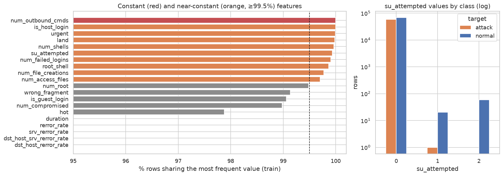

| Check | Result |
|---|---|
| Missing / infinite (incl. division-by-zero artefacts) | 0 / 0 in both files |
| Exact duplicate rows | 0 train, 0 test |
| Repeated feature vectors (train) | 16. **7 have conflicting labels**, which is irreducible error. |
| Feature vectors shared by train and test | 654 (routine traffic) |
| Rates outside [0, 1] / negative values | 0 / 0 |
| Constant | `num_outbound_cmds` |
| Near-constant (≥ 99.5% one value) | `is_host_login`, `urgent`, `land`, `num_shells`, `su_attempted`, `num_failed_logins`, `root_shell`, `num_file_creations`, `num_access_files` |
| `su_attempted = 2` | 59 train / 2 test rows. **All 59 are normal and all have `root_shell = 1`**, so it means "attempted". |

**Decisions:**
- Keep all 41 predictors. The constant `num_outbound_cmds` becomes an all-zero column after scaling and carries no weight.
- Leave `su_attempted` as recorded.
- **Keep** the near-constant content flags. They are the U2R/R2L evidence.
- Remove no rows.

### B.3 Target and class balance

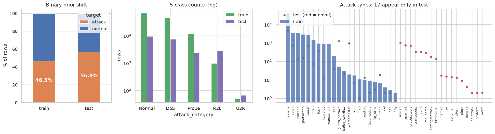

| Class | Train | Test |
|---|---|---|
| Normal | 67,343 | 9,710 |
| DoS | 45,927 | 7,458 |
| Probe | 11,656 | 2,421 |
| R2L | 995 | 2,887 |
| U2R | 52 | 67 |
| **Attack %** | **46.54** | **56.93** |

9 train attack types have fewer than 20 rows.

**Decisions:**
- The task is binary (`is_intrusion`). The 39 attack names merge into "attack", so no rare-class removal is needed.
- `class_weight` is fixed to `None` for every model (`config.yaml`), so no model gets a different class prior.
- **No SMOTE.** The binary ratio is about 50/50, and oversampling train families cannot create the novel test families.
- The test set keeps its original distribution.

### B.4 Feature distributions and outliers

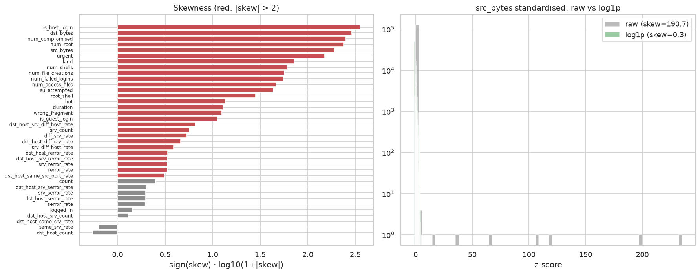
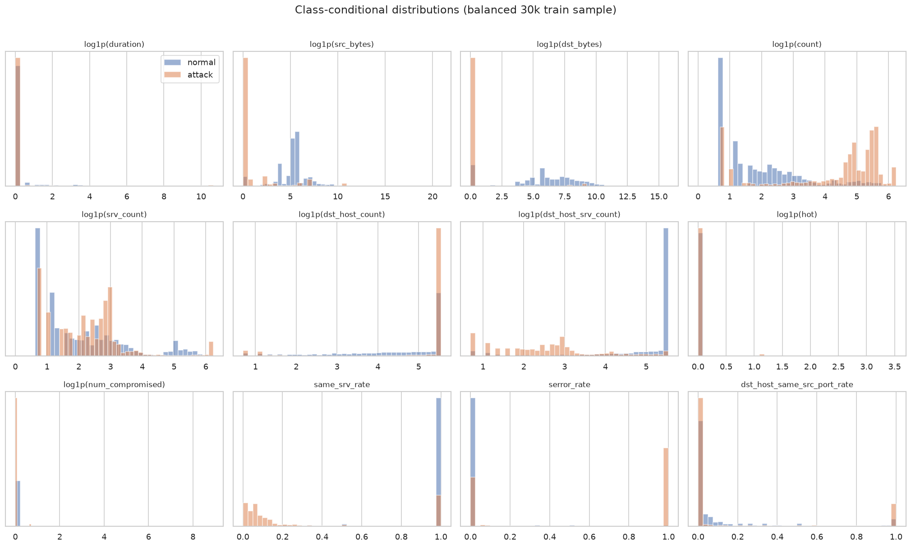
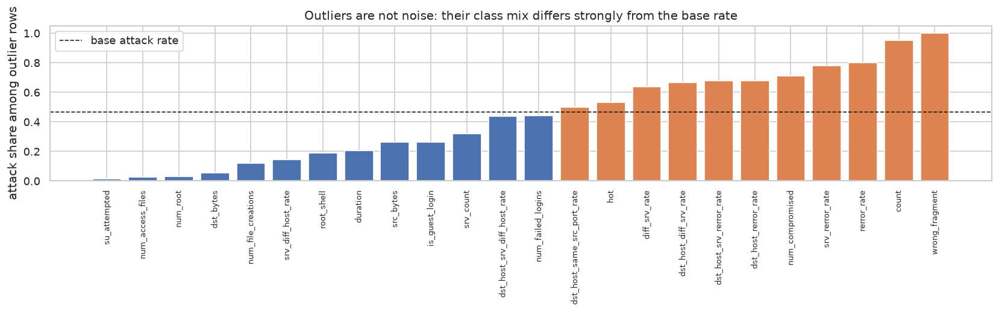
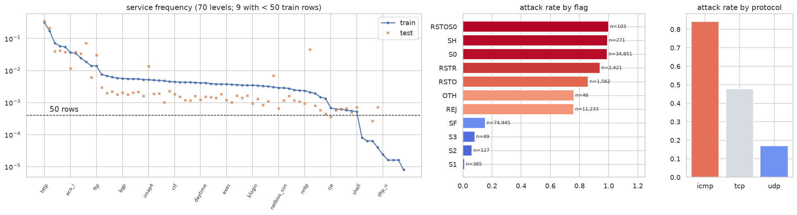

- Counts and bytes are zero-inflated and heavy-tailed. `log1p` cuts the skew of `src_bytes` from 191 to 0.31.
- In 11 of 24 features, IQR outliers are attack-enriched; in the others they are normal-enriched. They are **genuine behaviour**, so nothing is clipped or removed.
- `service` has 70 levels, 9 of them with fewer than 50 train rows. 7 services occur only in train. **Test has no unseen categories** in any categorical feature.
- `flag` S0, REJ and RSTR, and the `icmp` protocol, are strongly attack-associated.

**Decisions:**
- Every model gets the same input: `StandardScaler` on all 38 numeric features (no log transform).
- One-hot encoding of all categorical levels with `handle_unknown="ignore"` (84 indicator columns).

### B.5 Feature–target relationships and leakage

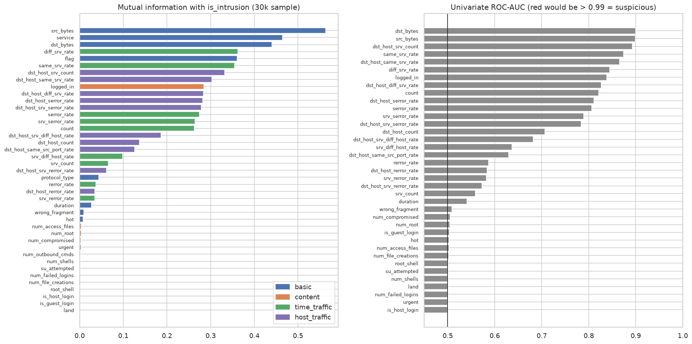
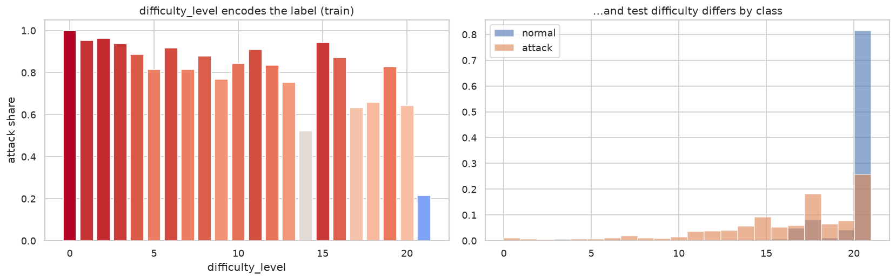

- Top MI: `src_bytes` 0.56, `service` 0.47, `dst_bytes` 0.44, `diff_srv_rate` 0.36, `flag` 0.36, `same_srv_rate` 0.36, `dst_host_srv_count` 0.33.
- Near-zero MI: `land`, `is_guest_login`, `is_host_login`, `root_shell`, `num_file_creations`, `num_failed_logins`, `su_attempted`. These are rare-attack flags.
- No suspiciously perfect feature: the maximum univariate AUC is 0.90 (`dst_bytes`).
- `difficulty_level` encodes the label, so it is excluded.

### B.6 Feature relationships and separability

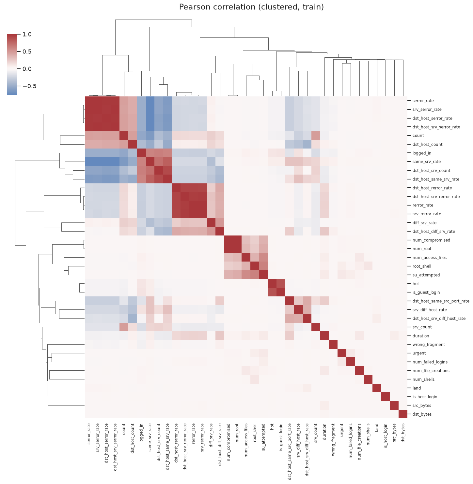
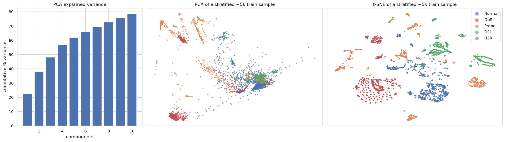

- Pairs with |r| ≥ 0.98 form a SYN-error cluster (`serror_rate`, `srv_serror_rate`, `dst_host_serror_rate`, `dst_host_srv_serror_rate`), plus `rerror_rate`/`srv_rerror_rate` and `num_compromised`/`num_root`.
- In t-SNE, DoS, Probe and most R2L points form distinct clusters. In linear PCA, R2L and U2R sit inside the Normal cloud, so separability is non-linear. 10 PCs keep about 78% of the variance.

**Decision:** Correlated features are kept, so every model sees the identical 122-feature input. PCA is not used for modelling.

### B.7 Distribution shift and splitting

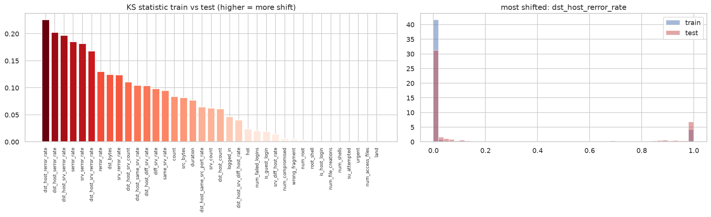

- The most shifted features (KS) are `dst_host_rerror_rate` 0.23, `dst_host_serror_rate` 0.20, `dst_host_srv_serror_rate` 0.20 and `serror_rate` 0.19.
- Mean KS is 0.072 on all rows but 0.044 on normal traffic only. **The shift is mainly the attack mix.**
- There is no temporal column, so temporal leakage cannot be assessed. The official split separates attack families, not time.

**Decision:**
- Keep the official split; evaluate each model on the test set once.
- Inside `KDDTrain+`, tune with leave-attack-types-out CV: each of 5 folds holds out a group of training attack types plus a random fifth of the normal rows, so tuning rewards detecting attack types the model has not seen.

### B.8 EDA summary and preprocessing decisions

The modelling pipeline is the shared 122-feature `ColumnTransformer` in [`src/preprocessing.py`](../src/preprocessing.py), built and saved in [`notebooks/02_preprocessing.ipynb`](../notebooks/02_preprocessing.ipynb).

| Stage | Train | Test |
|---|---|---|
| Rows before / after preprocessing | 125,973 / 125,973 | 22,543 / 22,543 |
| Features: predictors → encoded | 41 → 122 | 41 → 122 |
| Duplicates removed / infinities handled | 0 / 0 | 0 / 0 |
| Labels: attack names → categories → binary | 22 → 4 → 2 classes | 37 → 4 → 2 classes |

| # | Decision | Justification |
|---|---|---|
| 1 | Keep all 41 predictors (incl. constant `num_outbound_cmds`) | One identical input for every model; a constant column carries no weight |
| 2 | Keep near-constant flags and outliers | Rare-attack signal; outliers are not errors |
| 3 | Exclude `difficulty_level`, `label`, derived targets | Leakage |
| 4 | `StandardScaler` on 38 numeric features, all models | Same representation for linear and tree models |
| 5 | `OneHotEncoder(handle_unknown="ignore")`, all levels | No unseen test levels; 84 indicator columns |
| 6 | `class_weight=None` for every model; no SMOTE | Binary near-balanced; one class prior for all models |
| 7 | Leave-attack-types-out 5-fold CV inside KDDTrain+; test once per model and seed | Official split tests generalisation to novel attacks |
