# 📊 NSL-KDD Dataset Notes & EDA Inferences

**Associated Notebook:** [`notebooks/01_data_exploration.ipynb`](file:///home/dhruvv_w/Documents/instrusion_detection/notebooks/01_data_exploration.ipynb)  
**Detailed Technical Report:** [`docs/eda_report.md`](file:///home/dhruvv_w/Documents/instrusion_detection/docs/eda_report.md)  
**Dataset Reference:** Tavallaee et al. (2009), University of New Brunswick

---

## 1. Executive Dataset Overview
- **Dataset Origin:** Curated benchmark derived from KDD Cup 1999 to resolve massive record redundancy (~78% duplicate records in KDD'99 train set).
- **Split Breakdown:**
  - **Training Set (`KDDTrain+.csv`):** 125,973 rows, 43 columns (70.50 MB, 84.82%).
  - **Testing Set (`KDDTest+.csv`):** 22,543 rows, 43 columns (12.62 MB, 15.18%).
  - **Total Samples:** 148,516 rows (83.13 MB).
- **Data Completeness:** 0 missing, null, infinite, or negative values across both splits. No imputation required.
- **De-Duplication Audit:** Exactly 0 full 43-column duplicate rows exist. 654 feature vectors overlap between train and test (representing routine background network services).

---

## 2. Core EDA Takeaways & Preprocessing Directives

1. **Train/Test Class Inversion:** Train set is 53.46% Normal; Test set flips to **56.93% Intrusion**. Raw accuracy is uninformative; models must prioritize Macro F1-score, PR-AUC, and Recall.
2. **Extreme Minority Attack Classes:** In training, U2R is **0.041% (52 cases)** and R2L is **0.790% (995 cases)**. In testing, R2L surges **16x to 12.81% (2,887 cases)**.
3. **17 Novel Zero-Day Attacks:** 3,750 connection records in the test set (16.63% of test samples, 29.22% of test intrusions) are attack types never seen during training.
4. **Heavy-Tail Distributions:** `src_bytes` (skew = 190.7, max 1.38B) and `dst_bytes` (skew = 290.1, max 1.31B) require monotonic **`np.log1p()` transformation**.
5. **Drop Constant Column:** `num_outbound_cmds` has $0.00$ variance across all 148,516 rows and must be dropped.
6. **Exclude Target Leakage:** `difficulty_level` is a post-hoc consensus accuracy score from 21 models; it must be excluded from predictor matrices $X$.

---

## 3. Visualizations & Analytical Inferences

### Figure 01: Binary Class Distribution (Normal vs Intrusion)
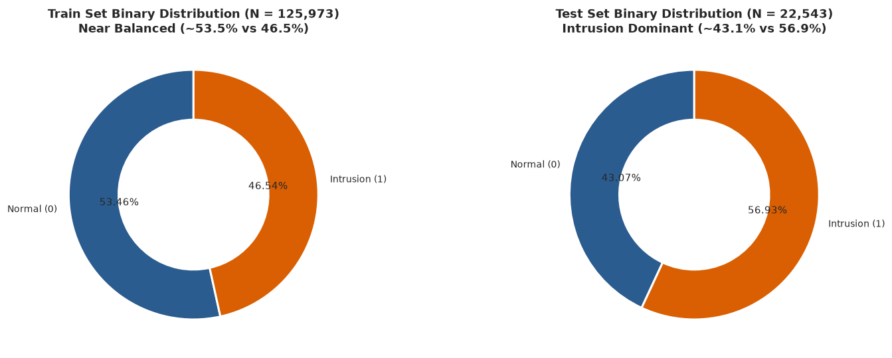

- **Train Set (N = 125,973):** Normal: 67,343 (53.46%) vs Intrusion: 58,630 (46.54%) — *Ratio: 1.15 : 1*
- **Test Set (N = 22,543):** Normal: 9,710 (43.07%) vs Intrusion: 12,833 (56.93%) — *Ratio: 1.32 : 1*
- **Inference:** A distribution inversion occurs between training and testing. Evaluating models solely by accuracy will yield false confidence; Precision, Recall, and PR-AUC must be tracked.

---

### Figure 02: 5-Class Attack Category Frequency
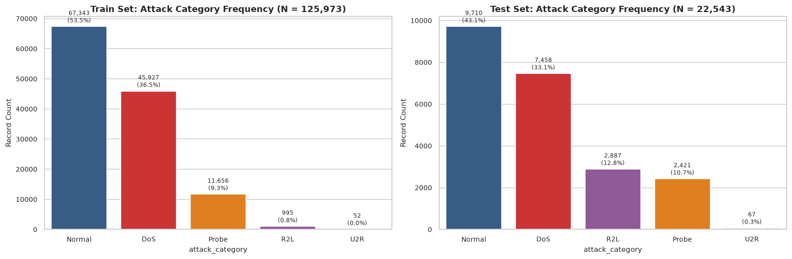

- **Training Distribution:** Normal (53.46%), DoS (36.46%), Probe (9.25%), R2L (0.79%), U2R (0.04%).
- **Testing Distribution:** Normal (43.07%), DoS (33.08%), Probe (10.74%), R2L (12.81%), U2R (0.30%).
- **Inference:** Severe minority class starvation in training: U2R (52 cases) and R2L (995 cases) represent $< 1\%$ combined. In testing, R2L experiences a 16-fold surge. Multi-class classifiers must incorporate `class_weight='balanced'` or SMOTE oversampling.

---

### Figure 03: Individual Attack Signatures Breakdown
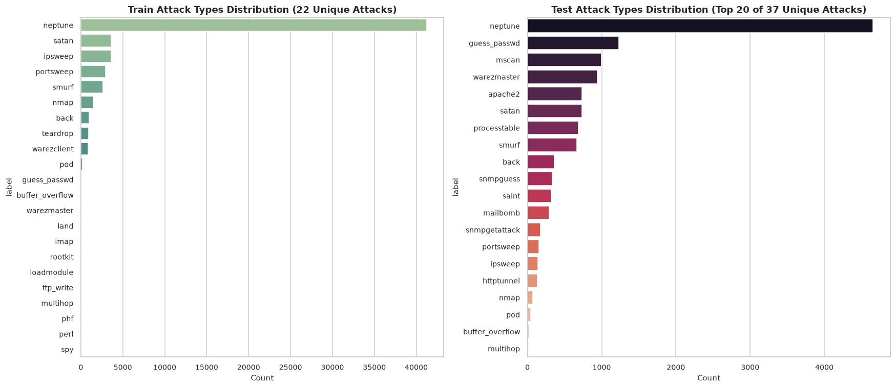

- **Train Set (22 Unique Attacks):** Heavily dominated by `neptune` (41,214), `satan` (3,633), `ipsweep` (3,599), `portsweep` (2,931), and `smurf` (2,646). These 5 account for 92.14% of all training intrusions.
- **Test Set (37 Unique Attacks):** Features prominent novel zero-day attacks including `mscan` (996), `apache2` (737), `processtable` (685), and `snmpguess` (331).

---

### Figure 04: Continuous Feature Distributions & Heavy-Tail Skewness
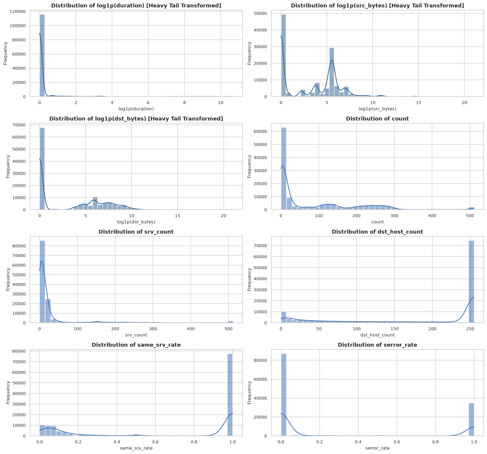

- **Parametric Extreme Values:**
  - `src_bytes`: Max = 1,379,963,888 | Mean = 45,566.74 | Max/Mean Ratio = 30,285x | Skewness = +190.67
  - `dst_bytes`: Max = 1,309,937,401 | Mean = 19,779.11 | Max/Mean Ratio = 66,228x | Skewness = +290.05
  - `duration`: Max = 42,908 sec | Mean = 287.14 sec | Skewness = +11.88
- **Inference:** Standard Z-score scaling fails because variance is distorted by extreme values. Applying `np.log1p()` compresses power-law tails into well-behaved multimodal continuous distributions.

---

### Figure 05: Categorical Feature Distributions
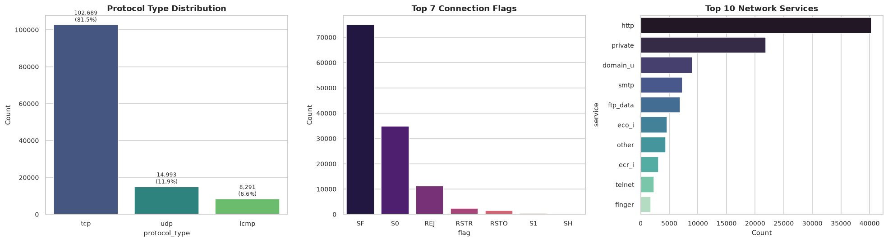

- **`protocol_type`:** TCP (81.52% / 102,689), UDP (11.90% / 14,993), ICMP (6.58% / 8,291).
- **`flag`:** Normal established `SF` (59.49% / 74,945), SYN flood `S0` (27.67% / 34,851), connection rejected `REJ` (8.92% / 11,233).
- **`service`:** 70 unique services in train, 63 in test. Top services are `http` (40,338), `private` (21,853), and `domain_u` (9,023).
- **Inference:** Unseen services in the test set require `OneHotEncoder(handle_unknown='ignore')` to ensure robust pipeline execution.

---

### Figure 06: Empirical Attack Rates Conditioned on Feature States
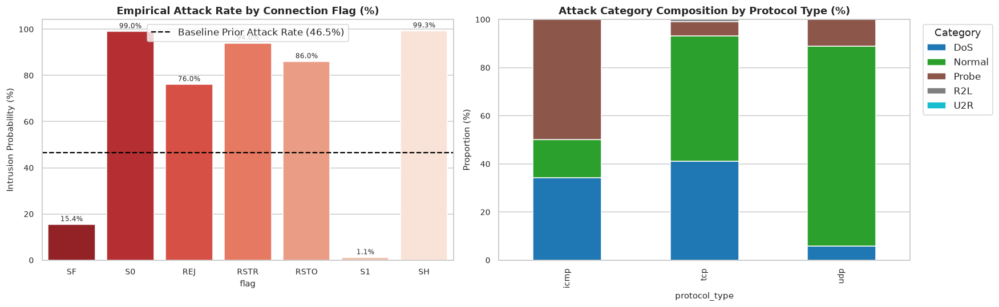

- **Protocol Attack Rates:** ICMP = **84.21%** (almost exclusively DoS/Smurf or Probe/Echo), TCP = 47.80%, UDP = 17.07%.
- **Connection Flag Attack Rates:**
  - `SH` (SYN half-open): **99.26%** attack rate
  - `S0` (SYN flood): **98.98%** attack rate (34,497 attacks out of 34,851 connections)
  - `RSTR` (Reset receiver): **93.97%** attack rate
  - `REJ` (Rejected): **76.03%** attack rate
  - `SF` (Normal completion): Only **15.41%** attack rate
- **Deterministic Services:** 35 legacy services (`uucp`, `bgp`, `whois`, `ldap`, `courier`) exhibit a **100.00% attack rate**. Any connection attempt to these ports is confirmed malicious.

---

### Figure 07: Discriminative Power Ranking (Mutual Information & ANOVA)
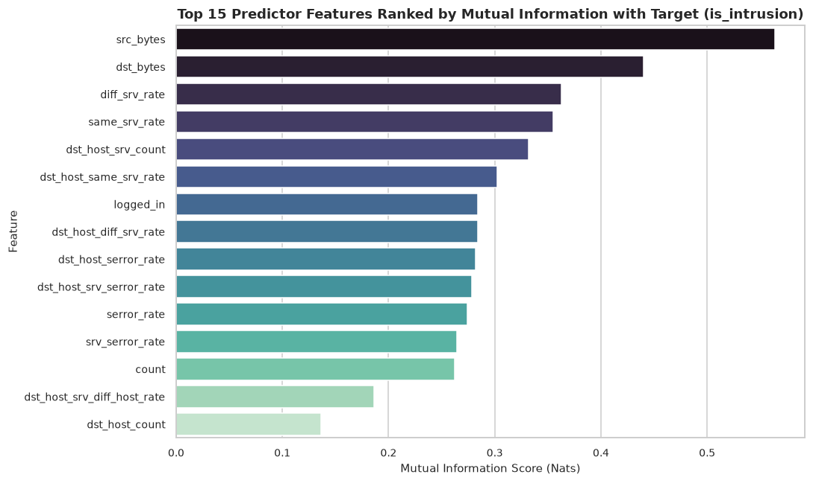

- **Top 5 Features by Mutual Information:**
  1. `src_bytes` (MI = 0.5637)
  2. `dst_bytes` (MI = 0.4399)
  3. `diff_srv_rate` (MI = 0.3626)
  4. `same_srv_rate` (MI = 0.3548)
  5. `dst_host_srv_count` (MI = 0.3321)
- **Top Features by ANOVA F-Score:** `same_srv_rate` (F = 38,725), `dst_host_srv_count` (F = 32,750), `logged_in` (F = 27,297).
- **Inference:** Network host-traffic rates and byte volumes provide the highest information gain for separating benign traffic from intrusions.

---

### Figure 08: Pearson Correlation Heatmap & Multicollinearity
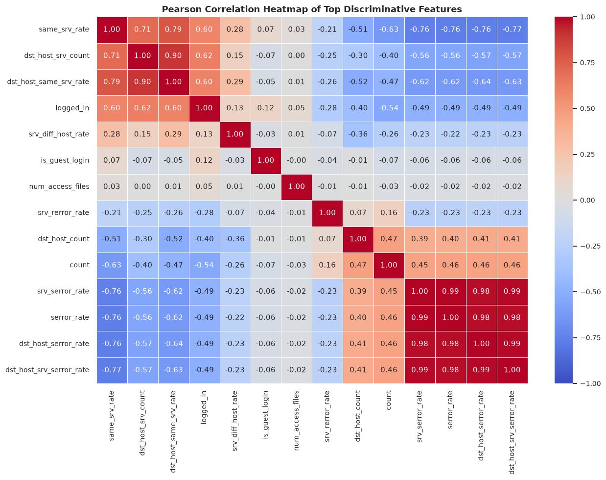

- **Strongest Negative Correlation with Intrusion:** `same_srv_rate` ($r = -0.75$), `dst_host_srv_count` ($r = -0.72$), `logged_in` ($r = -0.69$).
- **Strongest Positive Correlation with Intrusion:** `dst_host_srv_serror_rate` ($r = +0.66$), `serror_rate` ($r = +0.65$), `count` ($r = +0.58$).
- **Collinear Pairs ($\|r\| > 0.98$):**
  - `num_compromised` & `num_root` ($r = +0.9988$)
  - `serror_rate` & `srv_serror_rate` ($r = +0.9933$)
  - `rerror_rate` & `srv_rerror_rate` ($r = +0.9890$)
  - `srv_serror_rate` & `dst_host_srv_serror_rate` ($r = +0.9863$)
- **Inference:** Severe multicollinearity degrades unregularized linear models. Regularization (L1/L2) is mandatory for Logistic Regression in Notebook 04.

---

### Figure 09: Boxplots of Continuous Features by Binary Target
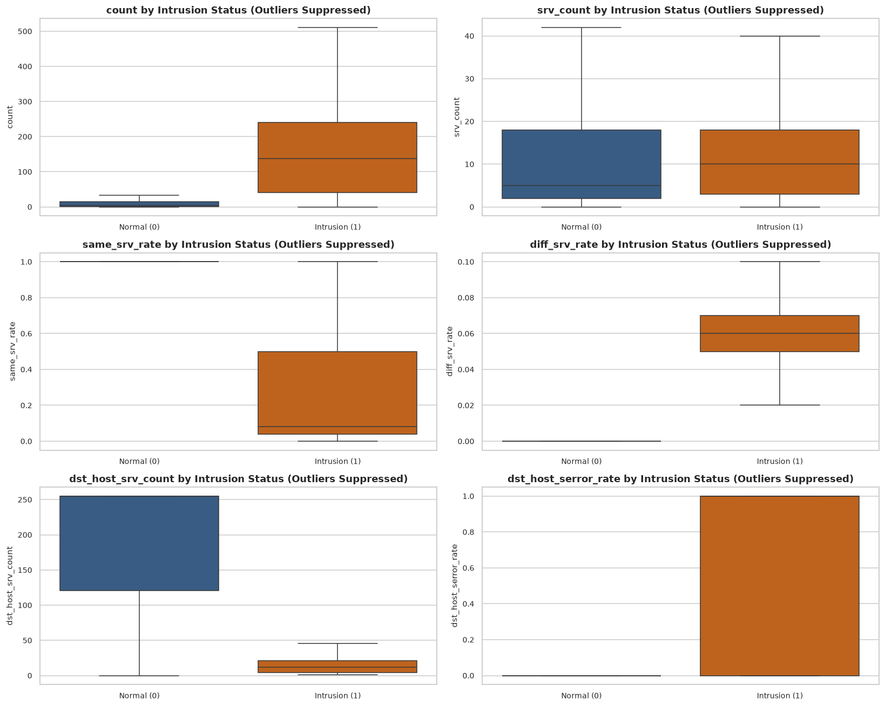

- **`count`:** Normal traffic median $\approx 2$; Intrusion traffic exhibits high connection spikes (median $> 100$).
- **`same_srv_rate`:** Normal traffic concentrates at 1.0; Intrusion traffic drops toward 0.0.
- **`dst_host_srv_count`:** Normal traffic reaches high saturation (255); Intrusion traffic is heavily suppressed (0 to 20).
- **`dst_host_serror_rate`:** Normal connections are 0.00; Intrusion traffic clusters at 1.00.

---

### Figure 10: Boxplots Across 5 Attack Categories
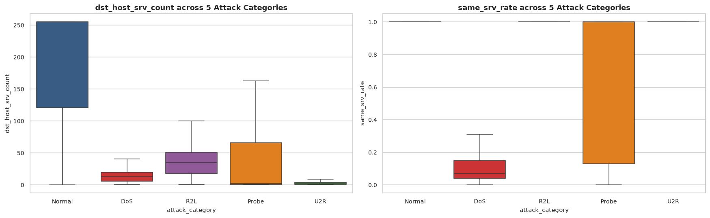

- **DoS & Probe:** Characterized by near-zero `dst_host_srv_count` and depressed `same_srv_rate`.
- **The Stealth Attack Dilemma (R2L and U2R):**
  - R2L and U2R exhibit `dst_host_srv_count` and `same_srv_rate` distributions that closely match Normal traffic.
  - Rate-based network metrics cannot isolate stealth attacks. They must be identified using **application-layer content features** (`logged_in`, `num_failed_logins`, `num_compromised`).

---

### Figure 11: Target Leakage in Difficulty Level
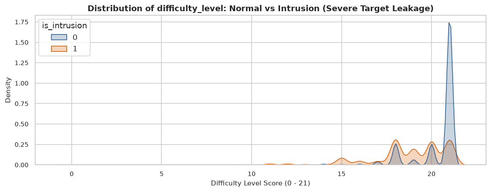

- **Difficulty Score Distributions:**
  - Normal traffic: Mean = 20.32 (Train) and 19.96 (Test), median = 21.0.
  - Intrusion traffic: Mean = 18.57 (Train) and 16.55 (Test), spanning all tiers (0 to 21).
- **Inference:** `difficulty_level` is a post-hoc evaluation metric (consensus across 21 ML models), not a real-time network packet property. Including it causes **severe target leakage**. It must be excluded from feature set $X$.

---

## 4. End-to-End Pipeline Execution Roadmap

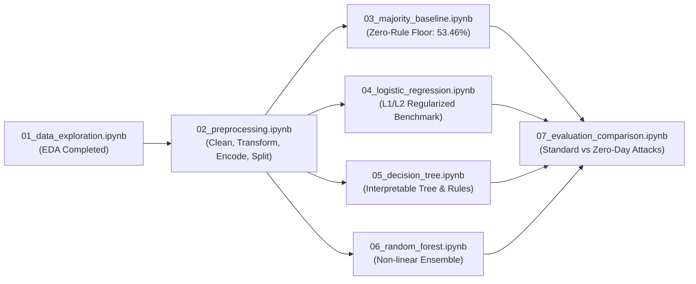
