# 🛡️ NSL-KDD Network Intrusion Detection: Comprehensive EDA Report & Inferences

> **Superseded:** the revamped EDA findings and preprocessing decisions are in [`docs/dataset_notes.md`](dataset_notes.md) (Part B). This report documents the earlier EDA and is kept for history.

**Document Version:** 1.0.0  
**Dataset Reference:** NSL-KDD Benchmark Dataset (Tavallaee et al., 2009)  
**Associated Notebook:** [`notebooks/01_data_exploration.ipynb`](file:///home/dhruvv_w/Documents/instrusion_detection/notebooks/01_data_exploration.ipynb)  
**Primary Focus:** Empirical Exploratory Data Analysis, Security Domain Inferences, Structural Quality Audits, and Modeling Implications.

---

## Table of Contents
1. [Executive Summary & Historical Background](#1-executive-summary--historical-background)
2. [Dataset Architecture & Dimensional Footprint](#2-dataset-architecture--dimensional-footprint)
3. [Feature Taxonomy & Network Domain Categorization](#3-feature-taxonomy--network-domain-categorization)
4. [Data Quality, Integrity & Missing Values Audit](#4-data-quality-integrity--missing-values-audit)
5. [Duplicate Analysis & Train-Test Overlap](#5-duplicate-analysis--train-test-overlap)
6. [Class Balance & Train-Test Class Inversion](#6-class-balance--train-test-class-inversion)
7. [Five-Class Attack Taxonomy & Minority Imbalance](#7-five-class-attack-taxonomy--minority-imbalance)
8. [Granular Attack Signatures & Test Distribution Shift](#8-granular-attack-signatures--test-distribution-shift)
9. [Novel Zero-Day Attacks in the Test Set](#9-novel-zero-day-attacks-in-the-test-set)
10. [Continuous Feature Distributions & Heavy-Tail Skewness](#10-continuous-feature-distributions--heavy-tail-skewness)
11. [Categorical Predictors & Protocol Telemetry](#11-categorical-predictors--protocol-telemetry)
12. [Feature vs Intrusion Conditional Probabilities](#12-feature-vs-intrusion-conditional-probabilities)
13. [Discriminative Feature Ranking (Mutual Information & ANOVA)](#13-discriminative-feature-ranking-mutual-information--anova)
14. [Variance Analysis & Constant Feature Identification](#14-variance-analysis--constant-feature-identification)
15. [Multicollinearity & Correlation Analysis](#15-multicollinearity--correlation-analysis)
16. [Visual Feature Separation Across Classes](#16-visual-feature-separation-across-classes)
17. [Extreme Values & Domain Interpretation of Outliers](#17-extreme-values--domain-interpretation-of-outliers)
18. [Data Leakage Audit & Difficulty Score Analysis](#18-data-leakage-audit--difficulty-score-analysis)
19. [Synthesis: Actionable Preprocessing & Modeling Roadmap](#19-synthesis-actionable-preprocessing--modeling-roadmap)

---

## 1. Executive Summary & Historical Background

The **NSL-KDD** dataset is a benchmark dataset for network-based intrusion detection systems (NIDS) and cybersecurity machine learning models. Developed by Tavallaee et al. (2009) at the University of New Brunswick, it directly addresses critical structural shortcomings in the legacy **KDD Cup 1999** dataset:

- **Elimination of Massive Redundancies:** In KDD'99, ~78% of training samples and ~75% of testing samples were exact duplicates. This heavily biased models toward high-frequency, trivial attacks (e.g., `smurf` ICMP floods and `neptune` SYN floods) while masking near-total classification failure on stealthy, low-volume attacks (`U2R` and `R2L`).
- **Carefully Calibrated Difficulty Levels:** NSL-KDD selected subsets of KDD'99 records across diverse difficulty strata, preventing artificial performance inflation.
- **Realistic Train/Test Partitioning:** Rather than a random shuffle, NSL-KDD supplies predefined training (`KDDTrain+.csv`) and testing (`KDDTest+.csv`) sets designed to test generalization, class shift, and zero-day attack identification.

### High-Level EDA Findings
| Metric / Quality Dimension | Empirical Observation | Modeling / Pipeline Implication |
| :--- | :--- | :--- |
| **Total Dataset Size** | 148,516 connections (125,973 Train / 22,543 Test) | Manageable memory footprint (~83.13 MB); suitable for rapid experimentation. |
| **Data Completeness** | 0 null, NaN, infinite, or negative values | No imputation algorithms (`SimpleImputer`, `KNNImputer`) needed. |
| **Identical Row Duplicates** | Exactly 0 full 43-column duplicate rows | Verifies successful resolution of the KDD'99 redundancy defect. |
| **Binary Class Split** | Train: 53.5% Normal / 46.5% Intrusion; Test: 43.1% Normal / 56.9% Intrusion | **Class Inversion:** Test set is intrusion-dominant; accuracy is an uninformative metric. |
| **Extreme Minority Classes** | U2R is 0.041% (52 rows) and R2L is 0.790% (995 rows) in Train | Requires `class_weight='balanced'`, SMOTE, or focal loss for multi-class tasks. |
| **Novel Zero-Day Attacks** | 17 unseen attack signatures (3,750 samples; 16.63% of Test) | Test set evaluates generalization to zero-day threats; must evaluate Novel Attack Recall. |
| **Heavy-Tailed Skewness** | `dst_bytes` (skew = 290.1), `src_bytes` (skew = 190.7), `duration` (skew = 11.9) | Standard Z-score scaling is invalid; requires `log1p` transformation or `RobustScaler`. |
| **Multicollinearity** | Multiple feature pairs have $\|r\| > 0.98$ (e.g., `serror_rate` & `srv_serror_rate`) | Linear models require L1/L2 regularization; tree ensembles are natively resilient. |
| **Constant Feature** | `num_outbound_cmds` has 0.00 variance across all 148,516 records | Drop `num_outbound_cmds` during preprocessing to avoid singular matrices. |
| **Target Leakage** | `difficulty_level` reflects 21-model post-hoc consensus accuracy | **MUST BE EXCLUDED** from input feature matrix $X$; reserve exclusively for stratified test analysis. |

---

## 2. Dataset Architecture & Dimensional Footprint

The NSL-KDD benchmark consists of two canonical files loaded via [`src/data_loader.py`](file:///home/dhruvv_w/Documents/instrusion_detection/src/data_loader.py):

| Dataset Partition | Filename | Row Count | Raw Columns | Derived Columns | Total Columns | Memory Footprint | Split Ratio |
| :--- | :--- | :--- | :--- | :--- | :--- | :--- | :--- |
| **Training Set** | `KDDTrain+.csv` | 125,973 | 43 | 2 | 45 | 70.50 MB | 84.82% |
| **Testing Set** | `KDDTest+.csv` | 22,543 | 43 | 2 | 45 | 12.62 MB | 15.18% |
| **Combined** | — | **148,516** | 43 | 2 | 45 | **83.13 MB** | 100.00% |

### Data Type Profile
- **`int64` (25 columns):** Packet and byte counters, discrete rates, flags, and binary indicators.
- **`float64` (15 columns):** Connection error rates, service percentages, and host traffic ratios (values bounded in $[0.0, 1.0]$).
- **`object` / `string` (5 columns):** 
  - Predictors: `protocol_type` (3 unique), `service` (70 unique), `flag` (11 unique).
  - Target / Labels: `label` (granular attack string) and `attack_category` (5-class taxonomy).

---

## 3. Feature Taxonomy & Network Domain Categorization

According to MIT Lincoln Laboratory and DARPA technical specifications, the 41 raw predictor features are grouped into four functional network telemetry categories:

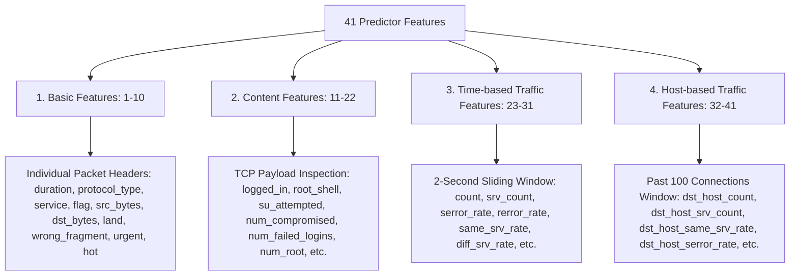

1. **Basic Header Features (1–10):** Extracted purely from IP/TCP packet headers without deep packet inspection. Highly effective for identifying basic volumetric floods, unusual protocols, or packet fragmentation errors.
2. **Content Features (11–22):** Extracted by inspecting TCP segment payloads (application layer). These track privilege escalation attempts, execution of administrative commands, and failed logins. Essential for detecting stealthy **R2L** and **U2R** attacks.
3. **Time-Based Traffic Features (23–31):** Computed using a **2-second temporal sliding window**. They count how many connections were initiated to the same destination host (`count`) or same service (`srv_count`), and calculate SYN/REJ error rates. Highly sensitive to fast volumetric DoS attacks and rapid port scanning.
4. **Host-Based Traffic Features (32–41):** Computed over a **window of the past 100 connections** to the same destination host, irrespective of time elapsed. Designed to expose slow, distributed, and stealthy recon attacks spread out over hours.

---

## 4. Data Quality, Integrity & Missing Values Audit

A comprehensive audit was executed across all 148,516 rows and 43 columns:

| Quality Dimension | Test Applied | Train Results | Test Results | Status |
| :--- | :--- | :--- | :--- | :--- |
| **Null / NaN Check** | `df.isnull().sum()` | 0 | 0 | PASSED |
| **Infinite Values** | `np.isinf(numeric_df).sum()` | 0 | 0 | PASSED |
| **Negative Values** | Non-negative audit on counters/rates | 0 | 0 | PASSED |
| **Placeholder Strings** | Search for `'?'`, `'NA'`, `'None'`, whitespace | 0 | 0 | PASSED |

### Engineering Inference
The dataset is structurally clean and free of corrupt values. There is **no need for numerical or categorical imputation pipelines** (e.g. `SimpleImputer`, `IterativeImputer`), saving runtime and eliminating potential imputation distortion.

---

## 5. Duplicate Analysis & Train-Test Overlap

| Duplicate Metric | Scope | Count | Percentage |
| :--- | :--- | :--- | :--- |
| **Exact 43-Column Full Duplicates** | Training Set | 0 | 0.000% |
| **Exact 43-Column Full Duplicates** | Test Set | 0 | 0.000% |
| **Feature-Only Duplicates** ($X$ identical, $y$ may differ) | Training Set | 16 | 0.013% |
| **Feature-Only Duplicates** ($X$ identical, $y$ may differ) | Test Set | 57 | 0.253% |
| **Cross-Dataset Overlap** ($X_{train} \cap X_{test}$) | Cross-Split | 654 | 2.90% of Test |

### Security Inferences
1. **Validation of NSL-KDD Filtering:** The zero full-duplicate count confirms that Tavallaee et al.'s de-duplication was executed correctly, overcoming KDD'99's 75%+ redundancy flaw.
2. **Train-Test Feature Overlap (654 samples):** Exactly 654 connection vectors in the test set have identical feature attributes to training connections. This represents routine background services (e.g., standard HTTP GET requests or DNS queries with identical packet parameters). Classifiers must not overfit to these overlapping vectors.

---

## 6. Class Balance & Train-Test Class Inversion

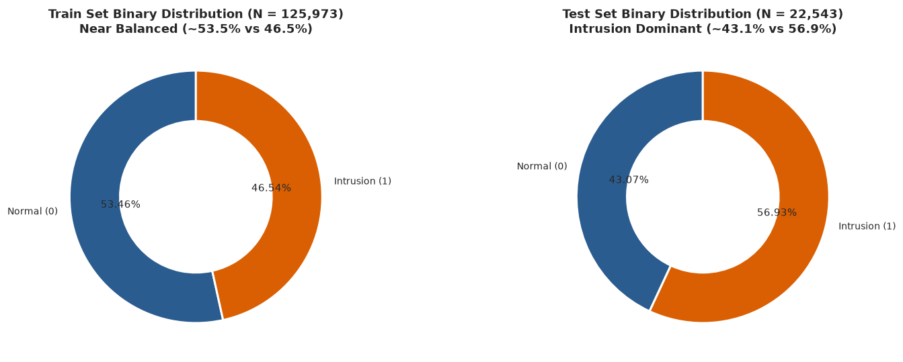

```
Binary Target Distribution:
  Train Set (N = 125,973):
    - Normal (0)    : 67,343  (53.46%)
    - Intrusion (1) : 58,630  (46.54%)
    - Normal-to-Intrusion Ratio: 1.15 : 1

  Test Set (N = 22,543):
    - Normal (0)    :  9,710  (43.07%)
    - Intrusion (1) : 12,833  (56.93%)
    - Intrusion-to-Normal Ratio: 1.32 : 1
```

### Critical Domain Inferences
1. **Train Set Balance:** In `KDDTrain+`, the binary classes are near-parity (53.5% vs 46.5%). A simple baseline classifier that always predicts the majority class (`Normal`) achieves **53.46% accuracy**, establishing a clear performance floor.
2. **Train-to-Test Class Inversion:** The test set undergoes a structural distribution flip: intrusions become the majority class (56.93%), while normal traffic drops to 43.07%.
3. **Evaluation Metric Takeaway:** Because class proportions invert between train and test, **raw classification accuracy is misleading**. Evaluation must rely on:
   - **Precision & Recall**
   - **Macro-Averaged F1-Score**
   - **Area Under the Precision-Recall Curve (PR-AUC)**
   - **Confusion Matrix Cost Analysis** (False Negatives are far more dangerous than False Positives).

---

## 7. Five-Class Attack Taxonomy & Minority Imbalance

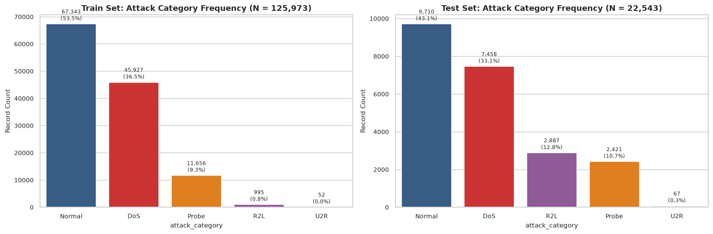

Every connection in NSL-KDD maps into one of 5 canonical categories:
- **Normal:** Legitimate user and system traffic.
- **Denial of Service (DoS):** Volumetric or algorithmic attempts to disrupt services (e.g., SYN floods, broadcast storms).
- **Surveillance / Probe:** Reconnaissance activities to map networks and identify vulnerable listening ports.
- **Remote to Local (R2L):** Unauthorized external attackers attempting to gain local account access.
- **User to Root (U2R):** Non-privileged local users attempting to escalate privileges to administrative/root level.

### Detailed Distribution Breakdown
| Category | Train Count | Train % | Test Count | Test % | Relative Test Shift | Primary Threat Vector |
| :--- | :--- | :--- | :--- | :--- | :--- | :--- |
| **Normal** | 67,343 | 53.46% | 9,710 | 43.07% | -10.39% | Benign operational traffic |
| **DoS** | 45,927 | 36.46% | 7,458 | 33.08% | -3.38% | Volumetric service denial |
| **Probe** | 11,656 | 9.25% | 2,421 | 10.74% | +1.49% | Network port scanning & reconnaissance |
| **R2L** | 995 | **0.79%** | 2,887 | **12.81%** | **+12.02% (16x surge)** | Password guessing, buffer exploits |
| **U2R** | 52 | **0.04%** | 67 | **0.30%** | **+0.26% (7.5x surge)** | Local root privilege escalation |
| **Total** | 125,973 | 100.00% | 22,543 | 100.00% | — | — |

### Key Inferences & Modeling Warnings
1. **Severe Minority Starvation in Training:**
   - `U2R` accounts for only **52 records (0.041%)** in the entire training set.
   - `R2L` accounts for only **995 records (0.790%)**.
   - Combined, `Normal` and `DoS` comprise **89.92%** of all training examples.
2. **Massive Test Surge in R2L:** In the test set, `R2L` surges from under 1% to **12.81%** of all traffic. A model that fails to detect R2L will see its overall test F1-score drop significantly.
3. **Remediation for Notebooks 04–06:**
   - Multi-class models must use loss reweighting (`class_weight='balanced'`).
   - Stratified K-Fold cross-validation is mandatory to prevent folds with zero U2R instances.
   - Evaluation must assess per-category recall rather than aggregate micro-accuracy.

---

## 8. Granular Attack Signatures & Test Distribution Shift

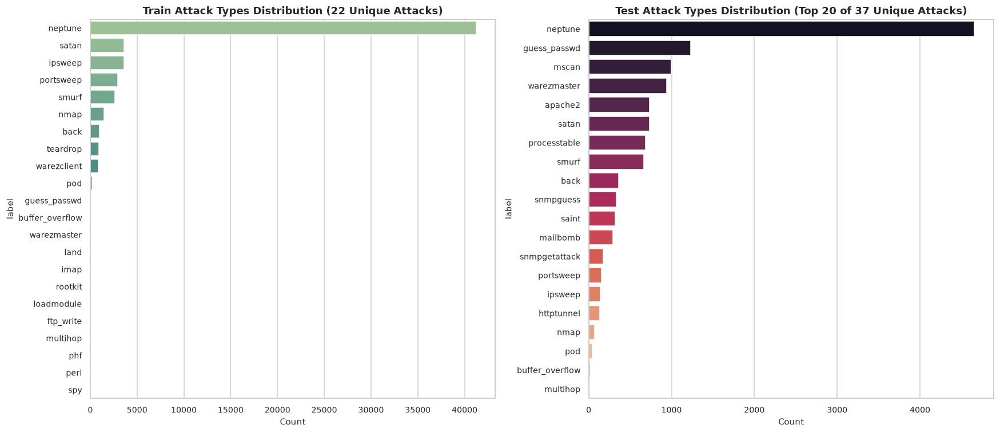

### Granular Attack Profile
- **Training Set (22 Attack Types):**
  - Dominated by 5 large attack signatures: `neptune` (41,214), `satan` (3,633), `ipsweep` (3,599), `portsweep` (2,931), and `smurf` (2,646).
  - Together, these top 5 attack signatures constitute **92.14% of all training intrusions**.
  - A long tail of 17 attack types accounts for the remaining 7.86% (including `phf`, `spy`, `loadmodule`, and `perl`, which have fewer than 10 occurrences each).
- **Testing Set (37 Attack Types):**
  - Contains **17 completely new attack signatures** not present anywhere in the training data.
  - Notice the test set prominence of novel signatures: `mscan` ranks as the 2nd most frequent test attack (996 instances), `apache2` is 4th (737 instances), and `processtable` is 5th (685 instances).

---

## 9. Novel Zero-Day Attacks in the Test Set

The defining capability of an intrusion detection system is detecting previously unseen attacks. NSL-KDD explicitly evaluates this by embedding 17 novel attack signatures in `KDDTest+.csv`:

| Rank | Novel Attack Signature | Canonical Category | Test Instances | % of Test Intrusions | % of Total Test Set | Attack Mechanism |
| :---: | :--- | :--- | :--- | :--- | :--- | :--- |
| 1 | `mscan` | **Probe** | 996 | 7.76% | 4.42% | Multi-protocol port scanner targeting known web vulnerabilities |
| 2 | `apache2` | **DoS** | 737 | 5.74% | 3.27% | HTTP server resource exhaustion via memory consumption |
| 3 | `processtable` | **DoS** | 685 | 5.34% | 3.04% | Exhausts process table via multiple persistent connections |
| 4 | `snmpguess` | **R2L** | 331 | 2.58% | 1.47% | Brute-force guessing of SNMP community strings |
| 5 | `saint` | **Probe** | 319 | 2.49% | 1.42% | Automated network security assessment tool scanning ports |
| 6 | `mailbomb` | **DoS** | 293 | 2.28% | 1.30% | Floods email queue with thousands of large emails |
| 7 | `snmpgetattack` | **R2L** | 178 | 1.39% | 0.79% | Leverages stolen SNMP string to extract host configurations |
| 8 | `httptunnel` | **R2L** | 133 | 1.04% | 0.59% | Tunnels arbitrary data/commands through port 80 HTTP |
| 9 | `named` | **R2L** | 17 | 0.13% | 0.08% | DNS server buffer overflow exploit to acquire shell |
| 10 | `ps` | **U2R** | 15 | 0.12% | 0.07% | Exploits race condition in Solaris `ps` utility for root |
| 11 | `sendmail` | **R2L** | 14 | 0.11% | 0.06% | Buffer overflow in sendmail daemon yielding local access |
| 12 | `xterm` | **U2R** | 13 | 0.10% | 0.06% | Exploits buffer overflow in terminal emulator |
| 13 | `xlock` | **R2L** | 9 | 0.07% | 0.04% | Screen locker authentication bypass exploit |
| 14 | `xsnoop` | **R2L** | 4 | 0.03% | 0.02% | Keystroke logger snooping on X11 display server |
| 15 | `sqlattack` | **U2R** | 2 | 0.02% | 0.01% | SQL query injection leading to root execution |
| 16 | `udpstorm` | **DoS** | 2 | 0.02% | 0.01% | UDP broadcast echo loop storm generating massive traffic |
| 17 | `worm` | **R2L** | 2 | 0.02% | 0.01% | Self-replicating network worm |
| **Total** | **17 Types** | — | **3,750** | **29.22%** | **16.63%** | **Nearly 1 in every 6 test connections is zero-day!** |

### Category Breakdown of Novel Attacks
```
Novel Attacks by Category:
  - DoS   : 1,717 records (45.79%)
  - Probe : 1,315 records (35.07%)
  - R2L   :   688 records (18.35%)
  - U2R   :    30 records ( 0.80%)
```

### Strategic Implications for Pipeline Design
- **Signature vs Anomaly Detection:** Classifiers that overfit to specific attack labels will fail to detect these 3,750 connections.
- **Dedicated Metric in Notebook 07:** The evaluation framework must report **Zero-Day Attack Recall**:
  $$\text{Recall}_{\text{novel}} = \frac{\text{Correctly Detected Novel Intrusions}}{\text{Total 3,750 Novel Intrusions}}$$

---

## 10. Continuous Feature Distributions & Heavy-Tail Skewness

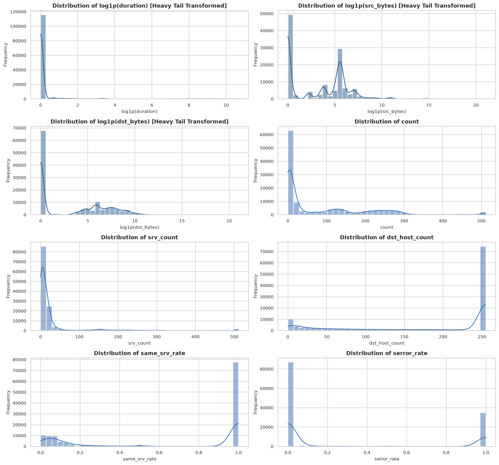

Parametric summary statistics highlight severe positive skewness and extreme value dispersion across continuous features:

| Feature Name | Mean | Std Dev | Median | IQR | Maximum | Skewness | Kurtosis |
| :--- | :--- | :--- | :--- | :--- | :--- | :--- | :--- |
| `is_host_login` | 0.000008 | 0.0028 | 0.0 | 0.0 | 1.0 | **+354.93** | 125,973.0 |
| `dst_bytes` | 19,779.11 | 4,021,269.15 | 0.0 | 516.0 | 1,309,937,401.0 | **+290.05** | 90,941.7 |
| `num_compromised` | 0.28 | 23.94 | 0.0 | 0.0 | 7,479.0 | **+250.11** | 75,956.2 |
| `num_root` | 0.30 | 24.40 | 0.0 | 0.0 | 7,468.0 | **+236.91** | 70,070.2 |
| `src_bytes` | 45,566.74 | 5,870,331.18 | 44.0 | 276.0 | 1,379,963,888.0 | **+190.67** | 39,354.1 |
| `urgent` | 0.0001 | 0.0144 | 0.0 | 0.0 | 3.0 | **+149.91** | 24,967.3 |
| `duration` | 287.14 | 2,604.52 | 0.0 | 0.0 | 42,908.0 | **+11.88** | 156.1 |
| `count` | 84.11 | 114.51 | 14.0 | 141.0 | 511.0 | **+1.51** | 0.9 |
| `dst_host_srv_count` | 115.65 | 110.70 | 63.0 | 245.0 | 255.0 | **+0.28** | -1.7 |

### Engineering Inferences
1. **Extreme Divergence Between Mean and Median:**
   - In `src_bytes`, the median is 44 bytes, while the mean is 45,567 bytes, driven by a maximum of **1.38 billion bytes**.
   - In `dst_bytes`, the median is 0 bytes, while the maximum reaches **1.31 billion bytes**.
2. **Invalidity of Standard Scaling:**
   - Applying `StandardScaler()` ($\frac{x - \mu}{\sigma}$) directly to `src_bytes` or `dst_bytes` compresses 99.9% of normal traffic into values near zero (e.g., $-0.007$), while extreme outliers produce values $> 200.0$. This destabilizes gradient updates in logistic regression and neural nets.
3. **Mandatory Transformation:**
   - Skewed volume features (`src_bytes`, `dst_bytes`, `duration`) must undergo a monotonic logarithmic transformation:
     $$x_{\text{transformed}} = \log(1 + x) = \text{log1p}(x)$$
   - Figure 4 demonstrates that after applying `log1p`, the distributions transform from degenerate spikes into well-behaved, multimodal continuous distributions.

---

## 11. Categorical Predictors & Protocol Telemetry

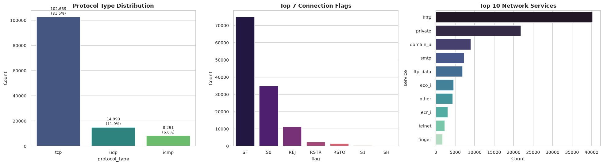

The NSL-KDD feature set contains three categorical predictors:
- `protocol_type` (3 levels)
- `flag` (11 levels)
- `service` (70 levels in train, 63 in test)

### 1. Protocol Distribution
- **TCP (81.52% / 102,689 rows):** Backbone protocol for web, mail, SSH, and file transfer.
- **UDP (11.90% / 14,993 rows):** Primarily DNS resolution (`domain_u`) and streaming services.
- **ICMP (6.58% / 8,291 rows):** Used for ping, error messaging, and echo replies; heavily targeted by broadcast DoS (`smurf`) and scanning.

### 2. Connection Flag Telemetry
- **`SF` (59.49% / 74,945 rows):** Normal TCP connection establishment and graceful close (`SYN` $\rightarrow$ `SYN-ACK` $\rightarrow$ `ACK` $\rightarrow$ `FIN`).
- **`S0` (27.67% / 34,851 rows):** SYN packet sent, but zero response returned. Classic hallmark of **SYN Flood DoS attacks** (`neptune`).
- **`REJ` (8.92% / 11,233 rows):** Connection rejected by destination with an `RST` packet (closed port or firewall filter).
- **`RSTR` / `RSTO` / `SH`:** Error states representing forced connection resets or half-open connections.

### 3. Service Telemetry
- Dominant services: `http` (40,338), `private` (21,853), `domain_u` (9,023), `smtp` (7,313), `ftp_data` (6,860).
- **Unseen Service Categories:** Several services appear exclusively in train or test. One-Hot Encoding must be configured with `handle_unknown='ignore'` to prevent runtime dimension mismatch errors.

---

## 12. Feature vs Intrusion Conditional Probabilities

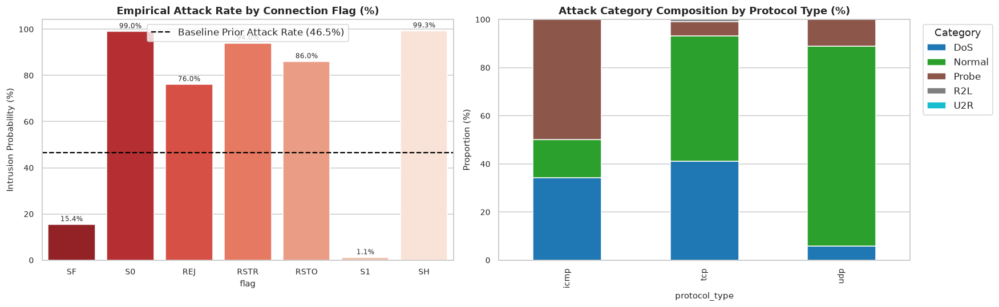

Investigating empirical conditional probabilities $P(\text{Intrusion} = 1 \mid \text{Feature} = x)$ reveals that specific feature states strongly indicate malicious activity.

### 1. Attack Probability Conditioned on Protocol Type
```
P(Intrusion | icmp) = 84.21%  (6,982 attacks / 8,291 total)
P(Intrusion | tcp)  = 47.80%  (49,089 attacks / 102,689 total)
P(Intrusion | udp)  = 17.07%  (2,559 attacks / 14,993 total)
```
- **Inference:** ICMP traffic is overwhelmingly malicious in this network environment. As shown in Figure 6 (right panel), ICMP attacks consist almost entirely of DoS (`smurf`) and Probe (`ipsweep`).

### 2. Attack Probability Conditioned on Connection Flag
| TCP Flag | Total Occurrences | Normal Connections | Intrusion Count | Empirical Attack Rate (%) | Security Interpretation |
| :---: | :--- | :--- | :--- | :--- | :--- |
| **`SH`** | 271 | 2 | 269 | **99.26%** | SYN sent, half-open stealth scan |
| **`S0`** | 34,851 | 354 | 34,497 | **98.98%** | Classic SYN flood (Neptune attack) |
| **`RSTR`** | 2,421 | 146 | 2,275 | **93.97%** | Reset by destination host |
| **`RSTO`** | 1,562 | 219 | 1,343 | **85.98%** | Reset by originating host |
| **`REJ`** | 11,233 | 2,693 | 8,540 | **76.03%** | Port rejection during scanning |
| **`SF`** | 74,945 | 63,393 | 11,552 | **15.41%** | Graceful connection termination |
| **`S1`** | 365 | 361 | 4 | **1.10%** | Established and normal termination |

- **Inference:** **`S0`, `SH`, `RSTR`, and `RSTO` are strong attack indicators ($>85\%$ likelihood)**. A simple decision tree node splitting on `flag == S0` accurately isolates 34,497 intrusions with $< 1.1\%$ false positive rate.

### 3. Services with 100% Guaranteed Intrusion Rate
A subset of 35 services exhibits a **100.00% attack rate** across every single recorded instance (where total count $> 100$):

| Service | Total Requests | Malicious Count | Benign Count | Empirical Attack Rate |
| :--- | :--- | :--- | :--- | :--- |
| `Z39_50` | 862 | 862 | 0 | **100.0%** |
| `uucp` | 780 | 780 | 0 | **100.0%** |
| `courier` | 734 | 734 | 0 | **100.0%** |
| `bgp` | 710 | 710 | 0 | **100.0%** |
| `whois` | 693 | 693 | 0 | **100.0%** |
| `uucp_path` | 689 | 689 | 0 | **100.0%** |
| `iso_tsap` | 687 | 687 | 0 | **100.0%** |
| `nnsp` | 630 | 630 | 0 | **100.0%** |
| `vmnet` | 617 | 617 | 0 | **100.0%** |
| `ctf` | 563 | 563 | 0 | **100.0%** |
| `csnet_ns` | 545 | 545 | 0 | **100.0%** |
| `http_443` | 530 | 530 | 0 | **100.0%** |
| `discard` | 538 | 538 | 0 | **100.0%** |
| `daytime` | 521 | 521 | 0 | **100.0%** |
| `exec` / `login` / `klogin` | 1,336 | 1,336 | 0 | **100.0%** |

- **Security Interpretation:** Legitimate network traffic in this enterprise environment never accesses legacy, insecure UNIX management services (`uucp`, `exec`, `klogin`, `finger`, `systat`). Any connection to these ports represents an active probe or exploitation attempt.

---

## 13. Discriminative Feature Ranking (Mutual Information & ANOVA)

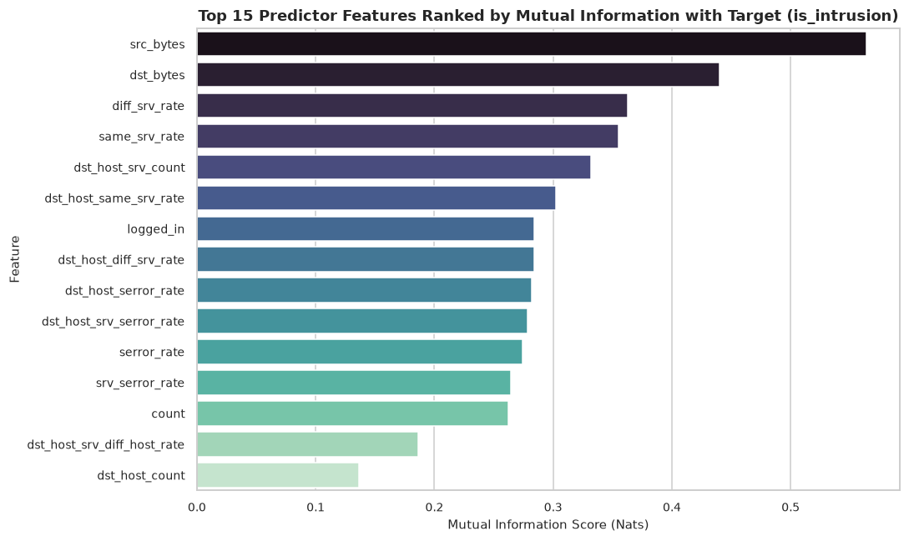

Features were ranked using non-linear **Mutual Information (MI)** (captures non-linear dependencies) alongside **ANOVA F-Scores** (measures linear between-group variance):

| Rank | Feature Name | Domain Group | Mutual Information | ANOVA F-Score | Predictive Separation Mechanism |
| :---: | :--- | :--- | :--- | :--- | :--- |
| **1** | `src_bytes` | Basic Header | **0.5637** | 0.76 | Byte volume distribution separates normal payloads from DoS/Probe |
| **2** | `dst_bytes` | Basic Header | **0.4399** | 3.14 | Response byte payload separates valid responses from closed ports |
| **3** | `diff_srv_rate` | Time-based Traffic | **0.3626** | 1,283.39 | High percentage of different services indicates horizontal port scanning |
| **4** | `same_srv_rate` | Time-based Traffic | **0.3548** | **38,725.89** | Uniform service targeting separates volumetric floods from normal web sessions |
| **5** | `dst_host_srv_count` | Host-based Traffic | **0.3321** | **32,749.99** | Number of connections to same service on destination host |
| **6** | `dst_host_same_srv_rate` | Host-based Traffic | **0.3025** | **27,274.56** | High rate signifies routine services; low rate signals sweeping attacks |
| **7** | `logged_in` | Content Payload | **0.2841** | **27,297.01** | Binary flag: 1 for authenticated session, 0 for failed/pre-auth traffic |
| **8** | `dst_host_diff_srv_rate` | Host-based Traffic | **0.2838** | 1,802.59 | Destination host service diversity over past 100 connections |
| **9** | `dst_host_serror_rate` | Host-based Traffic | **0.2817** | **22,183.36** | High SYN-error rate on destination host signals active DoS attacks |
| **10** | `dst_host_srv_serror_rate` | Host-based Traffic | **0.2787** | **22,717.67** | SYN-error rate to same service over destination window |
| **11** | `serror_rate` | Time-based Traffic | **0.2740** | **22,036.75** | SYN-error rate in 2-second temporal window |
| **12** | `srv_serror_rate` | Time-based Traffic | **0.2642** | **21,841.19** | SYN-error rate to same service in 2-second window |
| **13** | `count` | Time-based Traffic | **0.2623** | **14,783.62** | Raw connection frequency to same destination host in 2 seconds |
| **14** | `dst_host_srv_diff_host_rate`| Host-based Traffic | **0.1865** | 112.48 | Rate of connections to same service originating from different hosts |
| **15** | `dst_host_count` | Host-based Traffic | **0.1367** | 4,775.10 | Destination host accumulator count |

### Inferences
- Host-based and time-based traffic features provide substantial discriminative power.
- While linear ANOVA F-scores rank error rates (`same_srv_rate`, `dst_host_srv_count`) highest, Mutual Information reveals that payload volume (`src_bytes`, `dst_bytes`) possesses the strongest non-linear target correlation.

---

## 14. Variance Analysis & Constant Feature Identification

Features with zero variance convey no information to any machine learning algorithm and can cause numerical instability in matrix inversions ($X^T X$):

| Feature Name | Variance | Dominant Value | Dominance % | Unique Values | Status & Action |
| :--- | :--- | :--- | :--- | :--- | :--- |
| **`num_outbound_cmds`** | **0.000000** | 0.0 | **100.000%** | 1 | **ZERO VARIANCE $\rightarrow$ DROP** |
| `is_host_login` | 0.000008 | 0.0 | 99.999% | 2 | Near-Zero Variance (Retain for U2R) |
| `land` | 0.000198 | 0.0 | 99.980% | 2 | Near-Zero Variance (Specific to LAND DoS) |
| `urgent` | 0.000206 | 0.0 | 99.993% | 4 | Near-Zero Variance (Retain) |
| `num_shells` | 0.000492 | 0.0 | 99.963% | 3 | Near-Zero Variance (Specific to U2R) |
| `su_attempted` | 0.002039 | 0.0 | 99.936% | 3 | Near-Zero Variance (Specific to U2R) |
| `num_failed_logins` | 0.002047 | 0.0 | 99.903% | 6 | Near-Zero Variance (Specific to R2L) |

### Engineering Directives
1. **Drop `num_outbound_cmds`:** In all 125,973 training rows and all 22,543 testing rows, this column is exclusively `0`. It provides zero information and must be dropped during preprocessing.
2. **Retain Near-Zero Variance Payload Features:** Features like `num_shells`, `su_attempted`, and `root_shell` have $>99.9\%$ zero values, but their rare non-zero occurrences correlate directly with **U2R root exploits**. Pruning them based on naive variance thresholds would degrade U2R detection.

---

## 15. Multicollinearity & Correlation Analysis

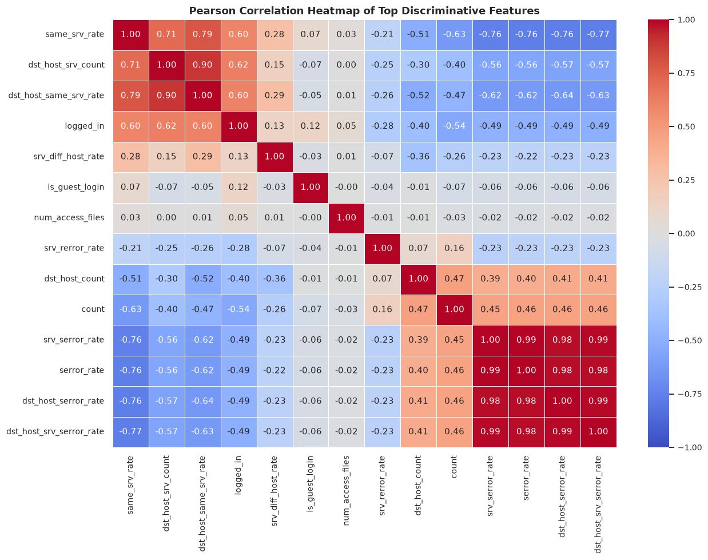

### 1. Features with Highest Correlation to `is_intrusion`
```
Strongest Negative Correlation (Protective / Normal Traffic):
  - same_srv_rate          : r = -0.7519
  - dst_host_srv_count     : r = -0.7225
  - dst_host_same_srv_rate : r = -0.6938
  - logged_in              : r = -0.6902

Strongest Positive Correlation (Malicious Traffic):
  - dst_host_srv_serror_rate : r = +0.6550
  - dst_host_serror_rate     : r = +0.6518
  - serror_rate              : r = +0.6507
  - srv_serror_rate          : r = +0.6483
  - count                    : r = +0.5764
```

### 2. Highly Collinear Feature Pairs ($\|r\| > 0.80$)
| Feature Pair ($X_1$ and $X_2$) | Pearson Correlation ($r$) | Underlying Telemetry Cause |
| :--- | :---: | :--- |
| `num_compromised` & `num_root` | **+0.9988** | Gaining root status is logged as a system compromised condition. |
| `serror_rate` & `srv_serror_rate` | **+0.9933** | SYN errors during an attack occur across both host and service windows. |
| `rerror_rate` & `srv_rerror_rate` | **+0.9890** | Rejection errors correlate across host and service counters. |
| `srv_serror_rate` & `dst_host_srv_serror_rate` | **+0.9863** | Temporal 2-sec SYN rate mirrors historical 100-connection SYN rate. |
| `dst_host_serror_rate` & `dst_host_srv_serror_rate` | **+0.9851** | Destination host SYN error rates reflect identical attack behavior. |
| `serror_rate` & `dst_host_srv_serror_rate` | **+0.9811** | Temporal and host-based SYN error tracking. |
| `serror_rate` & `dst_host_serror_rate` | **+0.9794** | Temporal and host-based SYN error tracking. |
| `dst_host_srv_count` & `dst_host_same_srv_rate` | **+0.8967** | High service count inherently implies high same-service rate. |
| `hot` & `is_guest_login` | **+0.8603** | Guest login attempts trigger system directory access indicators. |

### Modeling Takeaways
- **Linear Models (Notebook 04 - Logistic Regression):** Unregularized regression will suffer from inflated coefficient variances and numerical instability due to near-perfect collinearity ($r \approx 0.99$). **L2 (Ridge) or L1 (Lasso) regularization is required**.
- **Tree-Based Models (Notebooks 05 & 06 - Decision Trees & Random Forest):** Tree split criteria (Gini impurity / Information Gain) naturally handle collinearity by selecting one feature at each split without compromising performance.

---

## 16. Visual Feature Separation Across Classes

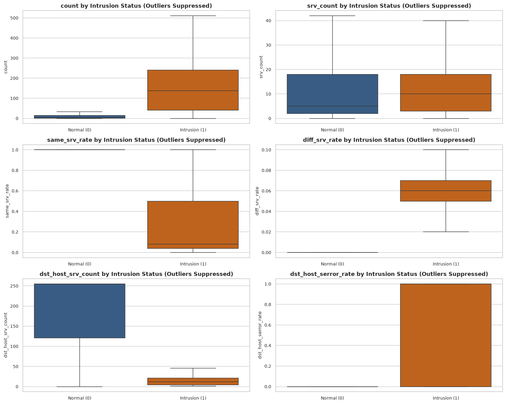

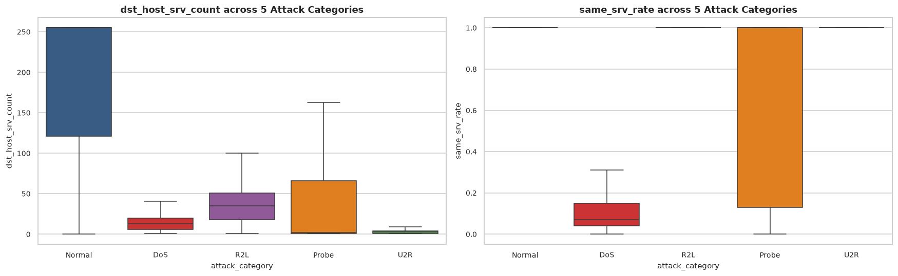

### Separation Analysis
1. **Binary Target Separation (`Normal` vs `Intrusion`):**
   - **`count`:** Normal traffic shows low connection bursts (median $\approx 2$), whereas intrusion traffic shows elevated connection counts (median $> 100$), reflecting rapid DoS/Probe generation.
   - **`same_srv_rate`:** Normal traffic demonstrates concentrated connection rates (median $\approx 1.0$), while intrusion traffic drops sharply toward 0.0.
   - **`dst_host_srv_count`:** Normal traffic reliably reaches maximum saturation ($255$), while intrusion connections are heavily suppressed (concentrated between $0$ and $20$).
   - **`dst_host_serror_rate`:** Normal connections are nearly $0.00$; intrusions exhibit a high concentration at $1.00$.

2. **Multi-Class Category Separation:**
   - **DoS:** Characterized by near-zero `dst_host_srv_count`, low `same_srv_rate`, and high error rates.
   - **Probe:** Displays near-zero `dst_host_srv_count` and low `same_srv_rate`, as scanning sweeps rapidly across broad port ranges.
   - **The Stealth Attack Dilemma (R2L and U2R):**
     - As demonstrated in Figure 10, **R2L and U2R have `dst_host_srv_count` and `same_srv_rate` distributions that appear identical to Normal traffic**.
     - Because attackers interact with services legitimately (e.g., via interactive shells or password guessing), **traffic rate and connection counters cannot distinguish them from benign traffic**.
     - They can only be detected via **payload content features** (`num_failed_logins`, `root_shell`, `num_compromised`).

---

## 17. Extreme Values & Domain Interpretation of Outliers

In traditional statistical modeling, outliers are often treated as measurement noise or sensor failures and removed. In cybersecurity, this assumption is fundamentally flawed:

| Feature Name | Minimum | Maximum | Sample Mean | Max / Mean Ratio | Outlier Count (IQR) | Outlier % |
| :--- | :--- | :--- | :--- | :--- | :--- | :--- |
| `srv_diff_host_rate` | 0.0 | 1.0 | 0.098 | 10.2x | 28,399 | **22.54%** |
| `dst_host_same_src_port_rate`| 0.0 | 1.0 | 0.148 | 6.7x | 25,052 | **19.89%** |
| `dst_bytes` | 0.0 | 1,309,937,401.0 | 19,779.11 | **66,228.3x** | 23,579 | **18.72%** |
| `dst_host_rerror_rate` | 0.0 | 1.0 | 0.119 | 8.4x | 22,795 | **18.10%** |
| `src_bytes` | 0.0 | 1,379,963,888.0 | 45,566.74 | **30,284.5x** | 13,840 | **10.99%** |
| `duration` | 0.0 | 42,908.0 | 287.14 | **149.4x** | 10,018 | **7.95%** |

### Cyber Threat Context of "Outliers"
- **Massive `src_bytes` / `dst_bytes`:** Outliers reaching $> 1$ GB represent large-scale data exfiltration, large file transfers, or volumetric buffer overflow payloads.
- **Extreme `duration` ($42,908$ seconds $\approx 12$ hours):** Represents long-lived persistent backdoor channels or slow interactive attacker sessions.
- **Extreme `count` & `srv_count`:** Direct footprint of automated DoS floods (`smurf`, `neptune`).

### Preprocessing Directive
> [!CAUTION]
> **DO NOT DROP OR ARBITRARILY CLIP OUTLIERS!**
> Dropping outliers in an intrusion dataset removes the very signatures that define high-severity attacks. Instead, apply non-linear transformations (`log1p`) or robust quantile scaling to handle heavy tails while preserving relative ordering.

---

## 18. Data Leakage Audit & Difficulty Score Analysis

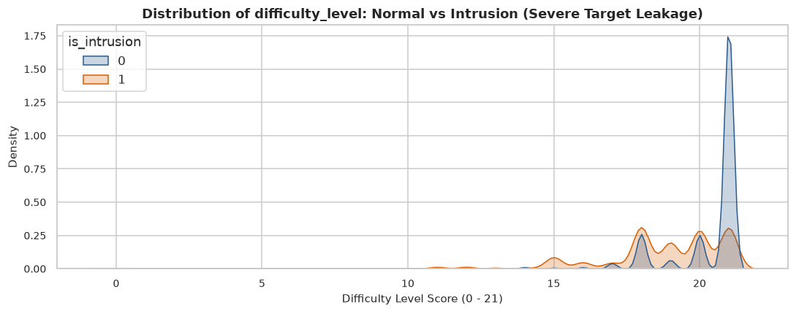

Column 42 (`difficulty_level`) represents the number of machine learning models (out of 21 evaluated by Tavallaee et al. in 2009) that correctly classified that specific connection:

| Subset | Class Partition | Sample Count | Mean Difficulty | Std Dev | 25th % | Median | 75th % | Max |
| :--- | :--- | :--- | :--- | :--- | :--- | :--- | :--- | :--- |
| **Train** | Normal (0) | 67,343 | **20.32** | 1.48 | 20.0 | 21.0 | 21.0 | 21.0 |
| **Train** | Intrusion (1) | 58,630 | **18.57** | 2.67 | 18.0 | 19.0 | 20.0 | 21.0 |
| **Test** | Normal (0) | 9,710 | **19.96** | 2.86 | 21.0 | 21.0 | 21.0 | 21.0 |
| **Test** | Intrusion (1) | 12,833 | **16.55** | 4.56 | 14.0 | 18.0 | 20.0 | 21.0 |

### Critical Leakage Findings
1. **Target Leakage:** Normal instances consistently have higher scores (mean $\approx 20.32$), while difficult intrusions exhibit much lower scores (reaching down to $0$). Feeding this column into training would cause target leakage, allowing models to learn post-hoc evaluation scores rather than raw network behavior.
2. **Operational Absence:** Real network packet capture cards (e.g. Bro/Zeek, Suricata, Snort) produce raw telemetry; they cannot provide post-hoc ensemble accuracy scores.
3. **Strict Policy:**
   - `difficulty_level` **MUST BE DROPPED** from all training feature matrices ($X$).
   - It may only be retained as an auxiliary evaluation attribute in `notebooks/07_evaluation_comparison.ipynb` to evaluate model performance across difficulty tiers.

---

## 19. Synthesis: Actionable Preprocessing & Modeling Roadmap

| EDA Finding | Statistical & Security Impact | Direct Engineering Action in Pipeline |
| :--- | :--- | :--- |
| **Constant Feature** | `num_outbound_cmds` has $0.00$ variance across all samples | **Drop `num_outbound_cmds`** during feature selection in `02_preprocessing.ipynb`. |
| **Metadata Target Leakage** | `difficulty_level` is a post-hoc consensus accuracy score | **Exclude `difficulty_level`** from training matrix $X$; reserve for evaluation analysis. |
| **Missing Values** | Exact 0 nulls, NaNs, infinite, or negative values | **Omit imputer transformers**, saving pipeline computation. |
| **Extreme Power-Law Tails** | `src_bytes` (skew = 190.7), `dst_bytes` (skew = 290.1), `duration` | Apply **`np.log1p()` transformation** or `RobustScaler` (median & IQR). |
| **Categorical Predictors** | `service` (70 unique values), `flag` (11), `protocol_type` (3) | Use **`OneHotEncoder(handle_unknown='ignore', sparse_output=False)`**. |
| **Severe Multicollinearity** | Pearson $\|r\| > 0.98$ on 7 error-rate and counter pairs | Use **L2 (Ridge) / L1 (Lasso) penalty** in Logistic Regression; rely on Tree Ensembles. |
| **Extreme Class Imbalance** | U2R ($0.04\%$) and R2L ($0.79\%$) in training set | Use **`class_weight='balanced'`** or **SMOTE** oversampling for multi-class tasks. |
| **Train/Test Class Inversion** | Train is 53.5% Normal; Test is 56.9% Intrusion | Primary benchmark metric must be **Macro F1-Score & PR-AUC**, not raw Accuracy. |
| **17 Novel Zero-Day Attacks** | 3,750 novel attack instances ($16.63\%$ of test set) | Implement and report **Zero-Day Attack Recall** in `07_evaluation_comparison.ipynb`. |

---

### Project Notebook Execution Architecture
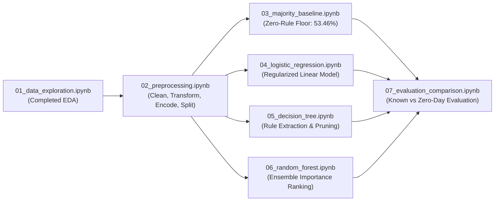

---
*Report generated based on empirical analysis in [`notebooks/01_data_exploration.ipynb`](file:///home/dhruvv_w/Documents/instrusion_detection/notebooks/01_data_exploration.ipynb).*
