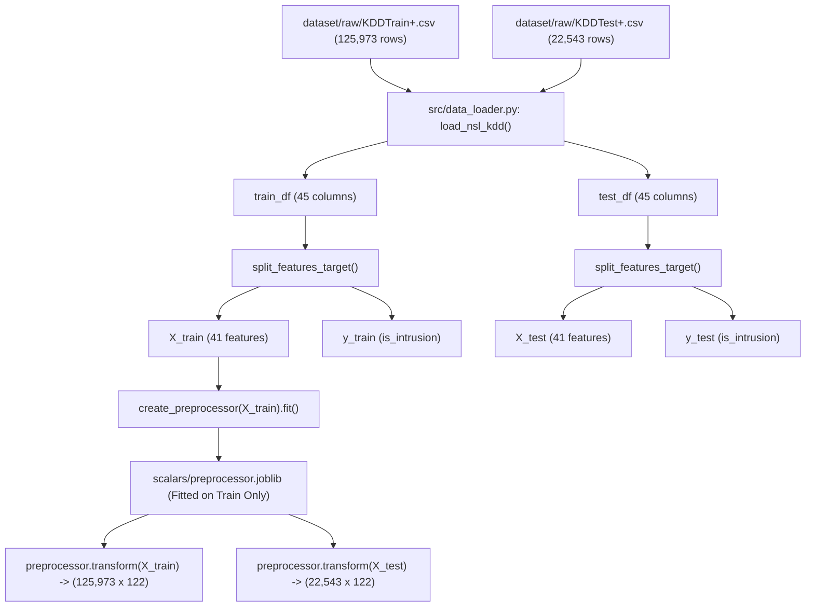

# 🛡️ Methodology: Data Pipeline, Controlled Experiment and Results

**Project:** Signature Memorization vs. Unseen Attack Generalization in Network Intrusion Detection  
**Course:** ES 335: Machine Learning (IIT Gandhinagar)  
**Modules:** [`src/data_loader.py`](../src/data_loader.py), [`src/preprocessing.py`](../src/preprocessing.py)  
**Notebooks (single source of truth, run in order 01 → 10):** [`01_data_exploration`](../notebooks/01_data_exploration.ipynb), [`02_preprocessing`](../notebooks/02_preprocessing.ipynb), [`03_majority_baseline`](../notebooks/03_majority_baseline.ipynb), [`04_logistic_regression`](../notebooks/04_logistic_regression.ipynb), [`05_decision_tree`](../notebooks/05_decision_tree.ipynb), [`06_random_forest`](../notebooks/06_random_forest.ipynb), [`07_xgboost`](../notebooks/07_xgboost.ipynb), [`08_evaluation_comparison`](../notebooks/08_evaluation_comparison.ipynb), [`09_capacity_analysis`](../notebooks/09_capacity_analysis.ipynb), [`10_website_data`](../notebooks/10_website_data.ipynb)  
**Helpers:** [`src/controlled_framework.py`](../src/controlled_framework.py); settings in [`config.yaml`](../config.yaml)  

---

## 1. Overview & Research Objective

This project investigates whether simpler models (Logistic Regression, a single Decision Tree) generalize better to previously unseen attack types than higher-capacity ensembles (Random Forest, XGBoost). All models share one data pipeline (§2–6) and one controlled protocol (§8), and every result is produced by the notebooks. Results are in §9, the test-set exposure history in §10 and reproduction steps in §11.

> [!IMPORTANT]
> **Methodological Restriction:** While NSL-KDD contains 17 attack types present exclusively in the test set, we do not claim genuine real-world zero-day detection based solely on this synthetic benchmark. These attacks represent novel signatures within the benchmark domain.

---

## 2. Shared Pipeline Architecture



---

## 3. Data Ingestion (`src/data_loader.py`)

### Schema Specification
- Loaded with `header=None` and `names=COLUMN_NAMES`.
- Canonical 43 columns: 41 network traffic features + 1 attack label (`label`) + 1 difficulty score (`difficulty_level`).
- Path handling is implemented via `pathlib.Path` anchored to `PROJECT_ROOT`, guaranteeing working-directory independence.

### Target Derivations
When `add_derived_targets=True` (default):
1. **Binary Classification (`is_intrusion`):**
   $$\text{is\_intrusion} = \begin{cases} 0 & \text{if } \text{label} = \text{'normal'} \\ 1 & \text{otherwise} \end{cases}$$
   - **Training Set:** 67,343 Normal vs. 58,630 Attack.
   - **Testing Set:** 9,710 Normal vs. 12,833 Attack (class distribution inversion).
2. **5-Class Categorization (`attack_category`):**
   - Maps 39 individual attack signatures into standard DARPA classes: `Normal`, `DoS`, `Probe`, `R2L`, `U2R`.
   - **Mapping Validation:** Pre-validates all unique labels against `ATTACK_MAPPING`. If an unmapped signature appears, it raises a descriptive `ValueError` instead of silently introducing NaNs.
   - **Signature Preservation:** Original fine-grained attack names remain intact in `df['label']` for per-attack and seen/unseen evaluation.

---

## 4. Feature Extraction & Preprocessing (`src/preprocessing.py`)

### Input Feature Isolation
- Model training inputs $X$ strictly consist of the 41 original predictor features (`FEATURE_COLUMNS = COLUMN_NAMES[:41]`).
- Target columns (`label`, `is_intrusion`, `attack_category`) and metadata (`difficulty_level`) are explicitly excluded. `create_preprocessor()` enforces this check and raises a `ValueError` if forbidden columns are passed.

### Transformations
Combined inside a scikit-learn `ColumnTransformer`:

1. **Categorical Pipeline (`protocol_type`, `service`, `flag`):**
   - Transformed with `OneHotEncoder(handle_unknown='ignore')`.
   - 3 protocol types + 70 training services + 11 TCP flags expand into **84 binary indicators**.
   - `handle_unknown='ignore'` maps unseen categories in test data to all zeros without error.
2. **Numerical Pipeline (remaining 38 features):**
   - Standardized via `StandardScaler()`:
     $$z = \frac{x - \mu_{\text{train}}}{\sigma_{\text{train}}}$$
- **Total Processed Features:** $84 + 38 = 122$ features.

---

## 5. Train-Only Fitting & Anti-Leakage Protocol

To ensure valid generalization measurement:
1. **Train-Only Statistics:** All encoders and scalers are fitted exclusively on training rows: on the training part of every CV fold during tuning, and on all of `KDDTrain+` for the final model.
2. **Test Transformation Only:** `X_test` is strictly transformed via `preprocessor.transform(X_test)`. It is never used in `fit()` or `fit_transform()`.
3. **Official Partitions:** The official NSL-KDD `KDDTrain+` and `KDDTest+` files are used without random repartitioning to preserve the designed unseen attack distribution.

---

## 6. Preprocessor Persistence (`scalars/preprocessor.joblib`)

The fitted pipeline is serialized using `joblib`:
- **Saved location:** `scalars/preprocessor.joblib`, with `scalars/preprocessor_feature_names.json` (122 names) and `scalars/label_mapping.json`, written by `notebooks/02_preprocessing.ipynb`.
- **Reproducibility:** A preprocessor freshly fitted with `src.preprocessing.create_preprocessor` on `KDDTrain+` reproduces the saved one exactly (checked in `tests/test_data_pipeline.py`). Each model pipeline in `models/` contains its own identical copy, refit inside every CV fold during tuning.
- **Reusable helpers:**
  ```python
  from src.preprocessing import save_preprocessor, load_preprocessor
  save_preprocessor(fitted_preprocessor)
  preprocessor = load_preprocessor()
  ```

---

## 7. Using the Saved Artifacts

Models are trained **only** by running notebooks 03–07, which call `cf.run_controlled_experiment()`. Each saved model in `models/` is a full `Pipeline` (fitted preprocessor + estimator), so it takes the raw 41 predictors directly:

```python
import joblib
from src.data_loader import load_nsl_kdd
from src.preprocessing import split_features_target, load_preprocessor

train_df, test_df = load_nsl_kdd()
X_test, y_test = split_features_target(test_df, target_col="is_intrusion")

model = joblib.load("models/random_forest.joblib")      # preprocessor + estimator, seed 42
p_attack = model.predict_proba(X_test)[:, 1]             # P(attack); the study's 0.5 rule is p_attack > 0.5

preprocessor = load_preprocessor()                       # scalars/preprocessor.joblib, for inspection
Z_test = preprocessor.transform(X_test)                  # (22543, 122)
```

To retrain or change a model, edit its notebook (search space, fixed parameters) or `config.yaml` and rerun it, then rerun notebooks 08 and 09.

---

## 8. Controlled Experimental Framework

**Helpers:** [`src/controlled_framework.py`](../src/controlled_framework.py) · **Settings:** [`config.yaml`](../config.yaml)  
**Executed in:** notebooks 02 (folds), 03–07 (one notebook per model), 08 (comparison), 09 (capacity sweeps)

### 8.1 Protocol
1. **Split.** Official `KDDTrain+` / `KDDTest+`, never merged, re-split or deduplicated across sets.
2. **Identical input.** Every model receives the 122-feature representation from `create_preprocessor()`, placed inside its `Pipeline`, so it is refit inside every CV fold and, for the final model, on `KDDTrain+` only.
3. **Novelty-aware CV (tuning).** The 22 training attack types are sorted by size and dealt round-robin into 5 groups (`results/splits/attack_type_folds.json`). Fold *k* validates on attack group *k* plus a random fifth of the normal rows (seeded) and trains on everything else, so no held-out attack type is ever in the training part. The objective is the mean fold ROC-AUC (held-out attacks vs held-out normals). Every row is held out once, which gives out-of-fold scores for all of `KDDTrain+`.
4. **Identical tuning budget.** 25 Optuna TPE trials per model and seed.
5. **Fixed parameters.** `class_weight=None` for every model (`scale_pos_weight=1` for XGBoost), `random_state` = the run's seed, and for LR `solver="lbfgs"`, `max_iter=2000` (convergence asserted).
6. **Final refit.** Each suggest function returns only tuned parameters; every trial and the final model use `{**fixed, **tuned}`. The full dict is stored on the trial and the final model on `KDDTrain+` is built from it; `check_final_params()` fails the notebook if the fitted estimator differs. `tests/test_controlled_framework.py` covers this, including seed propagation.
7. **Evaluation on `KDDTest+`**, once per model and seed:
   - threshold-free: ROC-AUC, PR-AUC, ROC-AUC of seen attacks vs normals and of unseen attacks vs normals;
   - matched FPR: seen and unseen recall at test FPR budgets of 1 / 2 / 5%, using the smallest threshold whose test FPR does not exceed the budget (a reading of the ROC curve, used for comparison only);
   - deployable: thresholds chosen so that 1 / 2 / 5% of out-of-fold `KDDTrain+` normals exceed them, then applied to the test set (training data only);
   - the fixed 0.5 threshold (attack if P(attack) > 0.5), for continuity;
   - category-stratified seen / unseen recall, macro recall over the 17 unseen types, and a seen recall reweighted to the unseen category mix.
8. **Seeds.** Steps 3–7 are repeated end to end for seeds 42, 1, 2, 3, 4. Seed 42 writes `models/` and the headline files; the others write to `results/{metrics,predictions,tuning}/seeds/`.

### 8.2 Search spaces
| Model | Tuned | Fixed |
|---|---|---|
| Logistic Regression | `C` ∈ [1e-3, 1e2] (log) | L2, `lbfgs`, `max_iter=2000`, `class_weight=None` |
| Decision Tree | `criterion` ∈ {gini, entropy}; `max_depth` ∈ {None, 3, 5, 10, 15, 20, 30}; `min_samples_split` ∈ [2, 20]; `min_samples_leaf` ∈ [1, 50] (log); `max_features` ∈ {sqrt, None} | `class_weight=None` |
| Random Forest | `n_estimators` ∈ {50, 75, …, 150}; `max_depth` ∈ {None, 5, 10, 15, 20, 25}; `min_samples_split` ∈ [2, 10]; `min_samples_leaf` ∈ [1, 20] (log); `max_features` ∈ {sqrt, log2} | `class_weight=None`, `bootstrap=True` |
| XGBoost | `n_estimators` ∈ {100, 150, …, 300}; `max_depth` ∈ [2, 7]; `learning_rate` ∈ [0.02, 0.3] (log); `min_child_weight` ∈ [1, 20] (log); `subsample` ∈ [0.6, 1]; `colsample_bytree` ∈ [0.5, 1]; `reg_lambda` ∈ [1e-3, 10] (log) | `hist`, `binary:logistic`, `scale_pos_weight=1` |

All models also fix `random_state` to the run's seed.

### 8.3 Selected configurations (seed 42)
| Model | Selected | Complexity of final fit | Novelty CV AUC (fold SD) |
|---|---|---|---|
| Logistic Regression | `C=0.0024` | ‖w‖₂ = 3.4; converged in 27 iterations | 0.906 (0.093) |
| Decision Tree | entropy, `max_depth=5`, `min_samples_split=15`, `min_samples_leaf=35`, `max_features=None` | depth 5, 24 leaves, 20 distinct output probabilities | 0.916 (0.064) |
| Random Forest | 150 trees, `max_depth=20`, `min_samples_split=5`, `min_samples_leaf=1`, `max_features='sqrt'` | depth 20, 456 leaves per tree | 0.994 (0.004) |
| XGBoost | 150 trees, `max_depth=5`, `learning_rate=0.021`, `min_child_weight=14.5`, `subsample=0.71`, `colsample_bytree=0.76`, `reg_lambda=0.98` | 21 leaves per tree | 0.982 (0.016) |

Fold 0 holds out `neptune` (70% of training attacks), which explains most of the fold-to-fold variation. Unlike the earlier in-distribution Macro-F1 objective (saturated at ≈0.998), this objective separates configurations; it selects strongly regularised single models.

### 8.4 Statistical procedures (notebook 08)
- **McNemar** with Edwards continuity correction, on all 22,543 test rows (0-1 error) and on the 3,750 unseen-attack rows (detection). Two-sided.
- **Paired bootstrap** (2,000 resamples of test rows, same rows for both models): Δ Macro-F1, Δ unseen recall at 0.5, Δ ROC-AUC (unseen vs normal), and Δ unseen recall at 2% test FPR with the threshold re-chosen inside each resample. p-values use (count + 1)/(B + 1).
- **Holm–Bonferroni** over the 36 two-sided tests (12 McNemar + 24 paired bootstrap). B = 2,000 keeps the smallest attainable bootstrap p-value (≈0.001) small enough to survive the correction.
- **Row bootstrap** CIs per model (test-sampling uncertainty) and a **cluster bootstrap** that resamples the 17 unseen attack types (uncertainty about which unseen types happen to be in the test set).
- **Seed summary:** mean ± SD over the 5 end-to-end runs, and per-pair seed-level differences (`results/tables/seed_paired_differences.md`).

---

## 9. Results (`KDDTest+`, N = 22,543)

### 9.1 Ranking quality and matched FPR (seed 42)
| Model | ROC-AUC | PR-AUC | AUC seen vs normal | AUC unseen vs normal | Unseen recall @1% / 2% / 5% test FPR |
|---|---|---|---|---|---|
| Majority Baseline | 0.500 | 0.569 | 0.500 | 0.500 | 0 / 0 / 0% |
| Logistic Regression | 0.885 | 0.916 | 0.885 | 0.883 | 5.2 / 5.4 / 7.2% |
| Decision Tree | 0.884 | 0.912 | 0.947 | 0.734 | 6.7 / 14.6 / 35.6% |
| Random Forest | 0.965 | 0.968 | 0.975 | 0.942 | 7.2 / 9.3 / 63.3% |
| XGBoost | 0.958 | 0.966 | 0.963 | 0.947 | 5.2 / 8.0 / 82.2% |

### 9.2 Five seeds (mean ± SD)
| Model | Novelty CV AUC | AUC unseen vs normal | Unseen recall @2% test FPR | Macro-F1 @0.5 | FPR @0.5 | Unseen recall @0.5 |
|---|---|---|---|---|---|---|
| Logistic Regression | 0.905 ± 0.001 | 0.8831 ± 0.0001 | 5.4% ± 0.0 | 0.736 ± 0.000 | 7.24% ± 0.01 | 29.6% ± 0.2 |
| Decision Tree | 0.911 ± 0.007 | 0.7456 ± 0.0277 | 16.6% ± 4.7 | 0.775 ± 0.011 | 3.21% ± 0.41 | 31.1% ± 8.7 |
| Random Forest | 0.993 ± 0.002 | 0.9410 ± 0.0037 | 8.4% ± 1.4 | 0.769 ± 0.002 | 2.68% ± 0.04 | 25.0% ± 1.1 |
| XGBoost | 0.985 ± 0.003 | 0.9432 ± 0.0048 | 6.9% ± 1.4 | 0.787 ± 0.009 | 2.73% ± 0.09 | 32.4% ± 5.5 |

### 9.3 Threshold 0.5 (seed 42)
| Model | Macro-F1 | FPR | Seen recall | Unseen recall | Row CI | Attack-type cluster CI | Drop | Reweighted drop |
|---|---|---|---|---|---|---|---|---|
| Logistic Regression | 0.736 | 7.24% | 71.5% | 29.6% | [28.1, 31.1] | [8.9, 49.1] | 42.0 pp | 47.7 pp |
| Decision Tree | 0.780 | 2.99% | 75.6% | 35.0% | [33.5, 36.5] | [4.8, 66.8] | 40.6 pp | 46.0 pp |
| Random Forest | 0.768 | 2.72% | 76.8% | 24.6% | [23.2, 26.0] | [1.1, 46.5] | 52.2 pp | 57.4 pp |
| XGBoost | 0.781 | 2.57% | 78.2% | 28.3% | [26.9, 29.8] | [2.4, 52.3] | 49.9 pp | 54.7 pp |

"Reweighted drop" uses seen recall reweighted to the unseen category mix (DoS 46%, Probe 35%, R2L 18%, U2R 1%); the drop grows rather than shrinks, so it is not an artefact of category composition. In ranking terms the drop differs a lot by model: seen-vs-normal → unseen-vs-normal AUC goes 0.885 → 0.883 (LR), 0.963 → 0.947 (XGBoost), 0.975 → 0.942 (RF) and 0.947 → 0.734 (DT). LR loses almost nothing because it already separates seen attacks poorly.

### 9.4 Paired tests (seed 42, Holm over 36 tests)
| Pair | Δ AUC unseen vs normal | Δ unseen recall @2% FPR (pp) | Δ unseen recall @0.5 (pp) | Δ Macro-F1 |
|---|---|---|---|---|
| LR − DT | +0.150* | −8.5* | −5.4* | −0.044* |
| LR − RF | −0.059* | −4.0* | +5.0* | −0.032* |
| LR − XGB | −0.064* | −2.2 | +1.2 | −0.045* |
| DT − RF | −0.208* | +4.5 | +10.4* | +0.012* |
| DT − XGB | −0.213* | +6.2 | +6.6* | −0.001 |
| RF − XGB | −0.005* | +1.8* | −3.7* | −0.013* |

\* p_holm ≤ 0.026. McNemar is significant for all pairs except DT vs XGBoost on the full test set (p_holm = 0.61) and LR vs XGBoost on the unseen subset (p_holm = 0.43). Full table: `results/tables/hypothesis_tests.md`.

### 9.5 Deployable thresholds
Thresholds set on out-of-fold training normals for 1 / 2 / 5% FPR give test FPRs of 6.7–8.0% (LR), 3.0–6.0% (DT), 9.9–13.5% (RF) and 3.3–10.5% (XGBoost) (`results/tables/deployable_operating_points.md`). Test normals score higher than training normals, so training-calibrated FPR targets do not transfer.

### 9.6 Capacity sweeps (notebook 09; test numbers descriptive only)
- **LR, `C` 1e-3 → 100:** unseen-vs-normal AUC falls monotonically 0.881 → 0.710.
- **Decision Tree, `max_depth` 1 → None:** ≈0.79 for depth 1–3, peak 0.83 at depth 6, 0.72 fully grown.
- **Random Forest, `max_depth` 2 → None:** flat, 0.937–0.947.
- **XGBoost, `max_depth` 1 → 10:** 0.918 at depth 1, then 0.937–0.949.
- Spearman correlation between training-only novelty CV AUC and test unseen AUC across sweep points: LR 0.94, XGBoost 0.54, DT −0.04, RF −0.43.

### 9.7 What the results support
- **Across families, the ensembles rank unseen attacks best.** RF and XGBoost beat LR and the Decision Tree on unseen-vs-normal AUC in every seed and in paired tests. The hypothesis that simpler models generalise better is **not supported** across families.
- **Within single-model families, regularisation helps.** Strong L2 for LR and moderate depth for trees give better unseen-vs-normal AUC than weak regularisation or full depth; the ensembles are insensitive to depth.
- **Operating point matters.** At 1–2% FPR all models detect few unseen attacks, and model rankings at 0.5 or at 2% FPR differ from the AUC ranking.

### 9.8 What they do not support
- Claims about specific mechanisms (e.g. "memorisation") for missed unseen attacks: no attribution analysis was done.
- Generalisation to other unseen attack types: cluster CIs are wide and overlap.
- Real-world zero-day detection.

---

## 10. Test-Set Exposure History

`KDDTest+` is not a blind holdout. In chronological order it was scored:
1. During an earlier Random Forest exploration: an initial default model was scored on the test set before its hyperparameters were hand-picked. That notebook version has been removed from the repository.
2. By an earlier controlled run in which the final refit dropped the fixed parameters (models trained unseeded, LR non-converged) and `class_weight` was tuned per model.
3. By a corrected run tuned on in-distribution 5-fold Macro-F1 with `class_weight=None` for all models (single seed, threshold 0.5 only).
4. By the current notebooks (novelty-aware tuning, 5 seeds, XGBoost added; results in §9).

Test results were never used to select hyperparameters or thresholds within any run, but the protocol was revised after test results had been seen.

---

## 11. Reproduction

Run the notebooks in order (01 → 10) in Jupyter, or headless:

```bash
export PYTHONHASHSEED=42
for nb in notebooks/0*.ipynb; do
  jupyter nbconvert --to notebook --execute --inplace --ExecutePreprocessor.timeout=-1 "$nb" || break
done
pytest -q tests
```

Outputs: `models/` (fitted pipelines, seed 42), `scalars/` (preprocessor, feature names, label mapping), `results/{splits,tuning,metrics,predictions,tables,figures,eda}/` (other seeds under `*/seeds/`). All shared settings live in `config.yaml`; model-specific search spaces and fixed parameters live in notebooks 04–07. Notebook 10 regenerates the website's data file (`website/src/data/researchData.ts`) from `results/`.
